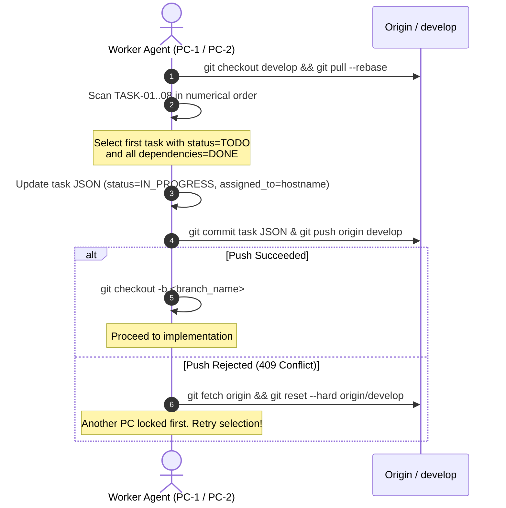

# .agents/WORKFLOW.md — Distributed Multi-Agent Coordination Protocol

This document defines the operational execution model for multiple Antigravity worker agents operating simultaneously across independent workstations (e.g., PC-1 and PC-2) on the **ēdiens** repository.

---

## 1. Zero-Conflict Architecture

To allow true parallel work across 2 physical PCs without human dispatchers or merge conflicts, the codebase is partitioned into **isolated path zones** governed by `.agents/tasks/TASK-*.json`.

### Path Isolation Matrix
| Task | Owner Branch | Allowed Paths / Deliverables | Dependencies |
| :--- | :--- | :--- | :--- |
| **TASK-01** | `docs/TASK-01-srs-core-and-data-model` | `docs/Ediens_SRS.md`, `docs/Ediens_SRS/03-*.md`, `docs/Ediens_SRS/07-*.md` | *None* |
| **TASK-02** | `docs/TASK-02-architecture-concurrency-nfrs` | `docs/Ediens_SRS/04-*.md`, `docs/Ediens_SRS/06-*.md`, `docs/Ediens_SRS/08..12-*.md`, `scripts/generate_architecture_diagram.py` | *None* |
| **TASK-03** | `docs/TASK-03-openapi-and-errors` | `docs/Ediens_OpenAPI.yaml`, `docs/Ediens_SRS/05-*.md` | `TASK-01` |
| **TASK-04** | `feat/TASK-04-dotnet-backend-foundation` | `src/Ediens.Api/**` (core infra, Data, Entities, Middleware, Program.cs) | `TASK-01` |
| **TASK-05** | `feat/TASK-05-react-ui-kit-foundation` | `src/ediens-web/**` (Vite, TS, Tailwind, components/ui, api client) | `TASK-03` |
| **TASK-06** | `feat/TASK-06-dotnet-api-endpoints-and-tests` | `src/Ediens.Api/Features/**`, `src/Ediens.Tests/**` | `TASK-03`, `TASK-04` |
| **TASK-07** | `feat/TASK-07-react-feature-views` | `src/ediens-web/src/features/**`, `src/ediens-web/src/pages/**` | `TASK-05` |
| **TASK-08** | `chore/TASK-08-docker-monitoring-verification` | `Dockerfile`, `compose*.yaml`, `infra/**`, `docs/LOCAL_*.md`, `docs/VERIFICATION.md`, `scripts/verify.sh` | `TASK-06`, `TASK-07` |

### Phase 3: Quality of Life & Bug Fix Matrix
| Task | Owner Branch | Allowed Paths / Deliverables | Dependencies |
| :--- | :--- | :--- | :--- |
| **QOL-01** | `feat/QOL-01-shopping-to-inventory-transfer` | `src/Ediens.Api/Features/ShoppingList/**`, `src/Ediens.Api/Features/Inventory/**`, `src/ediens-web/src/features/shopping/**`, `src/ediens-web/src/api/client.ts`, `src/Ediens.Tests/**`, `docs/Ediens_OpenAPI.yaml` | `FIX-07` |
| **QOL-02** | `feat/QOL-02-inventory-edit-and-spoilage` | `src/Ediens.Api/Features/Inventory/**`, `src/ediens-web/src/features/inventory/**`, `src/ediens-web/src/api/client.ts`, `src/Ediens.Tests/**` | `FIX-07` |
| **QOL-03** | `feat/QOL-03-product-search-and-custom-macros` | `src/Ediens.Api/Features/Products/**`, `src/Ediens.Api/Features/Meals/**`, `src/ediens-web/src/features/macros/**`, `src/ediens-web/src/features/inventory/AddInventoryModal.tsx`, `src/ediens-web/src/api/client.ts`, `src/Ediens.Tests/**` | `FIX-07` |
| **QOL-04** | `feat/QOL-04-recipe-servings-and-shortfall-purchase` | `src/Ediens.Api/Features/Recipes/**`, `src/ediens-web/src/features/recipes/**`, `src/ediens-web/src/api/client.ts` | `FIX-07` |
| **QOL-05** | `feat/QOL-05-household-switcher-and-invites` | `src/Ediens.Api/Features/Households/**`, `src/ediens-web/src/App.tsx`, `src/ediens-web/src/components/ui/**`, `src/ediens-web/src/features/household/**`, `src/ediens-web/src/api/client.ts`, `src/Ediens.Tests/**` | `FIX-07` |
| **QOL-06** | `chore/QOL-06-e2e-smoke-and-spec-refresh` | `scripts/**`, `docs/**`, `src/Ediens.Tests/**` | `QOL-01`, `QOL-02`, `QOL-03`, `QOL-04`, `QOL-05` |

---

## 2. Distributed Task Locking Protocol

Every task has a JSON state file in `.agents/tasks/TASK-XX.json` tracking:
- `status`: `"TODO"` | `"IN_PROGRESS"` | `"DONE"`
- `assigned_to`: Hostname of the claiming machine
- `updated_at`: ISO-8601 UTC timestamp
- `dependencies`: Array of prerequisite task IDs

### The Lock Acquisition Cycle


### Automation via Script
Worker agents can claim tasks automatically by executing:
```bash
./scripts/claim-task.sh
```
This script performs the rebase, dependency validation, task locking, race-condition retry, and branch checkout in one step.

---

## 3. Execution Rules

1. **Strict Deliverable Boundaries**: Agents MUST NOT modify files assigned to other tasks. For example, the agent working on TASK-01 must not touch `04-architecture.md` (owned by TASK-02).
2. **Context Intake**: Before coding or writing documentation, read `.agents/KNOWLEDGE.md` thoroughly.
3. **Pre-Completion Verification**: Run `./scripts/verify.sh` to ensure all tests, linters, and JSON definitions are valid.
4. **Marking Completion**: Before opening the pull request or merging into `develop`, update `.agents/tasks/TASK-XX.json`:
   ```json
   "status": "DONE",
   "updated_at": "2026-10-31T12:00:00Z"
   ```
5. **Releasing the Lock**: Merge the completed task branch back into `develop` and push to `origin/develop`. This notifies all other PCs that downstream tasks are now unblocked.
