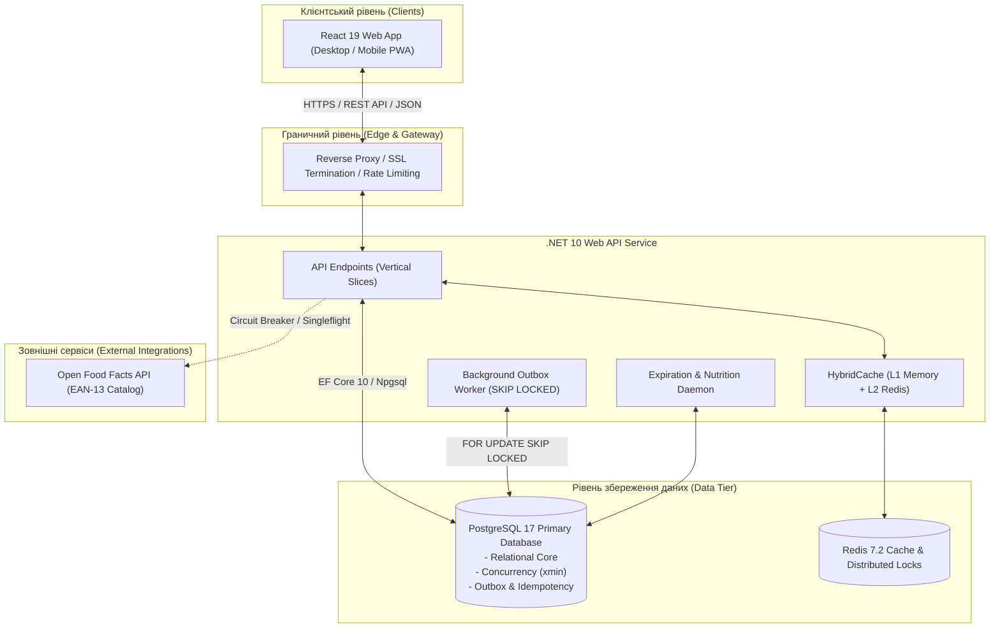

# Специфікація вимог до програмного забезпечення (SRS) — ēdiens

> **Назва системи:** ēdiens (латис. *ēdiens* — «їжа», «страва»)  
> **Слоган / Підзаголовок:** Єдиний хаб для управління запасами продуктів, підрахунку макросів та рекомендацій рецептів  
> **Версія документу:** 1.0.0 (Baseline Master Specification)  
> **Дата затвердження:** 31 жовтня 2026 року  
> **Статус:** Офіційний реліз базової специфікації (Baseline)  
> **Стандарти оформлення:** ISO/IEC/IEEE 29148:2018 (Systems and software engineering — Life cycle processes — Requirements engineering), IEEE Std 830-1998, jam01/SRS-Template, USAID SRS Standard Guidelines.

---

## Контроль версій документу (Document Revision History)

| Версія | Дата | Автор / Команда | Опис змін / Підстава |
| :--- | :--- | :--- | :--- |
| **0.1.0** | 2026-10-31 | Genesis Engineering Team | Початковий каркас структури документації та репозиторію. |
| **1.0.0** | 2026-10-31 | Core Architecture Agent (TASK-01) | Повне наповнення Майстер-індексу SRS за стандартами jam01/USAID SRS: специфікація акторів, персон, функціональних вимог (FR-01..FR-12), реляційної моделі даних PostgreSQL, токенів конкурентності `xmin`, Transactional Outbox та Idempotency Store. |

---

## Зміст (Table of Contents)

1. [Вступ (Introduction)](#1-вступ-introduction)
   - 1.1 [Призначення документу (Document Purpose)](#11-призначення-документу-document-purpose)
   - 1.2 [Межі та масштаб продукту (Product Scope)](#12-межі-та-масштаб-продукту-product-scope)
   - 1.3 [Визначення, акроніми та скорочення (Definitions, Acronyms, and Abbreviations)](#13-визначення-акроніми-та-скорочення-definitions-acronyms-and-abbreviations)
   - 1.4 [Нормативні посилання та стандарти (References & Standards)](#14-нормативні-посилання-та-стандарти-references--standards)
   - 1.5 [Огляд структури документу (Document Overview)](#15-огляд-структури-документу-document-overview)
2. [Загальний опис системи (Overall Description)](#2-загальний-опис-системи-overall-description)
   - 2.1 [Контекст системи (Product Perspective)](#21-контекст-системи-product-perspective)
   - 2.2 [Короткий огляд функціональних можливостей (Product Functions Summary)](#22-короткий-огляд-функціональних-можливостей-product-functions-summary)
   - 2.3 [Класи користувачів та характеристики (User Classes & Characteristics)](#23-класи-користувачів-та-характеристики-user-classes--characteristics)
   - 2.4 [Операційне середовище (Operating Environment)](#24-операційне-середовище-operating-environment)
   - 2.5 [Обмеження проектування та реалізації (Design & Implementation Constraints)](#25-обмеження-проектування-та-реалізації-design--implementation-constraints)
   - 2.6 [Припущення та залежності (Assumptions & Dependencies)](#26-припущення-та-залежності-assumptions--dependencies)
3. [Повний покажчик специфікацій та розділів SRS (Modular Specifications Index)](#3-повний-покажчик-специфікацій-та-розділів-srs-modular-specifications-index)
   - 3.1 [Основні розділи SRS (Chapters 03–12)](#31-основні-розділи-srs-chapters-0312)
   - 3.2 [Технічні регламенти та посібники інженера](#32-технічні-регламенти-та-посібники-інженера)

---

## 1. Вступ (Introduction)

### 1.1 Призначення документу (Document Purpose)
Цей документ є головною Специфікацією вимог до програмного забезпечення (Software Requirements Specification — SRS) для платформи **ēdiens**. Документ розроблено відповідно до вимог міжнародного стандарту **ISO/IEC/IEEE 29148:2018** та шаблону **jam01/SRS-Template** (USAID Software Development Guidelines).

Цільова аудиторія документу:
- **Інженери програмного забезпечення (Software Engineers):** як нормативна база для архітектурного проектування, імплементації бекенд-сервісів (.NET 10 / C# 13), фронтенд-клієнта (React 19 / TypeScript) та структури бази даних PostgreSQL 17.
- **Інженери з якості (QA / Test Engineers):** для складання матриці простежуваності вимог (Traceability Matrix), тест-планів, інтеграційних та навантажувальних тестів.
- **DevOps / SRE-інженери:** для конфігурації контейнеризації Docker Compose, моніторингу метрик Prometheus та налаштування політик стійкості.
- **Власники продукту та стейкхолдери:** для валідації бізнес-цілей, функціональних меж та відповідності сценаріїв кінцевих користувачів.

### 1.2 Межі та масштаб продукту (Product Scope)
Програмний комплекс **ēdiens** — це розподілена багатокористувацька система управління побутовим харчуванням, що синхронізує три ключові контури:
1. **Складський облік домашніх запасів:** ведення детального реєстру продуктів у холодильнику, морозильній камері та коморі з підтримкою партійного обліку за принципом **FEFO** (*First Expired, First Out*), скануванням штрих-кодів EAN-13 та проактивним сповіщенням про наближення терміну придатності.
2. **Нутриціологічний трекінг:** моніторинг балансу калорій та макронутрієнтів (білки, жири, вуглеводи — КБЖВ) у реальному часі відносно цільових нормативів користувача.
3. **Рекомендаційна система та 1-Click Cook:** інтелектуальний підбір рецептів із мінімізацією залишків, що псуються, та атомарна операція одночасного списання інгредієнтів зі складу і логування спожитих нутрієнтів у щоденник їжі.

Система проектується як хмарно-орієнтований веб-додаток (Progressive Web Application — PWA) з підтримкою офлайн-роботи для списку покупок, оптимістичного блокування при паралельній роботі членів сім'ї та наскрізної обробки помилок за стандартом **RFC 9457**.

### 1.3 Визначення, акроніми та скорочення (Definitions, Acronyms, and Abbreviations)

| Термін / Акронім | Повне найменування | Опис та контекст у системі ēdiens |
| :--- | :--- | :--- |
| **ēdiens** | Latvian: *«їжа», «страва»* | Назва проекту та інтегрованої платформи управління запасами й харчуванням. |
| **FEFO** | *First Expired, First Out* | Логістичний принцип управління складом: партія товару, у якої термін придатності спливає раніше, має бути використана/списана першою. |
| **КБЖВ (Macros)** | Калорії, Білки, Жири, Вуглеводи | Базові параметри харчової цінності продукту або страви на 100 г / на порцію. |
| **Household** | Домогосподарство | Одиниця мультитенантного володіння запасами та списком покупок; група користувачів із ролями `Owner` та `Member`. |
| **1-Click Cook** | One-Click Cooking Transaction | Атомарна транзакція в СУБД: автоматичне списання інгредієнтів за FEFO та внесення запису до щоденника харчування без ручного введення ваги кожної складової. |
| **xmin** | PostgreSQL System Column | Системний стовпець PostgreSQL (32-бітний Transaction ID), що використовується як оптимістичний токен конкурентності (RowVersion) для детекції колізій паралельного редагування. |
| **ETag / If-Match** | Entity Tag / Conditional HTTP | Механізм протоколу HTTP (RFC 9110) для перевірки відповідності версії ресурсу перед застосуванням мутацій (`PATCH`, `PUT`). |
| **Idempotency-Key** | HTTP Idempotency Header | Унікальний ідентифікатор клієнтського запиту (UUIDv7), що гарантує захист від повторного списання залишків або дублювання записів їжі при мережевих повторах. |
| **RFC 9457** | Problem Details for HTTP APIs | Стандарт структурованого представлення помилок HTTP API у форматі `application/problem+json`. |
| **Transactional Outbox** | Outbox Pattern | Архітектурний патерн надійної асинхронної доставки подій за допомогою проміжної реляційної таблиці `outbox_messages` у тій же транзакції, що й бізнес-дані. |
| **Singleflight** | Cache Stampede Protection | Патерн запобігання лавиноподібним навантаженням на зовнішні джерела/моделі шляхом об'єднання паралельних ідентичних запитів у єдиний виклик (реалізовано в .NET 10 `HybridCache`). |
| **EAN-13** | European Article Number | 13-значний міжнародний стандарт штрих-коду для ідентифікації споживчих товарів. |
| **RBAC** | Role-Based Access Control | Модель контролю доступу на основі ролей користувача всередині домогосподарства (`Owner`, `Member`). |
| **UUIDv7** | Universally Unique Identifier v7 | Стандарт генерації унікальних ідентифікаторів, упорядкованих за часом (Time-Ordered), що мінімізує фрагментацію B-Tree індексів у PostgreSQL. |

### 1.4 Нормативні посилання та стандарти (References & Standards)
1. **ISO/IEC/IEEE 29148:2018:** Systems and software engineering — Life cycle processes — Requirements engineering.
2. **IEEE Std 830-1998:** IEEE Recommended Practice for Software Requirements Specifications.
3. **IETF RFC 9457:** Problem Details for HTTP APIs (червень 2023).
4. **IETF RFC 9110:** HTTP Semantics (розділи 8.8.3 «ETag», 13.1.1 «If-Match»).
5. **OpenAPI Specification v3.1.0:** Open API Initiative (Linux Foundation).
6. **W3C Trace Context (Level 2):** W3C Recommendation for distributed tracing (`traceparent`, `tracestate`).
7. **PostgreSQL 17 Documentation:** System Columns (`xmin`), Concurrency Control, `FOR UPDATE SKIP LOCKED`.
8. **Microsoft .NET 10 Architecture Guidelines:** Minimal APIs, Vertical Slice Architecture, HybridCache, Polly Resilience.

### 1.5 Огляд структури документу (Document Overview)
Специфікація ēdiens побудована за модульним принципом згідно з найкращими практиками інженерного проектування складних розподілених систем. Майстер-документ `docs/Ediens_SRS.md` містить глобальний опис продукту, архітектурні межі та покажчик спеціалізованих розділів (Chapters 03–12), розміщених у каталозі `docs/Ediens_SRS/`.

---

## 2. Загальний опис системи (Overall Description)

### 2.1 Контекст системи (Product Perspective)
Система **ēdiens** функціонує як незалежний, самодостатній програмний комплекс з клієнт-серверною топологією. Вона інтегрується із зовнішніми постачальниками каталогів харчових продуктів (Open Food Facts API) та надає користувачам доступ через веб-інтерфейс із адаптивним дизайном.



### 2.2 Короткий огляд функціональних можливостей (Product Functions Summary)
- **Облік партій запасів з FEFO-пріоритизацією:** Фіксація місця зберігання (`Fridge`, `Freezer`, `Pantry`), кількості, одиниць виміру та дати спливу терміну придатності. Динамічна кольорова індикація свіжості (Green / Amber / Red).
- **Швидка ідентифікація за EAN-13:** Пошук харчової цінності товару за штрих-кодом із кешуванням та захистом від лавиноподібного навантаження (Singleflight).
- **Контроль добового макро-бюджету:** Встановлення цілей КБЖВ, облік прийомів їжі (сніданок, обід, вечеря, перекус) та інтерактивна візуалізація залишку нутрієнтів через компоненти прогресу.
- **Інтелектуальний підбір страв:** Ранжування рецептів за математичним критерієм, що враховує мінімізацію списань прострочених запасів та ідеальне попадання у залишковий макро-бюджет.
- **Транзакційний 1-Click Cook:** Автоматизоване списування ваги інгредієнтів із найстаріших партій згідно з FEFO та збереження запису споживання в єдиній транзакції СУБД.
- **Спільне домогосподарство (Household Multi-Tenancy):** Синхронізація запасів усередині сім'ї з рольовою моделлю (`Owner`, `Member`) та надійним вирішенням конфліктів редагування через `ETag` / `xmin`.
- **Офлайн-список покупок:** Робота зі списком придбання товарів в умовах відсутності інтернет-з'єднання з наступним безконфліктним злиттям змін.

### 2.3 Класи користувачів та характеристики (User Classes & Characteristics)
1. **Meal Preppers / Фітнес-ентузіасти:** Користувачі з високою технічною грамотністю, що фокусуються на строгому контролі макронутрієнтів (білки, жири, вуглеводи) та плановому приготуванні раціону.
2. **Члени домогосподарств (Household Members):** Користувачі різного віку, що здійснюють спільні закупівлі, щоденне приготування їжі для сім'ї та потребують простого, інтуїтивного інтерфейсу з миттєвим сповіщенням про те, що продукти закінчуються.
3. **Фонові системні процеси (Background Workers):** Автономні служби, що виконують періодичний аудит термінів придатності, обробку черги Outbox та синхронізацію довідників без прямої участі людини.
4. **Адміністратори платформи:** Технічний персонал, відповідальний за моніторинг стабільності системи, аналіз логів та аудит продуктивності.

### 2.4 Операційне середовище (Operating Environment)
- **Серверна інфраструктура:** Linux (x86_64 / arm64), контейнеризоване середовище Docker Engine 26+, Docker Compose v2.
- **Середовище виконання API:** .NET 10 Runtime (`net10.0`).
- **СУБД та сховища:** PostgreSQL 17+, Redis 7.2 (Alpine).
- **Клієнтське середовище:** Будь-які сучасні веб-браузери з підтримкою ECMAScript 2023, Web Storage API та Service Workers (Google Chrome 120+, Apple Safari 17+, Mozilla Firefox 120+, Microsoft Edge 120+).

### 2.5 Обмеження проектування та реалізації (Design & Implementation Constraints)
- **Консистентність даних:** Інваріант невід'ємних залишків складу гарантується на рівні ядра СУБД за допомогою перевірочних обмежень `CHECK (quantity >= 0)`.
- **Модель помилок:** Всі помилки API строго відповідають формату RFC 9457 `application/problem+json` із фіксованими кодами помилок та контекстними розширеннями.
- **Безпека:** Ізоляція даних між домогосподарствами виконується на рівні кожного SQL-запиту (Tenant Scoping). Аутентифікація реалізована через Stateless JWT (Access + Refresh tokens).
- **Конкурентність:** Будь-яке оновлення залишків товару вимагає передачі заголовка `If-Match` з актуальним токеном `ETag` (на основі PostgreSQL `xmin`). При порушенні повертається HTTP 409 Conflict.
- **Ідемпотентність:** Фінансово- або матеріально-значущі операції (логування їжі, 1-Click Cook) захищені обов'язковим заголовком `Idempotency-Key` (UUIDv7).

### 2.6 Припущення та залежності (Assumptions & Dependencies)
- Доступність глобального каталогу Open Food Facts оцінюється як нестабільна; система повинна мати локальний кеш та автоматичний перехід у режим Circuit Breaker при збоях провайдера.
- Усі часові мітки в системі генеруються та зберігаються виключно у форматі UTC (ISO-8601).
- Клієнтські пристрої мають можливість локального збереження до 5 МБ даних у `localStorage` / `IndexedDB` для забезпечення офлайн-роботи списку покупок.

---

## 3. Повний покажчик специфікацій та розділів SRS (Modular Specifications Index)

Для забезпечення максимальної деталізації та зручності паралельної розробки розподіленими командами, повна специфікація вимог декомпозована на спеціалізовані модулі, посилання на які наведено нижче.

### 3.1 Основні розділи SRS (Chapters 03–12)

```
docs/
├── Ediens_SRS.md                                # [Поточний документ] Головний покажчик та огляд SRS
└── Ediens_SRS/
    ├── 03-product-description.md                # Розділ 03: Актори, персони та функціональні вимоги (FR-01..FR-12)
    ├── 04-architecture.md                       # Розділ 04: Архітектура C4, компоненти та контейнери
    ├── 05-error-handling.md                     # Розділ 05: Обробка помилок RFC 9457 та матриця реакцій
    ├── 06-concurrency-patterns.md               # Розділ 06: Конкурентність (ETag/xmin, Redis Lock, Outbox, Singleflight)
    ├── 07-data-model.md                         # Розділ 07: Реляційна модель даних PostgreSQL, ERD, xmin та індекси
    ├── 08-resiliency-model.md                   # Розділ 08: Стійкість системи, Circuit Breakers та Fallback-стратегії
    ├── 09-security-model.md                     # Розділ 09: Модель безпеки, JWT, RBAC та ліміти Rate Limiting
    ├── 10-deployment-model.md                   # Розділ 10: Модель розгортання, Docker Compose та CI/CD пайплайни
    ├── 11-analytics-model.md                    # Розділ 11: Скоринг рецептів, аналітика відходів та метрики
    └── 12-monitoring-alerting-model.md          # Розділ 12: Моніторинг Prometheus, W3C Tracing та алертинг
```

#### Детальний опис розділів:

| Номер | Розділ специфікації | Цільовий файл | Короткий зміст та охоплення |
| :---: | :--- | :--- | :--- |
| **03** | **Опис продукту, актори та вимоги** | [`docs/Ediens_SRS/03-product-description.md`](./Ediens_SRS/03-product-description.md) | 3 детальні персони (Meal Prepper Олег, Household Member Анна, Background Worker); 12 функціональних вимог (FR-01..FR-12) з критеріями прийнятності у форматі Given-When-Then, пріоритетами MoSCoW та прекондишенами. |
| **04** | **Архітектура системи** | [`docs/Ediens_SRS/04-architecture.md`](./Ediens_SRS/04-architecture.md) | C4 Container & Component діаграми, топологія розподіленої системи, взаємодія .NET 10 Minimal API, Redis L2, React 19 Frontend. |
| **05** | **Обробка помилок та RFC 9457** | [`docs/Ediens_SRS/05-error-handling.md`](./Ediens_SRS/05-error-handling.md) | Повна схема Problem Details, словник колізій, правила реакції фронтенд-компонентів на статус-коди 400, 403, 404, 409, 422, 429. |
| **06** | **Патерни конкурентності** | [`docs/Ediens_SRS/06-concurrency-patterns.md`](./Ediens_SRS/06-concurrency-patterns.md) | 5 розподілених патернів: Optimistic Locking через `xmin`, Idempotency + Redis Distributed Lock, Transactional Outbox + SKIP LOCKED, Pessimistic Row Locking, Singleflight HybridCache. Діаграми Mermaid sequenceDiagram. |
| **07** | **Модель даних PostgreSQL** | [`docs/Ediens_SRS/07-data-model.md`](./Ediens_SRS/07-data-model.md) | Детальна ER-діаграма Mermaid, DDL 13 таблиць, системні стовпці `xmin` для EF Core 10, таблиці `outbox_messages` та `idempotency_records`, стратегія індексації FEFO. |
| **08** | **Модель стійкості (Resiliency)** | [`docs/Ediens_SRS/08-resiliency-model.md`](./Ediens_SRS/08-resiliency-model.md) | Політики Polly (.NET Resilience), таймаути, Circuit Breakers, degraded mode при відмові зовнішнього сервісу штрих-кодів. |
| **09** | **Модель безпеки (Security)** | [`docs/Ediens_SRS/09-security-model.md`](./Ediens_SRS/09-security-model.md) | Модель автентифікації на базі JWT, Tenant Scoping за `household_id`, захист від CSRF/XSS, алгоритми хешування паролів (Argon2id / BCrypt). |
| **10** | **Модель розгортання (Deployment)** | [`docs/Ediens_SRS/10-deployment-model.md`](./Ediens_SRS/10-deployment-model.md) | Конфігурація Docker Compose, мережеві мости, volumes для збереження даних, Healthcheck ендпоінти, інструкції для production/staging. |
| **11** | **Модель аналітики (Analytics)** | [`docs/Ediens_SRS/11-analytics-model.md`](./Ediens_SRS/11-analytics-model.md) | Математичні формули скорингу страв, статистика зменшення харчових відходів (Food Waste Index), метрики точності дотримання макро-цілей. |
| **12** | **Моніторинг та алертинг** | [`docs/Ediens_SRS/12-monitoring-alerting-model.md`](./Ediens_SRS/12-monitoring-alerting-model.md) | Метрики Prometheus, розподілений трейсинг W3C TraceContext, експорт структурованих JSON-логів, правила сповіщень про відмови. |

---

### 3.2 Технічні регламенти та посібники інженера

Окрім нормативних розділів SRS, проект супроводжується інженерними специфікаціями в каталозі `docs/` та корені репозиторію:

1. **Контракт API (OpenAPI 3.1.0):** [`docs/Ediens_OpenAPI.yaml`](./Ediens_OpenAPI.yaml) — машинночитна специфікація 10 обов'язкових REST ендпоінтів, запитів, відповідей та схем помилок RFC 9457.
2. **Інструкція локальної розробки:** [`docs/LOCAL_DEVELOPMENT.md`](./LOCAL_DEVELOPMENT.md) — покроковий гайд із підняття локального середовища, конфігурації Docker Compose та запуску тестів.
3. **Регламент верифікації системи:** [`docs/VERIFICATION.md`](./VERIFICATION.md) та скрипт [`scripts/verify.sh`](../scripts/verify.sh) — набір автоматизованих перевірок коректності кодової бази, контрактів та документації.
4. **Правила багатоагентної розробки:** [`AGENTS.md`](../AGENTS.md) та [`.agents/WORKFLOW.md`](../.agents/WORKFLOW.md) — протокол безконфліктної паралельної роботи в команді автономних агентів.
5. **Єдине джерело істини (Single Source of Truth):** [`.agents/KNOWLEDGE.md`](../.agents/KNOWLEDGE.md) — концентрований довідник доменних правил, стеків технологій та архітектурних домовленостей.
