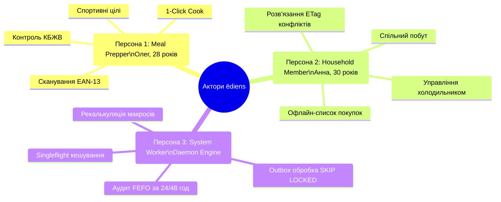

# 03. Опис продукту (Product Description)

> **Статус:** Офіційний реліз базової специфікації (Baseline)  
> **Модуль SRS:** Розділ 03  
> **Зв'язок із завданнями:** TASK-01  
> **Стандарти:** ISO/IEC/IEEE 29148:2018, jam01/SRS-Template (USAID)

---

## 1. Загальний огляд розділу

Розділ описує цільову аудиторію, акторів та детальні персони користувачів системи **ēdiens**, а також формалізує 12 обов'язкових функціональних вимог (FR-01 — FR-12). Кожна функціональна вимога містить чіткий пріоритет за шкалою MoSCoW, передумови, покроковий сценарій виконання, правила обробки помилок за стандартом RFC 9457 та формалізовані критерії прийнятності у форматі *Given-When-Then*.

---

## 2. Актори та детальні персони (Actors & Personas)

Система взаємодіє з трьома основними типами дійових осіб: двома людськими ролями з різними патернами поведінки та одним системним автономним актором.

---

### 2.1 Персона 1: Meal Prepper / Nutrition Tracker (Олег)

| Атрибут | Детальний опис |
| :--- | :--- |
| **Повне ім'я та вік** | Олег Коваленко, 28 років |
| **Професія / Зайнятість** | Senior DevOps Engineer, працює віддалено |
| **Сімейний стан** | Проживає разом із партнеркою в орендованій квартирі |
| **Рівень технічної грамотності**| Експертний (power user, вимагає мінімального часу відгуку UI, швидких клавіш та автоматизацій) |
| **Спортивні та харчові цілі** | Займається кросфітом 4 рази на тиждень; дотримується цільового щоденного споживання: $2400\text{ kcal}$, $180\text{ g}$ білка, $70\text{ g}$ жирів, $260\text{ g}$ вуглеводів. Проводить сесії заготовлення їжі (meal prep) у неділю. |
| **Психологічний портрет та мотивація** | Цінує точність даних та свій час. Дратується, коли доводиться вручну вводити 10 інгредієнтів до MyFitnessPal або викидати пів упаковки індички, про яку забули в кутку холодильника. |
| **Основні больові точки (Pain Points)** | 1. **Когнітивне перевантаження:** Наприкінці дня втомлений відкриває холодильник, маючи дефіцит у 45 г білка, і не знає, що швидко приготувати з наявних продуктів, не перевищивши ліміт жирів. 2. **Рутинне логування:** Зважування кожного інгредієнта окремо та пошук його у базі щоразу забирає до 20 хвилин на день. 3. **Псування їжі:** Куплені дорогі джерела білка (грецький йогурт, філе, тунець) псуються через відсутність контролю за термінами відкритих упаковок. |
| **Типові робочі пристрої** | iPhone 15 Pro (мобільний клієнт), MacBook Pro 16" (десктопний дашборд) |

#### Ключові користувацькі історії (User Stories) для Олега:
- **US-01:** *«Як атлет, який ретельно контролює баланс білка, я хочу бачити віджет залишку макро-бюджету в реальному часі на головному екрані, щоб приймати рішення про склад вечері за 5 секунд».*
- **US-02:** *«Як користувач із заповненим холодильником, я хочу отримати рекомендацію рецепта, який максимізує використання продуктів, термін яких спливає завтра, та покриває мій поточний дефіцит білка, щоб уникнути викидання їжі та досягти добової норми».*
- **US-03:** *«Як meal prepper, я хочу приготувати рекомендовану страву в "1 клік", щоб система автоматично списала точну вагу наявних у холодильнику інгредієнтів за принципом FEFO та додала відповідні КБЖВ до мого щоденника харчування без ручного введення».*

---

### 2.2 Персона 2: Household Member / Co-resident (Анна)

| Атрибут | Детальний опис |
| :--- | :--- |
| **Повне ім'я та вік** | Анна Шевченко, 30 років |
| **Професія / Зайнятість** | Product Designer у цифровій агенції |
| **Сімейний стан** | Співмешканка Олега, спільно ведуть домашнє господарство та бюджет |
| **Рівень технічної грамотності**| Високий (вибаглива до UX, візуальної естетики, плавності анімацій та зручності взаємодії на ходу) |
| **Побутовий контекст** | Відповідає за регулярні щотижневі закупівлі свіжих продуктів (овочі, фрукти, молочні продукти) у супермаркетах. Готує спонтанні сніданки та вечері. |
| **Психологічний портрет та мотивація** | Прагне затишку та порядку на кухні. Прагне мінімізувати побутовий хаос і непорозуміння, коли один купує те, що інший уже приніс, або бере останній інгредієнт, запланований для іншої страви. |
| **Основні больові точки (Pain Points)** | 1. **Дублювання покупок:** Купує вівсяне молоко або пачку сиру, повертається додому і виявляє, що Олег уже купив такі самі дві години тому. 2. **Втрата зв'язку в супермаркеті:** У підвальних приміщеннях великих супермаркетів пропадає мобільний інтернет, через що веб-додатки зависають або втрачають відмічені товари. 3. **Конкурентні конфлікти:** Відкрила додаток, щоб списати залишок йогурту, а Олег у цей же час списав його зі свого телефону — додаток видає незрозумілу системну помилку. |
| **Типові робочі пристрої** | iPhone 14, iPad Air |

#### Ключові користувацькі історії (User Stories) для Анни:
- **US-04:** *«Як організатор сімейних закупівель, я хочу бачити спільний список запасів нашого домогосподарства, розподілений за зонами (Холодильник, Морозилка, Комора), щоб перед виходом з роботи точно знати, чого не вистачає».*
- **US-05:** *«Як покупець у супермаркеті, я хочу викреслювати куплені товари зі списку навіть за повної відсутності інтернет-з'єднання, щоб додаток автоматично синхронізував зміни з сервером, як тільки зв'язок відновиться».*
- **US-06:** *«Як учасник спільного домогосподарства, коли виникає одночасна зміна залишків товару мною та іншим користувачем, я хочу бачити зручне модальне вікно вирішення конфлікту із актуальними даними з сервера замість технічного збою».*

---

### 2.3 Персона 3: Background Nutrition & Recipe Engine Worker (Системний агент)

| Атрибут | Детальний опис |
| :--- | :--- |
| **Тип суб'єкта** | Автономний системний фоновий демон / Background Service (.NET 10 Worker) |
| **Ідентифікатор / Привілеї**| `service-account:nutrition-worker` (System Scope, повний доступ до черги подій та аналітичних агрегатів) |
| **Середовище виконання** | Ізольований контейнер Docker, масштабований до кількох паралельних інстансів |
| **Основна місія** | Забезпечення системної цілісності, асинхронного виконання важких обчислень, зняття навантаження з інтерактивного API та проактивна підтримка свіжості даних. |
| **Характер навантаження** | Періодичні кронджоби (cron schedules) та безперервне опитування черги повідомлень Transactional Outbox за допомогою конкурентного механізму `FOR UPDATE SKIP LOCKED`. |

#### Ключові системні сценарії (System Stories):
- **SS-01:** *«Як фоновий обробник подій, я повинен вичитувати події з таблиці `outbox_messages` пачками за алгоритмом `FOR UPDATE SKIP LOCKED`, публікувати їх у внутрішні канали обробки та переводити статус у `PROCESSED` без взаємних блокувань із паралельними воркерами».*
- **SS-02:** *«Як сервіс контролю термінів придатності, я повинен раз на 6 годин сканувати всі активні партії продуктів домогосподарств і при виявленні партій із терміном придатності $\le 48\text{ годин}$ та $\le 24\text{ годин}$ генерувати відповідні події у системі та черзі сповіщень».*
- **SS-03:** *«Як кешуючий провайдер харчових даних, я повинен використовувати патерн Singleflight (через .NET HybridCache), щоб при одночасному запиті на пошук одного штрих-коду від 50 користувачів виконувати лише 1 зовнішній HTTP-запит до Open Food Facts API».*
- **SS-04:** *«Як оптимізатор рецептів, я повинен виконувати попередній перерахунок матриці сумісності складських запасів і бази рецептів після кожної масової зміни інвентарю, щоб час відповіді ендпоінту `GET /recipes/recommendations` не перевищував 800 мс».*

---

## 3. Функціональні вимоги (FR-01 — FR-12)

### FR-01: Управління партіями складських запасів (Inventory Batch CRUD)
- **Пріоритет:** `Must Have`
- **Актори:** Meal Prepper (Олег), Household Member (Анна).
- **Передумови:** Користувач автентифікований та належить до активного домогосподарства (`household_id`).
- **Опис:** Система надає повноцінний інтерфейс та API для створення, перегляду, часткового списання, редагування та видалення партій продуктів (inventory batches). Кожна партія прив'язується до локації (`Fridge` — холодильник, `Freezer` — морозильна камера, `Pantry` — комора/шафа).
- **Бізнес-правила:**
  1. Кількість продукту `quantity` є строго невід'ємною ($\text{quantity} \ge 0$). Спроба встановити від'ємну кількість відхиляється на рівні валідації та перевірочного обмеження СУБД.
  2. Кожна партія обов'язково містить `expires_at` (дата закінчення терміну придатності).
  3. Будь-яке оновлення або списання частини партії виконується через HTTP `PATCH /api/v1/inventory/items/{id}` із обов'язковим передаванням заголовка `If-Match: W/"<xmin>"`.
- **Основний сценарій:**
  1. Користувач обирає продукт із каталогу або вводить назву та заповнює форму (вага/об'єм, одиниця виміру `g`, `ml`, `pcs`, локація, дата спливу).
  2. Клієнт надсилає `POST /api/v1/inventory/items`.
  3. Сервер валідує дані, зберігає запис у PostgreSQL у таблицю `inventory_items`, створює запис в `outbox_messages` (`InventoryBatchCreated`) та повертає HTTP `201 Created` із заголовком `ETag: W/"<xmin>"`.
- **Винятки та обробка помилок:**
  - `400 Bad Request` (`VALIDATION_FAILED`): якщо `quantity <= 0` або передано невідому одиницю виміру.
  - `409 Conflict` (`CONCURRENT_MODIFICATION`): якщо версія ресурсу у заголовку `If-Match` не відповідає поточному `xmin` у базі даних.
- **Критерії прийнятності (Given-When-Then):**
  - **Given:** Користувач відкрив форму додавання партії продукту в домогосподарстві.
  - **When:** Користувач вводить вагу 500 г, локацію `Fridge` та валідний термін придатності і підтверджує додавання.
  - **Then:** Партія успішно зберігається в базі даних, повертається статус 201 Created, і новий елемент з'являється у списку запасів із токеном `ETag`.

---

### FR-02: FEFO-відстеження та сортування за терміном придатності (FEFO Expiration Tracking & Sorting)
- **Пріоритет:** `Must Have`
- **Актори:** Meal Prepper (Олег), Household Member (Анна), Background Worker.
- **Передумови:** У домогосподарстві наявні збережені партії продуктів із ненульовим залишком.
- **Опис:** Відображення списку запасів домогосподарства з обов'язковим автоматичним сортуванням за принципом **FEFO** (`expires_at ASC`). Кожна позиція візуалізується із кольоровим індикатором свіжості залежно від часу $T$, що залишився до спливу терміну придатності:
  - **Зелений (Fresh / Свіжий):** $T > 72\text{ години}$ (> 3 діб).
  - **Жовтий/Бурштиновий (Warning / Увага):** $24\text{ години} < T \le 72\text{ години}$ (від 1 до 3 діб).
  - **Червоний (Critical / Критичний або Прострочений):** $T \le 24\text{ години}$ або $T \le 0$.
- **Бізнес-правила:**
  1. При отриманні списку запасів клієнтом за замовчуванням застосовується сортування `expires_at ASC`.
  2. Продукти з нульовим залишком автоматично виключаються з основного переліку активних залишків.
- **Основний сценарій:**
  1. Користувач відкриває вкладку «Запаси» (Inventory).
  2. Клієнт надсилає `GET /api/v1/inventory/items?location=Fridge`.
  3. Сервер повертає JSON-список партій, відсортований за `expires_at ASC`.
  4. Клієнтський UI рендерить компоненти `<InventoryBatchRow>` із відповідними бейджами свіжості `<Badge variant="fefo-*">`.
- **Критерії прийнятності:**
  - **Given:** У холодильнику зберігаються молоко (термін спливає через 18 годин) та сир (термін спливає через 5 днів).
  - **When:** Користувач відкриває список запасів холодильника.
  - **Then:** Молоко відображається першим у списку з червоним бейджем "Критично: < 24 год", а сир — другим із зеленим бейджем свіжості.

---

### FR-03: Пошук та сканування штрих-кодів EAN-13 (EAN-13 Barcode Lookup)
- **Пріоритет:** `Must Have`
- **Актори:** Meal Prepper (Олег), Household Member (Анна).
- **Передумови:** Наявність вбудованої камери на пристрої або ручне введення 13 цифр штрих-коду.
- **Опис:** Система забезпечує розпізнавання штрих-коду формату EAN-13 через камеру мобільного пристрою або через ручний інпут із миттєвим пошуком метаданих продукту (назва, бренд, фотографія, калорійність, білки, жири, вуглеводи на 100 г).
- **Бізнес-правила:**
  1. Пошук спочатку виконується у локальній базі даних `products` (L1).
  2. При відсутності запису в локальній базі запит спрямовується до зовнішнього Open Food Facts API через механізм **Singleflight / HybridCache**.
  3. Якщо зовнішній сервіс недоступний або перевищено ліміт часу у 500 мс, спрацьовує Circuit Breaker, і користувачеві пропонується ввести назву та КБЖВ вручну з опцією збереження до локальної бази.
- **Основний сценарій:**
  1. Користувач натискає піктограму «Сканувати штрих-код» у формі додавання продукту.
  2. Відеопотік камери фіксує штрих-код і декодує його у значення `4820000000001`.
  3. Клієнт надсилає `GET /api/v1/products/barcode/4820000000001`.
  4. API знаходить інформацію, повертає дані товару, і поля форми заповнюються автоматично.
- **Критерії прийнятності:**
  - **Given:** Товар зі штрих-кодом `4820001234567` присутній у каталозі Open Food Facts.
  - **When:** Користувач сканує штрих-код через камеру смартфона.
  - **Then:** Поля "Назва", "Білки", "Жири", "Вуглеводи", "Калорійність" у формі заповнюються протягом менше ніж 400 мс.

---

### FR-04: Налаштування добових цілей харчування та макронутрієнтів (Daily Macro Targets Setup)
- **Пріоритет:** `Must Have`
- **Актори:** Meal Prepper (Олег).
- **Передумови:** Користувач успішно пройшов автентифікацію.
- **Опис:** Користувач встановлює або коригує власні добові норми споживання: цільову калорійність ($E$, kcal), білки ($P$, g), жири ($F$, g), вуглеводи ($C$, g). Система підтримує історію змін нормативів через поле `effective_from`.
- **Бізнес-правила:**
  1. Значення цілей мають бути строго додатними числами.
  2. Перевіряється математична узгодженість калорійності: допустима похибка між заявленою калорійністю та формулою Етватера $4P + 9F + 4C$ не повинна перевищувати 15%. При більшій розбіжності користувач отримує попередження.
- **Основний сценарій:**
  1. Користувач переходить у розділ «Профіль харчування».
  2. Вводить нові параметри (наприклад: 2400 kcal, 180g P, 70g F, 260g C).
  3. Клієнт надсилає `PUT /api/v1/nutrition/targets`.
  4. Сервер зберігає цілі в таблицю `nutrition_targets` із міткою часу `effective_from = CURRENT_DATE` та повертає HTTP `200 OK`.
- **Критерії прийнятності:**
  - **Given:** Користувач має діючі добові цілі харчування.
  - **When:** Користувач зберігає нові значення білків (збільшує з 150 до 180 г).
  - **Then:** Головний дашборд негайно оновлює шкалу прогресу білка, перераховуючи залишок з урахуванням нового нормативу.

---

### FR-05: Журналювання споживання їжі (Meal Intake Logging)
- **Пріоритет:** `Must Have`
- **Актори:** Meal Prepper (Олег).
- **Передумови:** Користувач має активний обліковий запис.
- **Опис:** Фіксація спожитої їжі за категоріями (`Breakfast`, `Lunch`, `Dinner`, `Snack`) із зазначенням ваги або кількості порцій.
- **Бізнес-правила:**
  1. Запит `POST /api/v1/meals/log` обов'язково повинен супроводжуватися клієнтським заголовком `Idempotency-Key: <UUIDv7>`.
  2. При отриманні повторного запиту з тим самим `Idempotency-Key` система повертає збережений результат первинного запиту без повторного збільшення сумарних макросів.
  3. Підрахунок фактичних нутрієнтів виконується сервером на основі питомої ваги на 100 г продукту.
- **Основний сценарій:**
  1. Користувач обирає продукт або страву, вказує вагу порції 200 г та категорію `Lunch`.
  2. Клієнт генерує `Idempotency-Key` та відправляє `POST /api/v1/meals/log`.
  3. Сервер у транзакції фіксує запис у `meal_logs` та `meal_log_items`, оновлює добовий агрегат і повертає `201 Created`.
- **Критерії прийнятності:**
  - **Given:** Користувач залогував порцію обіду, але через нестабільний Wi-Fi мобільний клієнт повторно надіслав той самий HTTP-запит з тим самим `Idempotency-Key`.
  - **When:** Сервер отримує повторний запит.
  - **Then:** Сервер повертає раніше збережену відповідь 201 Created, не дублюючи запис у базі даних і не змінюючи сумарні макроси дня двічі.

---

### FR-06: Візуалізація та моніторинг макро-бюджету (Macro Budget Visualization)
- **Пріоритет:** `Must Have`
- **Актори:** Meal Prepper (Олег), Household Member (Анна).
- **Передумови:** Встановлено добові цілі користувача.
- **Опис:** Інтерактивне графічне відображення поточного статусу дотримання дієти: компонент "Кільце макросів" (Macro Ring) або паралельні шкали прогресу, що демонструють фактично спожиті калорії, білки, жири та вуглеводи відносно цілі, а також точний залишковий бюджет:
  $$\text{Budget}_{rem} = \text{Target} - \sum \text{LoggedToday}$$
- **Бізнес-правила:**
  1. При перевищенні ліміту нутрієнта індикатор забарвлюється у попереджувальний колір, а лічильник залишку відображає перевищення (наприклад, `+12 г`).
  2. Інтерфейс оновлюється реактивно без перезавантаження сторінки при додаванні нових записів їжі або виконанні операції 1-Click Cook.
- **Критерії прийнятності:**
  - **Given:** Ціль білка становить 180 г, а користувач уже спожив 120 г протягом дня.
  - **When:** Користувач відкриває дашборд.
  - **Then:** Віджет макро-кільця відображає прогрес 66.7% та чітке числове значення залишку: "Залишилось: 60 г білка".

---

### FR-07: Алгоритм розумних рекомендацій рецептів (Smart Recipe Recommendation Engine)
- **Пріоритет:** `Must Have`
- **Актори:** Meal Prepper (Олег), Household Member (Анна).
- **Передумови:** У домогосподарстві є запаси в інвентарі, а у користувача визначено цілі КБЖВ на поточний день.
- **Опис:** Інтелектуальний підбір страв із бази рецептів на основі багатокритеріального аналізу:
  1. Пріоритетне утилізування продуктів, термін придатності яких спливає найближчим часом (мінімізація Food Waste).
  2. Відповідність нутрієнтів страви залишковому макро-бюджету користувача.
  3. Мінімізація кількості інгредієнтів, яких не вистачає на складі.
- **Математична модель ранжування:**
  Для кожного рецепта $R$ розраховується загальний бал привабливості $\text{Score}(R)$:
  $$\text{Score}(R) = w_1 \cdot \text{ExpiringStockMatch}(R) + w_2 \cdot \text{MacroBudgetFit}(R) - w_3 \cdot \text{MissingIngredientsCount}(R)$$
  - $w_1 = 0.45$ (ваговий коефіцієнт фактора збереження продуктів від псування).
  - $w_2 = 0.35$ (ваговий коефіцієнт відповідності КБЖВ залишку добової норми).
  - $w_3 = 0.20$ (штраф за кожен інгредієнт, якого немає в наявності).
  - $\text{ExpiringStockMatch} \in [0, 1]$ розраховується як частка інгредієнтів рецепта, які наявні у холодильнику з терміном придатності $T \le 72\text{ год}$, з додатковим подвоєним ваговим бустом для партій із $T \le 24\text{ год}$.
  - $\text{MacroBudgetFit} \in [0, 1]$ базується на мінімізації евклідової відстані між нормалізованими векторами залишку бюджету та нутрієнтами страви:
    $$\text{MacroBudgetFit} = 1 - \min\left(1, \sqrt{\frac{1}{4}\left[\left(\frac{\Delta E}{E_{target}}\right)^2 + \left(\frac{\Delta P}{P_{target}}\right)^2 + \left(\frac{\Delta F}{F_{target}}\right)^2 + \left(\frac{\Delta C}{C_{target}}\right)^2\right]}\right)$$
- **Основний сценарій:**
  1. Користувач переходить у розділ «Що приготувати?».
  2. Клієнт надсилає `GET /api/v1/recipes/recommendations`.
  3. Сервер виконує скоринг рецептів та повертає відсортований перелік рекомендованих страв із детальним бейджем обґрунтування (наприклад: *"Використовує куряче філе (залишилось 20 год) та закриває 85% дефіциту білка"*).
- **Критерії прийнятності:**
  - **Given:** У холодильнику є куряче філе, термін якого спливає сьогодні о 23:59, а у користувача залишок бюджету білка складає 45 г.
  - **When:** Користувач запитує рекомендації рецептів.
  - **Then:** Страва «Куряче філе на грилі з травами» отримує найвищий Score і відображається першою у списку рекомендацій.

---

### FR-08: Атомарне приготування страви «1-Click Cook» (Atomic 1-Click Cook Execution)
- **Пріоритет:** `Must Have`
- **Актори:** Meal Prepper (Олег), Household Member (Анна).
- **Передумови:** Обрано рецепт; користувач підтвердив приготування страви.
- **Опис:** Атомарна транзакція в СУБД, яка одночасно виконує дві взаємопов'язані бізнес-дії:
  1. Списує необхідну за рецептом кількість кожного інгредієнта зі складу домогосподарства, дотримуючись принципу **FEFO** (спочатку списуються партії з найближчим терміном спливу).
  2. Створює запис у журналі споживання їжі (`meal_logs`) з відповідними КБЖВ на ім'я користувача, який ініціював дію.
- **Бізнес-правила:**
  1. Операція є строго атомарною: якщо хоча б одного обов'язкового інгредієнта недостатньо на складі або залишок стає від'ємним, транзакція повністю відкочується (`ROLLBACK`).
  2. Запит `POST /api/v1/recipes/{id}/cook` обов'язково передає заголовок `Idempotency-Key`.
  3. Якщо на складі наявні дві партії одного продукту (наприклад, відкрите молоко 200 мл зі спливом завтра та закрите молоко 1000 мл зі спливом через 5 днів), а для рецепта потрібно 300 мл:
     - Перша партія списується повністю (200 мл $\rightarrow$ 0 мл, видалення або позначення спожитим).
     - З другої партії списується залишок (1000 мл $\rightarrow$ 900 мл).
- **Винятки та помилки:**
  - `422 Unprocessable Content` (`INSUFFICIENT_INVENTORY`): якщо сумарного залишку одного з інгредієнтів недостатньо на складі. Тіло відповіді RFC 9457 містить розширення `missingIngredients` із переліком відсутніх товарів та їх дефіцитом.
- **Критерії прийнятності:**
  - **Given:** На складі є дві пачки сиру: 150 г (спливає завтра) і 300 г (спливає за 6 днів). Для запіканки потрібно 250 г сиру.
  - **When:** Користувач натискає кнопку «1-Click Cook».
  - **Then:** Перша пачка сиру списується повністю (0 г), від другої пачки списується 100 г (залишається 200 г), до журналу їжі додається запис запіканки, а транзакція фіксується атомарно.

---

### FR-09: Багатокористувацький доступ домогосподарства та ролі (Household Multi-User Access & RBAC)
- **Пріоритет:** `Must Have`
- **Актори:** Household Member (Анна), Meal Prepper (Олег).
- **Передумови:** Користувач зареєстрований у системі.
- **Опис:** Користувач може створити домогосподарство або приєднатися до існуючого за допомогою 8-символьного унікального інвайт-коду. Усі ресурси інвентарю, рецепти та спільні списки покупок мають tenant-ізоляцію за `household_id`.
- **Рольова модель (RBAC):**
  - **`Owner` (Власник):** Повні права керування домогосподарством, регенерація інвайт-коду, видалення учасників, перейменування або ліквідація домогосподарства.
  - **`Member` (Учасник):** Створення, перегляд, оновлення та списання партій продуктів, взаємодія зі спільним списком покупок, запуск 1-Click Cook.
- **Критерії прийнятності:**
  - **Given:** Олег створив домогосподарство «Квартира 42» і згенерував інвайт-код.
  - **When:** Анна вводить інвайт-код у своєму профілі.
  - **Then:** Вона стає учасником з роллю `Member` і миттєво отримує доступ до всіх запасів у холодильнику Олега, тоді як персональні макро-цілі кожного користувача залишаються суворо приватними.

---

### FR-10: Автоматизоване формування списку покупок (Automated Shopping List Generation)
- **Пріоритет:** `Should Have`
- **Актори:** Household Member (Анна), Meal Prepper (Олег), Background Worker.
- **Передумови:** Увімкнено опцію автоматичного поповнення у налаштуваннях домогосподарства.
- **Опис:** Автоматичне додавання позицій до спільного списку покупок у таких сценаріях:
  1. Залишок регулярного базового продукту в інвентарі опускається нижче визначеного мінімального порогу (наприклад, яйця < 3 шт або молоко < 300 мл).
  2. Користувач обирає бажаний рецепт, але система фіксує нестачу певних інгредієнтів — за згодою користувача відсутні інгредієнти автоматично додаються до кошика покупок із зазначенням необхідної кількості.
- **Критерії прийнятності:**
  - **Given:** У домогосподарстві закінчилося вершкове масло після ранкового списання.
  - **When:** Кількість партії масла досягає 0.
  - **Then:** У таблиці `shopping_list_items` автоматично створюється запис "Вершкове масло, 1 шт" зі статусом `is_purchased = false`.

---

### FR-11: Проактивні сповіщення про завершення терміну придатності (Proactive Expiration Alerts)
- **Пріоритет:** `Should Have`
- **Актори:** Background Worker, Meal Prepper (Олег), Household Member (Анна).
- **Передумови:** У домогосподарстві є продукти з терміном спливу $\le 48\text{ годин}$.
- **Опис:** Системний фоновий воркер двічі на добу (о 09:00 та 18:00 за локальним часом домогосподарства) генерує підсумковий звіт про партії продуктів, термін придатності яких спливає:
  - **За 48 годин:** Інформаційне повідомлення з переліком продуктів та швидким лінком на рекомендовані рецепти для їх використання.
  - **За 24 години:** Попереджувальне сповіщення високого пріоритету з червоним індикатором терміновості.
- **Критерії прийнятності:**
  - **Given:** У холодильнику стоїть грецький йогурт, термін якого спливає за 22 години.
  - **When:** Настає час виконання фонового аудиту (09:00).
  - **Then:** Всі члени домогосподарства отримують повідомлення в інтерфейсі з пропозицією приготувати сніданок або соус на основі цього йогурту.

---

### FR-12: Офлайн-синхронізація списку покупок (Offline-First Shopping List Sync)
- **Пріоритет:** `Should Have`
- **Актори:** Household Member (Анна).
- **Передумови:** Користувач завантажив список покупок перед входом до супермаркету.
- **Опис:** Можливість повноцінно взаємодіяти зі списком покупок (позначати товари як куплені `is_purchased = true`, змінювати кількість або додавати нові пункти) в умовах нестабільного з'єднання або повної відсутності інтернет-мережі.
- **Механізм синхронізації:**
  1. Клієнт зберігає локальний стан у `IndexedDB` / `localStorage` разом із монотонно зростаючим номером локальної версії та міткою часу `updated_at`.
  2. При відновленні зв'язку відправляється запит `POST /api/v1/households/{id}/shopping-list/sync` із пакетом локальних змін.
  3. Сервер обробляє злиття (Last-Write-Wins для окремих полів або об'єднання куплених позицій) і повертає фінальний узгоджений стан списку.
- **Критерії прийнятності:**
  - **Given:** Анна відмітила 4 товари купленими у підвальному магазині за відсутності мобільного інтернету.
  - **When:** Вона виходить із магазину, і смартфон відновлює 4G-зв'язок.
  - **Then:** Клієнт автоматично надсилає зміни на сервер, і Олег зі свого робочого комп'ютера бачить, що ці товари вже позначені як куплені.

---

## 4. Матриця простежуваності вимог (Requirements Traceability Matrix)

| ID Вимоги | Назва вимоги | Пріоритет | Ключові Актори | Пов'язані ендпоінти API | Таблиці моделі даних PostgreSQL |
| :---: | :--- | :---: | :--- | :--- | :--- |
| **FR-01** | Inventory Batch CRUD | Must Have | Олег, Анна | `POST/GET/PATCH/DELETE /api/v1/inventory/items` | `inventory_items`, `products`, `outbox_messages` |
| **FR-02** | FEFO Expiration Tracking | Must Have | Олег, Анна, Worker | `GET /api/v1/inventory/items` | `inventory_items` (індекс `idx_inventory_fefo`) |
| **FR-03** | EAN-13 Barcode Lookup | Must Have | Олег, Анна | `GET /api/v1/products/barcode/{code}` | `products` (індекс `idx_products_barcode`) |
| **FR-04** | Daily Macro Targets | Must Have | Олег | `PUT/GET /api/v1/nutrition/targets` | `nutrition_targets`, `users` |
| **FR-05** | Meal Intake Logging | Must Have | Олег | `POST /api/v1/meals/log` | `meal_logs`, `meal_log_items`, `idempotency_records` |
| **FR-06** | Macro Budget Visualization | Must Have | Олег, Анна | `GET /api/v1/nutrition/budget/today` | `nutrition_targets`, `meal_logs` |
| **FR-07** | Smart Recipe Engine | Must Have | Олег, Анна | `GET /api/v1/recipes/recommendations` | `recipes`, `recipe_ingredients`, `inventory_items` |
| **FR-08** | Atomic 1-Click Cook | Must Have | Олег, Анна | `POST /api/v1/recipes/{id}/cook` | `inventory_items`, `meal_logs`, `idempotency_records` |
| **FR-09** | Household Multi-User RBAC | Must Have | Олег, Анна | `POST/GET /api/v1/households` | `households`, `household_members`, `users` |
| **FR-10** | Auto Shopping List | Should Have | Анна, Олег, Worker | `GET/POST /api/v1/households/{id}/shopping-list` | `shopping_list_items`, `inventory_items` |
| **FR-11** | Proactive Expiry Alerts | Should Have | Worker, Олег, Анна | `POST /api/v1/notifications/dispatch` | `inventory_items`, `outbox_messages` |
| **FR-12** | Offline Shopping Sync | Should Have | Анна | `POST /api/v1/households/{id}/shopping-list/sync`| `shopping_list_items` |
