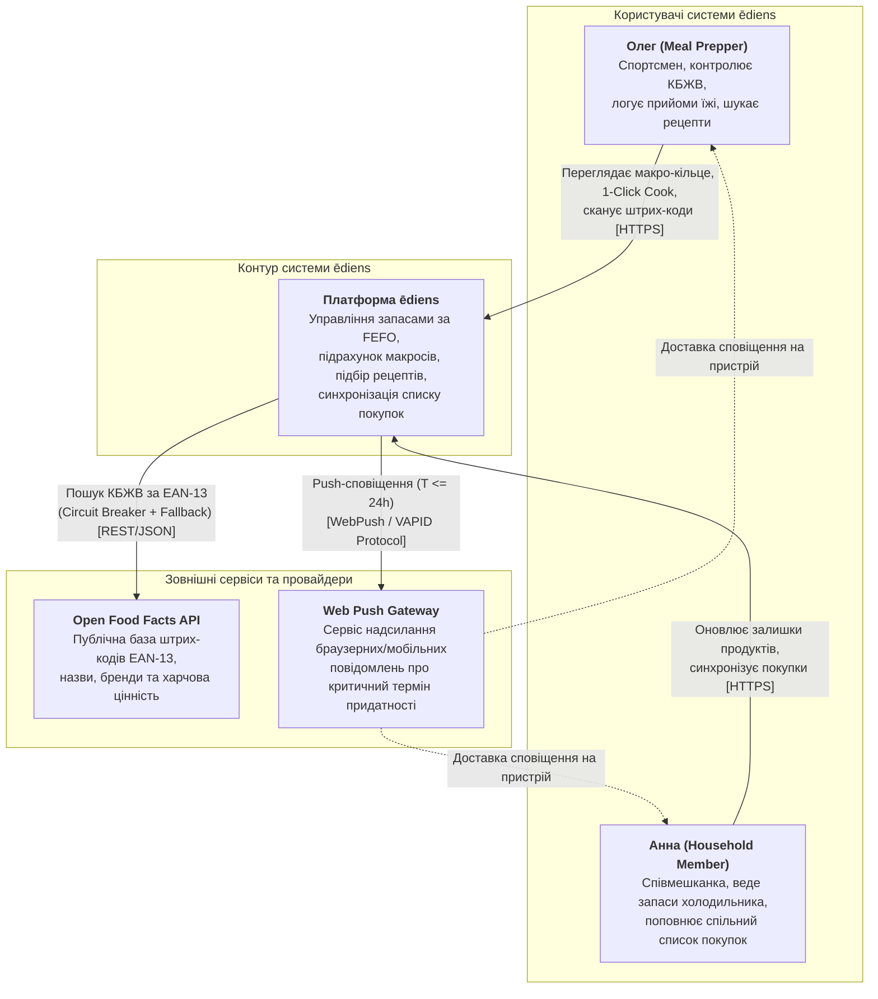
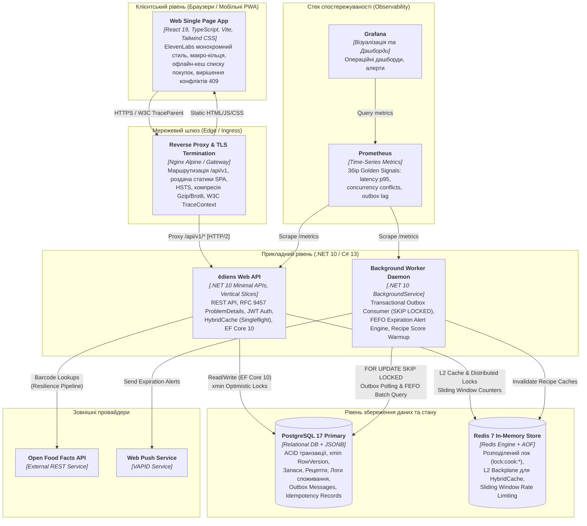
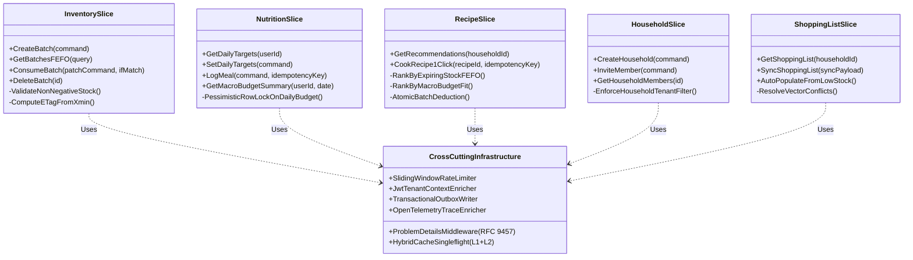

# 04. Архітектура системи (System Architecture)

> **Статус:** Затверджено  
> **Версія:** 1.0.0  
> **Авторство:** ēdiens System Architecture Working Group (TASK-02)

---

## 4.1 Загальний огляд архітектурного стилю

Архітектура системи **ēdiens** спроектована як високопродуктивний, відмовостійкий **модульний моноліт (Modular Monolith)** із використанням **Vertical Slice Architecture** на бекенді та реактивного клієнтського застосунку типу **Single Page Application (SPA / PWA)**. Такий підхід забезпечує максимальну швидкість розробки, нульову затримку міжмодульної мережевої взаємодії, строгу ізоляцію бізнес-фіч та простоту операційного обслуговування в контейнеризованому середовищі.

Система спроектована згідно з принципами **C4 Model** (Context, Containers, Components, Code) для забезпечення багаторівневої візуалізації взаємозв'язків між акторами, контейнерами та внутрішніми компонентами.

---

## 4.2 C4 Рівень 1: Діаграма контексту системи (System Context)

Діаграма контексту ілюструє межі системи **ēdiens**, її користувачів та зовнішні сервіси, з якими вона інтегрується.



---

## 4.3 C4 Рівень 2: Діаграма контейнерів (Container Diagram)

Контейнерна топологія системи охоплює клієнтську частину, зворотний проксі, монолітний бекенд API, асинхронний фоновий процесор, сховище даних PostgreSQL, кеш-сервер Redis та стек моніторингу.



---

## 4.4 C4 Рівень 3: Компонентна архітектура Web API (Component Diagram)

Бекенд `Ediens.Api` структурований за принципом **Vertical Slice Architecture**, де кожна фіча інкапсулює власні команди, запити, DTO, валідатори та бізнес-правила:



### Основні вертикальні зрізи (Vertical Slices):
1. **Features/Inventory:**
   - Облік партій (`inventory_items`) з атрибутами `expires_at`, `opened_at`, `location` (`Fridge`, `Freezer`, `Pantry`).
   - Сортування FEFO (найближчі до закінчення терміну — зверху).
   - Оптимістичне блокування через `xmin` (PostgreSQL) та заголовок HTTP `If-Match`.
2. **Features/Nutrition:**
   - Управління цілями КБЖВ (`nutrition_targets`).
   - Журнал прийому їжі (`meal_logs`, `meal_log_items`).
   - Розрахунок залишку макро-бюджету та захист від гонок через песимістичне блокування рядків `SELECT FOR UPDATE`.
3. **Features/Recipes:**
   - Двофакторний рекомендаційний скоринг: максимальне утилізування продуктів, що спливають, та ідеальне попадання у залишок БЖВ.
   - Атомарна операція `1-Click Cook`: списання інгредієнтів за FEFO + логування в щоденник харчування під захистом розподіленого локу Redis та `Idempotency-Key`.
4. **Features/Households:**
   - Багатокористувацький доступ (Multi-Tenancy) з ролями `Owner` та `Member`.
   - Автоматичний глобальний фільтр запитів (Global Query Filter) в EF Core для повної ізоляції даних домогосподарств.
5. **Features/ShoppingList:**
   - Спільний список покупок з авто-поповненням при критичному залишку або нестачі інгредієнтів.
   - Офлайн-перша синхронізація змін.

---

## 4.5 Архітектурні рішення (Architecture Decision Records — ADRs)

### ADR-01: Modular Monolith з Vertical Slice замість мікросервісів
- **Контекст:** Система ēdiens об'єднує інвентар, трекінг макросів та рецепти, які вимагають транзакційної узгодженості (наприклад, 1-Click Cook списує зі складу та додає прийом їжі в одній транзакції).
- **Рішення:** Обрано модульний моноліт (.NET 10 Minimal APIs) з вертикальними зрізами замість мікросервісів.
- **Наслідки:** Відсутність потреби в складних розподілених сагах (Distributed Sagas / 2PC), збереження ACID-гарантій, миттєвий запуск єдиного контейнера, швидкість відгуку $p95 < 150\text{ ms}$.

### ADR-02: Системне поле PostgreSQL `xmin` як Concurrency Token
- **Контекст:** Багатокористувацьке редагування запасів у домогосподарстві (наприклад, одночасне споживання молока).
- **Рішення:** Використовувати системний стовпець `xmin` рушія PostgreSQL, який неявно оновлюється рушієм MVCC при кожній модифікації рядка.
- **Наслідки:** Немає потреби додавати штучні колонки `version_number` або тригери. EF Core підтримує `xmin` з коробки через конфігурацію `.IsRowVersion()`.

### ADR-03: .NET 10 HybridCache (L1 In-Memory + L2 Redis) з Singleflight
- **Контекст:** Запобігання перевантаженню зовнішнього API Open Food Facts та внутрішньої бази при різких спалахах трафіку (Cache Stampede / Thundering Herd).
- **Рішення:** Впровадження нової підсистеми `Microsoft.Extensions.Caching.Hybrid.HybridCache`, що поєднує швидкий L1 (локальна пам'ять процесу) та розподілений L2 (Redis) з автоматичним Singleflight блокуванням.
- **Наслідки:** Якщо 100 користувачів одночасно сканують однаковий штрих-код, лише 1 виклик надсилається до постачальника, решта 99 безпечно чекають закешованого результату.

### ADR-04: Transactional Outbox з `FOR UPDATE SKIP LOCKED`
- **Контекст:** Потреба надійної асинхронної публікації подій (інвалідація кешів рекомендацій, push-сповіщення) без distributed transactions.
- **Рішення:** Збереження бізнес-сутностей та подій у таблицю `outbox_messages` в межах єдиної транзакції PostgreSQL. Фоновий воркер вичитує записи пакетами за допомогою конструкції `SELECT ... FOR UPDATE SKIP LOCKED`.
- **Наслідки:** 100% гарантія доставки (At-Least-Once), нульова вірогідність блокування між паралельними воркерами, висока пропускна здатність.

---

## 4.6 Генератор діаграми архітектури (Python Diagrams Script)

Для автоматизованої генерації діаграм високої роздільної здатності для презентацій та релізів розроблено скрипт `scripts/generate_architecture_diagram.py` на базі бібліотеки `diagrams`:

```bash
# Встановлення залежностей та генерація діаграми
pip install diagrams
python scripts/generate_architecture_diagram.py
```

Скрипт формує граф контейнерної топології в темній естетиці (ElevenLabs-style `#09090b`), що повністю узгоджується з C4 Container діаграмою цього розділу.
