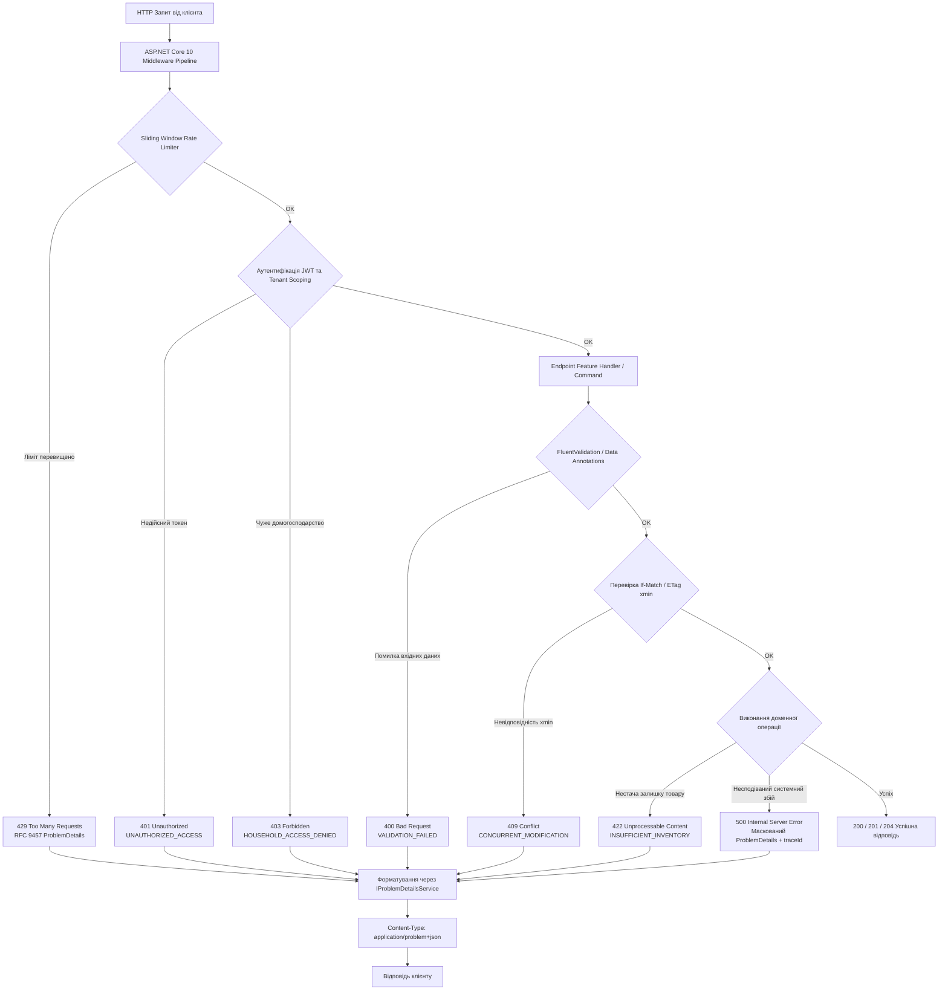
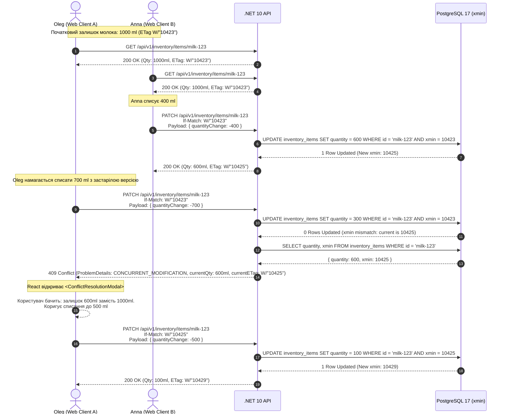
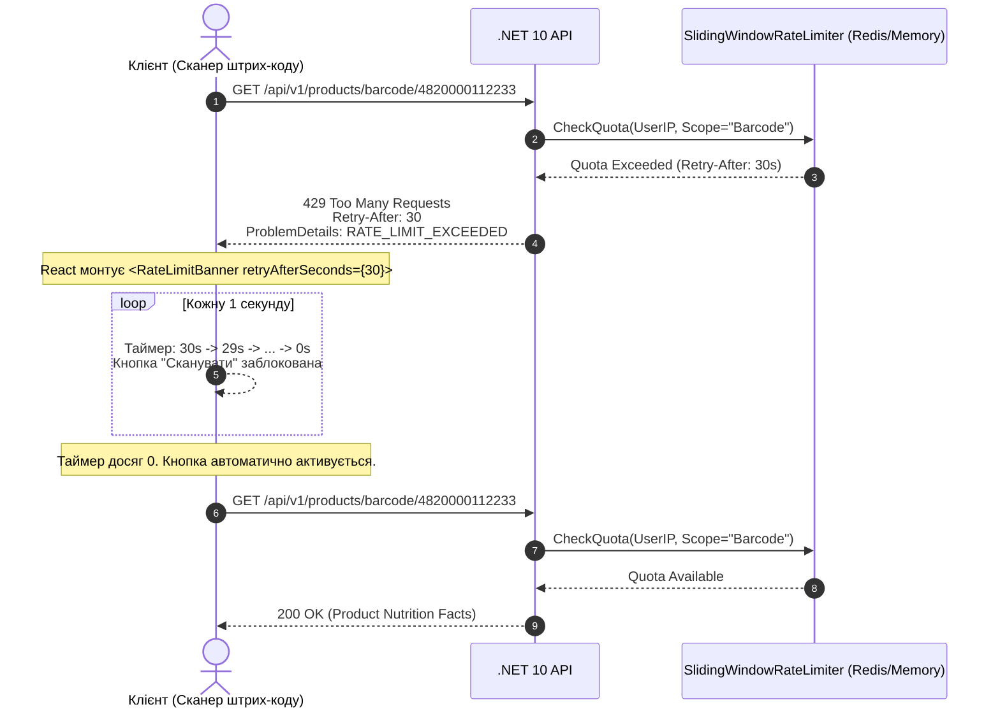
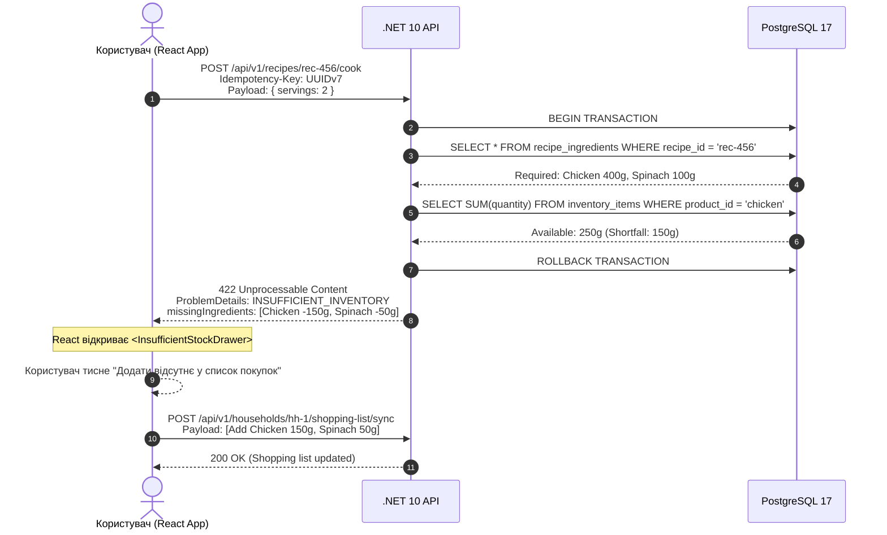

# 05. Обробка помилок та стандарти RFC 9457 (Error Handling & RFC 9457 Standards)

> **Статус:** Офіційний реліз базової специфікації (Baseline Release)  
> **Модуль SRS:** Розділ 05  
> **Зв'язок із завданнями:** TASK-03 (OpenAPI 3.1 Specification and RFC 9457 Error Handling Standards)  
> **Нормативні стандарти:** RFC 9457 ("Problem Details for HTTP APIs"), RFC 7232 (Conditional Requests / ETag), RFC 7231 (HTTP Semantics), W3C TraceContext (`traceparent`).

---

## 1. Архітектурні принципи та філософія обробки помилок

Система **ēdiens** функціонує в умовах високої конкурентності: декілька користувачів одного домогосподарства (наприклад, Oleg та Anna) можуть одночасно переглядати, змінювати та списувати продукти в холодильнику, перебуваючи вдома або здійснюючи закупівлі в супермаркеті з нестабільним мобільним зв'язком.

У зв'язку з цим, обробка помилок у системі проектується не як технічний виняток, а як **ключовий компонент взаємодії з користувачем (UX)** та надійний контур розподіленої консистентності.

### Ключові принципи обробки помилок:
1. **Єдиний машинночитний та людиночитний стандарт (RFC 9457):** Жоден ендпоінт API не повертає текстові помилки у довільному форматі або пусті тіла зі статусами 4xx/5xx. Усі помилкові відповіді без винятку повертаються з медіа-типом `Content-Type: application/problem+json; charset=utf-8`.
2. **Типізовані доменні коди помилок (`errorCode`):** Окрім стандартних статусів HTTP, кожна помилка містить строгий машинночитний код у форматі `UPPER_SNAKE_CASE` (наприклад, `CONCURRENT_MODIFICATION`, `INSUFFICIENT_INVENTORY`, `RATE_LIMIT_EXCEEDED`). Це дозволяє фронтенду однозначно обирати стратегію реакції без парсингу тексту повідомлення.
3. **Наскрізна трасованість (Distributed Tracing & W3C TraceContext):** Кожна помилка автоматично зв'язується з ідентифікатором трасування W3C `traceId` (`00-${trace_id}-${span_id}-${flags}`). Це забезпечує миттєву кореляцію інциденту на клієнті з логами у фоновому сервісі та метриками Prometheus/OpenTelemetry.
4. **Контекстні розширення для відновлення (Actionable Extensions):** Відповіді з помилками містять повний набір даних, необхідний клієнту для негайного розв'язання проблеми без додаткових мережевих запитів. Наприклад, помилка конфлікту версій `409 Conflict` містить актуальний залишок товару на сервері та поточний `currentETag`.
5. **Безпека та маскування деталей (Zero Information Leakage in Production):** У виробничому середовищі (Production) стеки викликів (.NET Stack Traces) та деталі внутрішніх винятків СУБД ніколи не передаються клієнту. Всі неочікувані збої маскуються загальним статусом `500 Internal Server Error` з типом `https://ediens.app/errors/internal-server-error`, зберігаючи лише унікальний `traceId` для аудиту інженерами.
6. **Ідемпотентність та захист від гонитви (Race Conditions):** Повторні запити з тим самим заголовком `Idempotency-Key` коректно розпізнаються сервером і або повертають збережений результат першої спроби, або повідомляють про триваючий процес обробки (`409 IDEMPOTENCY_CONFLICT`).

---

## 2. Архітектура обробки винятків у .NET 10 Web API

У бекенді .NET 10 (C# 13 Minimal APIs) обробка помилок організована через централізований конвеєр проміжного ПЗ (Middleware Pipeline) з використанням інтерфейсу `IProblemDetailsService` та кастомного обробника винятків `EdiensExceptionHandler`.



### Принципи роботи серверного конвеєра:
- При виникненні доменного винятку або помилки валідації обробник викликає `Results.Problem(...)` або кастомний extension-метод `Results.ProblemDetails(...)`.
- Заголовок `traceparent` автоматично парситься `System.Diagnostics.Activity` і додається в кожну відповідь як поле `traceId`.
- Якщо в запиті вказано неіснуючий або невідповідний `If-Match` токен під час мутації сутності з системним полем PostgreSQL `xmin`, генерується `DBConcurrencyException`, що автоматично транслюється у `409 Conflict` із заповненням розширень `currentETag` та `currentQuantity`.

---

## 3. Специфікація схеми RFC 9457 у системі ēdiens

Кожна помилка системи є JSON-об'єктом, що містить базові поля стандарту **RFC 9457** та спеціалізовані розширення **ēdiens**.

### 3.1 Базові поля RFC 9457
| Поле | Тип | Опис | Приклад значення |
| :--- | :--- | :--- | :--- |
| **`type`** | `string (URI)` | Абсолютний URI-ідентифікатор конкретного класу проблеми. Слугує стабільною назвою типу помилки. | `"https://ediens.app/errors/concurrent-modification"` |
| **`title`** | `string` | Короткий, людиночитний опис типу проблеми (не змінюється від інстансу до інстансу). | `"Conflict during state modification"` |
| **`status`** | `integer` | Код стану HTTP, згенерований сервером. | `409` |
| **`detail`** | `string` | Детальне людиночитне пояснення конкретної причини виникнення проблеми для цього запиту. | `"The inventory item has been modified by another household member since you loaded it."` |
| **`instance`** | `string (URI)` | Відносний або абсолютний URI ендпоінту/ресурсу, на якому виникла помилка. | `"/api/v1/inventory/items/0192e2b3-5730-7432-8411-cf0b91d23456"` |

### 3.2 Кастомні розширення ēdiens
| Поле | Тип | Опис | Приклад значення |
| :--- | :--- | :--- | :--- |
| **`errorCode`** | `string (enum)` | Унікальний машинночитний код помилки в `UPPER_SNAKE_CASE`. Використовується клієнтом для switch/case маршрутизації обробки. | `"CONCURRENT_MODIFICATION"` |
| **`traceId`** | `string` | Унікальний ідентифікатор трасування W3C TraceContext. | `"00-4bf92f3577b34da6a3ce929d0e0e4736-00f067aa0ba902b7-01"` |
| **`timestamp`** | `string (date-time)` | Часова мітка виникнення помилки за стандартом ISO-8601 UTC. | `"2026-10-31T08:04:15.123Z"` |
| **`extensions`** | `object` | Контекстний об'єкт із додатковими полями, специфічними для конкретного `errorCode`. | Див. детальні описи розширень нижче. |

---

## 4. Словник помилок та детальні JSON-приклади

### 4.1 `400 Bad Request` — `VALIDATION_FAILED`
Виникає, коли вхідний JSON містить невалідні поля (від'ємна кількість продукту, недійсний формат EAN-13, минула дата придатності тощо).

**Заголовки відповіді:**
```http
HTTP/1.1 400 Bad Request
Content-Type: application/problem+json; charset=utf-8
traceparent: 00-4bf92f3577b34da6a3ce929d0e0e4736-00f067aa0ba902b7-01
```

**Тіло відповіді (JSON):**
```json
{
  "type": "https://ediens.app/errors/validation-failed",
  "title": "One or more validation errors occurred.",
  "status": 400,
  "detail": "The request payload failed input validation rules. Please correct the specified fields.",
  "instance": "/api/v1/inventory/items",
  "errorCode": "VALIDATION_FAILED",
  "traceId": "00-4bf92f3577b34da6a3ce929d0e0e4736-00f067aa0ba902b7-01",
  "timestamp": "2026-10-31T08:05:00.120Z",
  "extensions": {
    "errors": {
      "quantity": [
        "Quantity must be greater than 0.",
        "Precision cannot exceed 2 decimal places."
      ],
      "expiresAt": [
        "Expiration date cannot be in the past when creating a new batch."
      ],
      "unit": [
        "Unit 'kilogram' is invalid. Permitted units are: 'g', 'ml', 'pcs'."
      ]
    },
    "invalidParams": [
      {
        "name": "quantity",
        "reason": "Must be greater than 0",
        "value": -150
      },
      {
        "name": "unit",
        "reason": "Must match enum [g, ml, pcs]",
        "value": "kilogram"
      }
    ]
  }
}
```

---

### 4.2 `401 Unauthorized` — `UNAUTHORIZED_ACCESS`
Виникає, коли заголовок `Authorization: Bearer <token>` відсутній, прострочений або підписаний недійсним секретом.

**Заголовки відповіді:**
```http
HTTP/1.1 401 Unauthorized
WWW-Authenticate: Bearer error="invalid_token", error_description="The token has expired"
Content-Type: application/problem+json; charset=utf-8
```

**Тіло відповіді (JSON):**
```json
{
  "type": "https://ediens.app/errors/unauthorized-access",
  "title": "Authentication token is missing, expired, or invalid.",
  "status": 401,
  "detail": "Your access token expired at 2026-10-31T07:55:00Z. Please refresh your session.",
  "instance": "/api/v1/nutrition/targets",
  "errorCode": "UNAUTHORIZED_ACCESS",
  "traceId": "00-2d88c4591a293bf6114a821e901455bb-00c8121f1ba48099-01",
  "timestamp": "2026-10-31T08:05:10.450Z",
  "extensions": {
    "tokenExpiredAt": "2026-10-31T07:55:00Z",
    "canRefresh": true
  }
}
```

---

### 4.3 `403 Forbidden` — `HOUSEHOLD_ACCESS_DENIED`
Виникає при спробі переглянути чи змінити дані домогосподарства, членом якого поточний користувач не є (порушення Tenant Scoping), або при спробі виконати дію, дозволену лише `Owner` (наприклад, видалення домогосподарства).

**Заголовки відповіді:**
```http
HTTP/1.1 403 Forbidden
Content-Type: application/problem+json; charset=utf-8
```

**Тіло відповіді (JSON):**
```json
{
  "type": "https://ediens.app/errors/household-access-denied",
  "title": "Access to household resources denied.",
  "status": 403,
  "detail": "The authenticated user is not a registered member of household '0192e2b0-8812-7001-9011-aa9988776655'.",
  "instance": "/api/v1/inventory/items?householdId=0192e2b0-8812-7001-9011-aa9988776655",
  "errorCode": "HOUSEHOLD_ACCESS_DENIED",
  "traceId": "00-51a87b3287114400aa89711566442200-0011223344556677-01",
  "timestamp": "2026-10-31T08:05:25.890Z",
  "extensions": {
    "householdId": "0192e2b0-8812-7001-9011-aa9988776655",
    "requiredRole": "Member",
    "currentMembershipStatus": "NOT_A_MEMBER"
  }
}
```

---

### 4.4 `404 Not Found` — `ITEM_NOT_FOUND`
Виникає, коли запитувану партію інвентарю, продукт за штрих-кодом або рецепт не знайдено (або запис було видалено іншим учасником домогосподарства).

**Заголовки відповіді:**
```http
HTTP/1.1 404 Not Found
Content-Type: application/problem+json; charset=utf-8
```

**Тіло відповіді (JSON):**
```json
{
  "type": "https://ediens.app/errors/item-not-found",
  "title": "Resource does not exist or was deleted.",
  "status": 404,
  "detail": "Inventory batch '0192e2b3-5730-7432-8411-cf0b91d23456' could not be found in active household inventory.",
  "instance": "/api/v1/inventory/items/0192e2b3-5730-7432-8411-cf0b91d23456",
  "errorCode": "ITEM_NOT_FOUND",
  "traceId": "00-8899aabbccddeeff0011223344556677-1122334455667788-01",
  "timestamp": "2026-10-31T08:05:40.012Z",
  "extensions": {
    "resourceType": "InventoryBatch",
    "resourceId": "0192e2b3-5730-7432-8411-cf0b91d23456",
    "searchedAtUtc": "2026-10-31T08:05:40.012Z"
  }
}
```

---

### 4.5 `409 Conflict` — `CONCURRENT_MODIFICATION`
Виникає під час оптимістичного блокування при спробі оновити залишок партії через `PATCH /api/v1/inventory/items/{id}`, коли переданий у заголовку `If-Match: W/"<ETag>"` не співпадає з поточним значенням PostgreSQL `xmin` у базі даних (інший співмешканець уже встиг списати або змінити частину продукту).

**Заголовки відповіді:**
```http
HTTP/1.1 409 Conflict
Content-Type: application/problem+json; charset=utf-8
ETag: W/"10425"
```

**Тіло відповіді (JSON):**
```json
{
  "type": "https://ediens.app/errors/concurrent-modification",
  "title": "Conflict during state modification",
  "status": 409,
  "detail": "The inventory item has been modified by another household member since you loaded it.",
  "instance": "/api/v1/inventory/items/0192e2b3-5730-7432-8411-cf0b91d23456",
  "errorCode": "CONCURRENT_MODIFICATION",
  "traceId": "00-4bf92f3577b34da6a3ce929d0e0e4736-00f067aa0ba902b7-01",
  "timestamp": "2026-10-31T08:06:00.670Z",
  "extensions": {
    "currentETag": "W/\"10425\"",
    "clientExpectedETag": "W/\"10423\"",
    "currentQuantity": 600.0,
    "unit": "ml",
    "productName": "Молоко 'Селянське' 2.5%",
    "lastModifiedBy": "Anna",
    "lastModifiedAt": "2026-10-31T08:05:58.210Z"
  }
}
```

---

### 4.6 `409 Conflict` — `IDEMPOTENCY_CONFLICT`
Виникає при повторному надсиланні мутуючого запиту (наприклад, списання страви «Cook Recipe») з тим самим ключем `Idempotency-Key`, коли попередня операція ще перебуває в стані виконання іншим фоновим потоком, або коли тіло запиту не співпадає з оригінальним запитом для цього ключа.

**Заголовки відповіді:**
```http
HTTP/1.1 409 Conflict
Content-Type: application/problem+json; charset=utf-8
```

**Тіло відповіді (JSON):**
```json
{
  "type": "https://ediens.app/errors/idempotency-conflict",
  "title": "Concurrent idempotent request already in progress.",
  "status": 409,
  "detail": "An identical request with Idempotency-Key '0192e2b9-1122-7f30-8111-cc0099887766' is currently being processed by the server. Please do not retry immediately.",
  "instance": "/api/v1/recipes/0192e2b8-1234-7111-9988-bbccddeeff00/cook",
  "errorCode": "IDEMPOTENCY_CONFLICT",
  "traceId": "00-778899aabbccddeeff00112233445566-2233445566778899-01",
  "timestamp": "2026-10-31T08:06:15.340Z",
  "extensions": {
    "idempotencyKey": "0192e2b9-1122-7f30-8111-cc0099887766",
    "state": "IN_FLIGHT",
    "lockExpiresInMs": 2400
  }
}
```

---

### 4.7 `422 Unprocessable Content` — `INSUFFICIENT_INVENTORY`
Виникає при спробі виконання транзакції «1-Click Cook» або ручного списання продуктів, коли сумарного наявного залишку одного або декількох інгредієнтів у домогосподарстві недостатньо для приготування зазначеної кількості порцій.

**Заголовки відповіді:**
```http
HTTP/1.1 422 Unprocessable Content
Content-Type: application/problem+json; charset=utf-8
```

**Тіло відповіді (JSON):**
```json
{
  "type": "https://ediens.app/errors/insufficient-inventory",
  "title": "Inventory stock insufficient to complete requested action.",
  "status": 422,
  "detail": "Cannot cook recipe 'Куряче філе з гречкою та шпинатом' for 2 servings: missing 150g chicken breast and 50g spinach.",
  "instance": "/api/v1/recipes/0192e2b8-1234-7111-9988-bbccddeeff00/cook",
  "errorCode": "INSUFFICIENT_INVENTORY",
  "traceId": "00-3344556677889900aabbccddeeff0011-44556677889900aa-01",
  "timestamp": "2026-10-31T08:06:30.980Z",
  "extensions": {
    "recipeId": "0192e2b8-1234-7111-9988-bbccddeeff00",
    "requestedServings": 2,
    "missingIngredients": [
      {
        "productId": "0192e2b1-0000-7000-8000-000000000002",
        "productName": "Куряче філе охолоджене",
        "requiredQuantity": 400.0,
        "availableQuantity": 250.0,
        "unit": "g",
        "shortfall": 150.0
      },
      {
        "productId": "0192e2b1-0000-7000-8000-000000000007",
        "productName": "Шпинат свіжий 'Верес'",
        "requiredQuantity": 100.0,
        "availableQuantity": 50.0,
        "unit": "g",
        "shortfall": 50.0
      }
    ]
  }
}
```

---

### 4.8 `429 Too Many Requests` — `RATE_LIMIT_EXCEEDED`
Виникає при перевищенні ліміту запитів клієнта (наприклад, сканування штрих-кодів або генерація складних рекомендацій з ШІ). Обмежується механізмом ASP.NET Core `SlidingWindowRateLimiter`.

**Заголовки відповіді:**
```http
HTTP/1.1 429 Too Many Requests
Content-Type: application/problem+json; charset=utf-8
Retry-After: 30
X-RateLimit-Limit: 60
X-RateLimit-Remaining: 0
X-RateLimit-Reset: 30
```

**Тіло відповіді (JSON):**
```json
{
  "type": "https://ediens.app/errors/rate-limit-exceeded",
  "title": "Too Many Requests",
  "status": 429,
  "detail": "Rate limit quota exceeded for barcode scanning. Please wait 30 seconds before sending further requests.",
  "instance": "/api/v1/products/barcode/4820000112233",
  "errorCode": "RATE_LIMIT_EXCEEDED",
  "traceId": "00-9900aabbccddeeff0011223344556677-556677889900aabb-01",
  "timestamp": "2026-10-31T08:07:00.120Z",
  "extensions": {
    "retryAfterSeconds": 30,
    "limit": 60,
    "windowSeconds": 60,
    "rateLimitScope": "BarcodeLookupPerUser"
  }
}
```

---

### 4.9 `500 Internal Server Error` — `INTERNAL_SERVER_ERROR`
Виникає при непередбачуваній внутрішній помилці бекенду (наприклад, аварійне розірвання зв'язку з базою даних або помилка серіалізації). Інформація про стек викликів маскується; детальний запис фіксується у внутрішньому лозі за `traceId`.

**Заголовки відповіді:**
```http
HTTP/1.1 500 Internal Server Error
Content-Type: application/problem+json; charset=utf-8
```

**Тіло відповіді (JSON):**
```json
{
  "type": "https://ediens.app/errors/internal-server-error",
  "title": "An unexpected error occurred on the server.",
  "status": 500,
  "detail": "A critical system error occurred while processing your request. Our engineering team has been notified. Use the provided traceId when contacting support.",
  "instance": "/api/v1/recipes/recommendations",
  "errorCode": "INTERNAL_SERVER_ERROR",
  "traceId": "00-fa11002233445566778899aabbccddee-66778899aabbccdd-01",
  "timestamp": "2026-10-31T08:07:15.990Z",
  "extensions": {
    "supportContact": "support@ediens.app"
  }
}
```

---

### 4.10 `503 Service Unavailable` — `EXTERNAL_SERVICE_UNAVAILABLE`
Виникає, коли відкривається запобіжник Circuit Breaker (Polly / .NET Resilience) під час звернення до зовнішнього API (наприклад, Open Food Facts або сервісу пуш-повідомлень), а локальний кеш не містить потрібної інформації.

**Заголовки відповіді:**
```http
HTTP/1.1 503 Service Unavailable
Content-Type: application/problem+json; charset=utf-8
Retry-After: 15
```

**Тіло відповіді (JSON):**
```json
{
  "type": "https://ediens.app/errors/external-service-unavailable",
  "title": "External Service Unavailable",
  "status": 503,
  "detail": "The external product catalog service (Open Food Facts) is temporarily unresponsive. Circuit breaker is currently OPEN.",
  "instance": "/api/v1/products/barcode/4820000998877",
  "errorCode": "EXTERNAL_SERVICE_UNAVAILABLE",
  "traceId": "00-bbccddee0011223344556677889900aa-77889900aabbccdd-01",
  "timestamp": "2026-10-31T08:07:30.430Z",
  "extensions": {
    "serviceName": "OpenFoodFactsApi",
    "circuitBreakerState": "OPEN",
    "retryAfterSeconds": 15
  }
}
```

---

## 5. Матриця клієнтських реакцій (Client Reaction Rules Matrix)

У цьому розділі встановлено нормативні вимоги до поведінки веб-інтерфейсу на базі **React 19** та **Tailwind CSS (стилістика ElevenLabs)** при отриманні кожного типу помилки RFC 9457.

| HTTP Код | Error Code | Домен / Ендпоінт | Цільовий React UI-компонент | Зміна стану клієнта (Client State Transition) | Візуальна реакція та UX | Стратегія відновлення (Recovery Strategy) |
| :--- | :--- | :--- | :--- | :--- | :--- | :--- |
| **`400`** | `VALIDATION_FAILED` | Будь-яка форма мутації (`POST /inventory/items`, `PUT /nutrition/targets`) | `<FormFieldError>`, `<Input error={...}>` | Помилки записуються у стан форми (React Hook Form / Zod). Фокус переноситься на перше помилкове поле. | Підсвічування рамок інпутів червоним кольором (`border-rose-500/80`), вивід тексту помилки під кожним полем дрібним моноширинним шрифтом (`text-xs text-rose-400 font-mono`). | Користувач виправляє значення в полі. При введенні валідного символу статус помилки скидається автоматично. |
| **`401`** | `UNAUTHORIZED_ACCESS` | Усі захищені ендпоінти | `<AuthModal>`, `useAuthStore` | Скидання активного `accessToken`, збереження перерваного запиту у чергу на повтор (Retry Queue). | Відображення модального вікна відновлення сесії або автоматичний виклик `/api/v1/auth/refresh` через Axios/Fetch Interceptor. | Якщо refresh-токен валідний — тихе оновлення токенів і повтор запиту без участі користувача. Якщо невалідний — редирект на `/login`. |
| **`403`** | `HOUSEHOLD_ACCESS_DENIED` | Доступ до даних домогосподарства (`/inventory/items`, `/shopping-list/sync`) | `<HouseholdSelectorModal>`, `<AccessDeniedCard>` | Очищення кешу вибраного домогосподарства в `useHouseholdStore`. | Показ картки з повідомленням про відсутність доступу та випадаючим списком доступних користувачеві домогосподарств. | Користувач перемикає активне домогосподарство на одне зі своїх дозволених або надсилає запит на запрошення власнику (`Owner`). |
| **`404`** | `ITEM_NOT_FOUND` | Деталі партії або видалення (`PATCH`, `DELETE /inventory/items/{id}`) | `<Toast variant="warning">`, `useInventoryStore` | Оптимістичне видалення елемента з локального стану та кешу React Query (`queryClient.invalidateQueries(...)`). | Спливаюче сповіщення (Toast): *«Цю партію вже було видалено або використано іншим членом сім'ї»*. Плавне зникнення рядка зі списку. | Автоматичний фоновий рефетч списку запасів домогосподарства без необхідності ручного перезавантаження сторінки. |
| **`409`** | `CONCURRENT_MODIFICATION` | Зміна залишку партії (`PATCH /inventory/items/{id}` з `If-Match`) | `<ConflictResolutionModal>` | Блокування поточної форми, завантаження об'єкта `extensions` у стан модалки вирішення колізії. | Показ модального вікна з порівнянням версій: «Ви намагалися списати X, але Anna вже змінила залишок на Y (поточний залишок: Z ml)». | Користувач обирає дію: (1) **Прийняти залишок сервера**; (2) **Списати з нового залишку**; (3) **Скасувати операцію**. При підтвердженні новий запит надсилається з новим `If-Match: currentETag`. |
| **`409`** | `IDEMPOTENCY_CONFLICT` | 1-Click Cook (`POST /recipes/{id}/cook`), логування (`POST /meals/log`) | `<Button loading={true}>`, `<Toast variant="info">` | Кнопка дії залишається в стані «Обробка запиту...» (Loading Spinner). | Показ інформаційного тосту: *«Ваше замовлення на приготування вже обробляється. Зачекайте декілька секунд...»*. | Клієнт автоматично очікує вказаний у `extensions.lockExpiresInMs` час (з експоненційним бекофом) і робить запит перевірки результату. |
| **`422`** | `INSUFFICIENT_INVENTORY` | 1-Click Cook (`POST /recipes/{id}/cook`) | `<InsufficientStockDrawer>`, `<ShoppingListQuickAdd>` | Відкриття бічної панелі (Drawer) зі списком дефіцитних інгредієнтів. | Візуалізація бракуючих продуктів з індикаторами нестачі червоним кольором (наприклад: *«Не вистачає 150г курячого філе»*). Кнопка швидкої дії *«Додати у список покупок»*. | Користувач в 1 клік додає відсутні позиції до списку покупок домогосподарства (`POST /shopping-list/sync`) або зменшує кількість порцій страви. |
| **`429`** | `RATE_LIMIT_EXCEEDED` | Сканування штрих-коду (`GET /products/barcode/{code}`), рекомендації | `<RateLimitBanner retryAfterSeconds={...}>` | Блокування елементів вводу (сканер штрих-кодів, кнопка пошуку) на період `retryAfterSeconds`. | Угорі екрана з'являється закріплений банер із таймером зворотного відліку: *«Забагато запитів. Зачекайте 28с...»* з анімованим індикатором прогресу. | Кнопки вводу автоматично розблоковуються після закінчення таймера. Якщо запит був у черзі, він надсилається повторно. |
| **`500`** | `INTERNAL_SERVER_ERROR` | Будь-який ендпоінт | `<ErrorBoundaryFallback>`, `<Toast variant="error">` | Логування `traceId` у внутрішню чергу помилок клієнта (Sentry / лог консолі). | Тост або екран помилки: *«Сталася технічна помилка на сервері. Код звернення: [traceId]»* з кнопкою *«Скопіювати код помилки»*. | Кнопка *«Спробувати ще раз»* (Retry). Якщо збій повторюється, користувач може надіслати `traceId` у службу підтримки. |
| **`503`** | `EXTERNAL_SERVICE_UNAVAILABLE` | Пошук товару за штрих-кодом (`GET /products/barcode/{code}`) | `<BarcodeManualEntryModal>`, `<Badge variant="offline">` | Перемикання компонента сканера в режим ручного введення товару. | Сповіщення: *«Каталог штрих-кодів тимчасово недоступний. Введіть назву та калорійність вручну»*. | Форма ручного введення назви та КБЖВ зберігає створений продукт локально в БД домогосподарства без очікування зовнішнього каталогу. |

---

## 6. Діаграми послідовності сценаріїв вирішення колізій (Mermaid)

### 6.1 Оптимістичне блокування та розв'язання конфлікту конкурентної зміни (409 Conflict)

Нижче наведено процес взаємодії двох співмешканців Oleg та Anna при одночасному споживанні молока з холодильника.



---

### 6.2 Обробка ліміту запитів та таймер блокування (429 Too Many Requests)



---

### 6.3 1-Click Cook при нестачі продуктів (422 Insufficient Inventory)



---

## 7. Інженерні рекомендації щодо реалізації на бекенді та фронтенді

### 7.1 Backend: .NET 10 C# 13 Helper Factory
Реалізація єдиної фабрики генерації RFC 9457 відповідей:

```csharp
// src/Ediens.Api/Common/Errors/EdiensProblemDetails.cs
namespace Ediens.Api.Common.Errors;

public static class EdiensResults
{
    public static IResult ProblemDetails(
        int statusCode,
        string title,
        string detail,
        string errorCode,
        string instance,
        object? extensions = null)
    {
        var traceId = Activity.Current?.Id ?? Guid.NewGuid().ToString();
        var problem = new ProblemDetails
        {
            Type = $"https://ediens.app/errors/{errorCode.ToLowerInvariant().Replace('_', '-')}",
            Title = title,
            Status = statusCode,
            Detail = detail,
            Instance = instance
        };

        problem.Extensions["errorCode"] = errorCode;
        problem.Extensions["traceId"] = traceId;
        problem.Extensions["timestamp"] = DateTime.UtcNow.ToString("O");

        if (extensions != null)
        {
            foreach (var prop in extensions.GetType().GetProperties())
            {
                problem.Extensions[prop.Name] = prop.GetValue(extensions);
            }
        }

        return Results.Json(problem, statusCode: statusCode, contentType: "application/problem+json; charset=utf-8");
    }
}
```

### 7.2 Frontend: TypeScript інтерфейс обробки та Error Handler
Централізоване визначення типів RFC 9457 у React-клієнті:

```typescript
// src/ediens-web/src/api/problemDetails.ts

export type ErrorCode =
  | 'VALIDATION_FAILED'
  | 'UNAUTHORIZED_ACCESS'
  | 'HOUSEHOLD_ACCESS_DENIED'
  | 'ITEM_NOT_FOUND'
  | 'CONCURRENT_MODIFICATION'
  | 'IDEMPOTENCY_CONFLICT'
  | 'INSUFFICIENT_INVENTORY'
  | 'RATE_LIMIT_EXCEEDED'
  | 'INTERNAL_SERVER_ERROR'
  | 'EXTERNAL_SERVICE_UNAVAILABLE';

export interface ProblemDetails<TExtensions = Record<string, unknown>> {
  type: string;
  title: string;
  status: number;
  detail: string;
  instance: string;
  errorCode: ErrorCode;
  traceId: string;
  timestamp: string;
  extensions?: TExtensions;
}

export interface ConcurrentModificationExtensions {
  currentETag: string;
  clientExpectedETag?: string;
  currentQuantity: number;
  unit: string;
  productName?: string;
  lastModifiedBy?: string;
}

export interface InsufficientInventoryExtensions {
  recipeId: string;
  requestedServings: number;
  missingIngredients: Array<{
    productId: string;
    productName: string;
    requiredQuantity: number;
    availableQuantity: number;
    unit: string;
    shortfall: number;
  }>;
}

export interface RateLimitExtensions {
  retryAfterSeconds: number;
  limit: number;
  windowSeconds: number;
  rateLimitScope: string;
}
```
