```mermaid
sequenceDiagram
    autonumber
    actor Alice as Анна (Клієнт A)
    actor Bob as Олег (Клієнт B)
    participant API as ēdiens Web API (.NET 10)
    participant DB as PostgreSQL 17 (MVCC)

    Note over Alice,DB: Початковий стан: Молоко 1000 мл (xmin = 10423)
    Alice->>API: GET /inventory/items/milk
    API->>DB: SELECT * FROM inventory_items WHERE id = 'milk'
    DB-->>API: 1000 ml, xmin = 10423
    API-->>Alice: 200 OK (ETag: W/"10423", quantity: 1000)

    Bob->>API: GET /inventory/items/milk
    API->>DB: SELECT * FROM inventory_items WHERE id = 'milk'
    DB-->>API: 1000 ml, xmin = 10423
    API-->>Bob: 200 OK (ETag: W/"10423", quantity: 1000)

    rect rgb(20, 45, 20)
        Note over Bob,DB: Олег списує 400 мл (першим)
        Bob->>API: PATCH /inventory/items/milk (If-Match: W/"10423", amount: -400)
        API->>DB: UPDATE inventory_items SET quantity = 600 WHERE id = 'milk' AND xmin = 10423
        DB-->>API: 1 row updated (New xmin = 10424)
        API-->>Bob: 200 OK (ETag: W/"10424", remaining: 600)
    end

    rect rgb(50, 20, 20)
        Note over Alice,DB: Анна намагається списати 700 мл зі старим ETag
        Alice->>API: PATCH /inventory/items/milk (If-Match: W/"10423", amount: -700)
        API->>DB: UPDATE inventory_items SET quantity = 300 WHERE id = 'milk' AND xmin = 10423
        DB-->>API: 0 rows updated! (xmin 10423 більше не актуальний)
        API->>DB: SELECT quantity, xmin FROM inventory_items WHERE id = 'milk'
        DB-->>API: 600 ml, xmin = 10424
        API-->>Alice: 409 Conflict (CONCURRENT_MODIFICATION, currentQuantity: 600)
    end

    Note over Alice: Відкриття ConflictResolutionModal:<br/>«Залишилося 600 мл. Бажаєте скоригувати порцію?»
```

```mermaid
sequenceDiagram
    autonumber
    actor User as Клієнт (Браузер)
    participant API as ēdiens Web API
    participant Redis as Redis 7 (Distributed Lock)
    participant DB as PostgreSQL 17 (ACID Transaction)

    User->>API: POST /recipes/omelette/cook<br/>[Idempotency-Key: UUIDv7-AAA]
    API->>Redis: SET lock:cook:UUIDv7-AAA {nodeId} NX PX 5000
    Redis-->>API: OK (Lock Acquired)

    API->>DB: SELECT * FROM idempotency_records WHERE key = 'UUIDv7-AAA'
    DB-->>API: Not found (Перше виконання)

    rect rgb(25, 25, 50)
        Note over API,DB: Початок єдиної транзакції (BEGIN TRANSACTION)
        API->>DB: SELECT * FROM inventory_items WHERE product_id IN (eggs, milk) ORDER BY expires_at ASC FOR UPDATE
        DB-->>API: Batches fetched (Locked)
        API->>DB: UPDATE inventory_items SET quantity = quantity - needed (FEFO deduction)
        API->>DB: INSERT INTO meal_logs (user_id, calories, protein, ...) VALUES (...)
        API->>DB: INSERT INTO idempotency_records (key, status, response_body) VALUES ('UUIDv7-AAA', 'COMPLETED', {...})
        API->>DB: COMMIT TRANSACTION
        DB-->>API: Transaction Committed
    end

    API->>Redis: EVAL "if redis.call('get', KEYS[1]) == ARGV[1] then return redis.call('del', KEYS[1]) else return 0 end"
    Redis-->>API: Lock Released
    API-->>User: 200 OK (Meal Logged, Stock Deducted)

    Note over User,DB: Мережевий збій! Клієнт повторює той самий запит через таймаут:
    User->>API: POST /recipes/omelette/cook<br/>[Idempotency-Key: UUIDv7-AAA]
    API->>Redis: SET lock:cook:UUIDv7-AAA {nodeId} NX PX 5000
    Redis-->>API: OK (Lock Acquired)
    API->>DB: SELECT * FROM idempotency_records WHERE key = 'UUIDv7-AAA'
    DB-->>API: Record found (status: COMPLETED, cached_response: {...})
    API->>Redis: Release Lock
    API-->>User: 200 OK (Повернення кешованої відповіді без повторного списання!)
```

```mermaid
sequenceDiagram
    autonumber
    actor User as Користувач
    participant API as ēdiens Web API
    participant DB as PostgreSQL 17 (Outbox Table)
    participant Worker1 as Background Worker 1
    participant Worker2 as Background Worker 2
    participant Redis as Redis (Recipe Cache)

    User->>API: POST /inventory/items (Масове додавання продуктів)
    rect rgb(20, 45, 20)
        Note over API,DB: Транзакція додавання інвентарю + Outbox
        API->>DB: BEGIN
        API->>DB: INSERT INTO inventory_items (15 продуктів)
        API->>DB: INSERT INTO outbox_messages ('InventoryBatchesCreated', PENDING)
        API->>DB: COMMIT
    end
    API-->>User: 201 Created (Миттєва відповідь, p95 < 80ms)

    par Worker 1 polling
        Worker1->>DB: SELECT * FROM outbox_messages WHERE status='PENDING' LIMIT 5 FOR UPDATE SKIP LOCKED
        DB-->>Worker1: Повідомлення #101, #102 (Заблоковано для W1)
    and Worker 2 polling (Одночасно)
        Worker2->>DB: SELECT * FROM outbox_messages WHERE status='PENDING' LIMIT 5 FOR UPDATE SKIP LOCKED
        DB-->>Worker2: Повідомлення #103, #104 (Рядки 101, 102 пропущені без очікування!)
    end

    Worker1->>Redis: Оновлення індексів скорингу рецептів для Household
    Worker1->>DB: UPDATE outbox_messages SET status='PROCESSED' WHERE id IN (101, 102)

    Worker2->>DB: Оцінка термінів FEFO & планування push-повідомлень
    Worker2->>DB: UPDATE outbox_messages SET status='PROCESSED' WHERE id IN (103, 104)
```

```mermaid
sequenceDiagram
    autonumber
    actor Phone as Мобільний додаток (+250 ккал)
    actor Watch as Смарт-годинник (+200 ккал)
    participant API as ēdiens Web API
    participant DB as PostgreSQL 17

    Note over Phone,DB: Початковий стан: 1900 / 2200 ккал (Залишок: 300 ккал)
    Phone->>API: POST /meals/log (Батончик: 250 ккал)
    Watch->>API: POST /meals/log (Смузі: 200 ккал)

    rect rgb(20, 45, 20)
        Note over Phone,DB: Потік 1 (Мобільний) захоплює блокування рядка
        API->>DB: BEGIN TRANSACTION
        API->>DB: SELECT * FROM daily_macro_budgets WHERE user_id='Oleh' FOR UPDATE
        DB-->>API: 1900 kcal (Row Locked!)
    end

    rect rgb(50, 40, 20)
        Note over Watch,DB: Потік 2 (Годинник) намагається заблокувати той самий рядок
        API->>DB: BEGIN TRANSACTION
        API->>DB: SELECT * FROM daily_macro_budgets WHERE user_id='Oleh' FOR UPDATE
        Note over DB: [Wait for Lock...] Потік 2 заблоковано на рівні ядра PostgreSQL
    end

    rect rgb(20, 45, 20)
        Note over Phone,DB: Перевірка інваріанта: 1900 + 250 = 2150 <= 2200 (OK)
        API->>DB: UPDATE daily_macro_budgets SET current_calories = 2150
        API->>DB: INSERT INTO meal_logs (...)
        API->>DB: COMMIT
        DB-->>API: Committed (Row Lock Released)
        API-->>Phone: 201 Created (Macro Logged: 2150/2200 kcal)
    end

    rect rgb(50, 20, 20)
        Note over Watch,DB: Потік 2 прокидається та читає НОВИЙ стан
        DB-->>API: 2150 kcal (Now locked by Thread 2)
        Note over API: Перевірка інваріанта: 2150 + 200 = 2350 > 2200! (Порушення!)
        API->>DB: ROLLBACK
        DB-->>API: Rolled back (Lock Released)
        API-->>Watch: 422 Unprocessable Content (DOMAIN_INVARIANT_VIOLATION)
    end
```

# 06. Патерни конкурентності та розподілених систем (Concurrency Patterns)

> **Статус:** Затверджено  
> **Версія:** 1.0.0  
> **Авторство:** ēdiens Distributed Systems Working Group (TASK-02)

---

## 6.1 Вступ та класифікація патернів

У системі **ēdiens** управління запасами домогосподарства, трекінг макронутрієнтів та рекомендація рецептів відбуваються в умовах **високої конкурентності (High Concurrency)**. Кілька членів сім'ї можуть одночасно відкривати холодильник, редагувати залишок молока, списувати інгредієнти через кнопку «1-Click Cook» або синхронізувати список покупок.

Для забезпечення суворої узгодженості (Strict Consistency), запобігання від'ємним залишкам на складі (Non-Negative Inventory Invariant) та захисту від дублювання операцій впроваджено **5 ключових розподілених патернів**:

| № | Назва патерну | Сфера застосування | Механізм реалізації | HTTP статус відповіді |
| :--- | :--- | :--- | :--- | :--- |
| **1** | **Optimistic Concurrency Control (OCC)** | Спільне редагування запасів продуктів | HTTP ETag + PostgreSQL системний стовпець `xmin` | `409 Conflict` (при колізії) |
| **2** | **Distributed Lock + Idempotency-Key** | Атомарне списання за рецептом (1-Click Cook) | Redis Distributed Lock (`SET NX PX`) + таблиця `idempotency_records` | `200 OK` (кешований) / `409 Conflict` |
| **3** | **Transactional Outbox + Competing Consumers** | Асинхронне оновлення скорингу рецептів та сповіщень | Єдина DB-транзакція + `SELECT FOR UPDATE SKIP LOCKED` | `202 Accepted` |
| **4** | **Pessimistic Row Locking** | Контроль добового ліміту макро-бюджету | SQL `SELECT ... FOR UPDATE` на рядку щоденного агрегату | `422 Unprocessable Content` |
| **5** | **HybridCache Stampede Protection & Rate Limiting** | Пошук штрих-кодів EAN-13 та ШІ-рекомендації | Singleflight L1/L2 Lock (.NET 10 HybridCache) + Sliding Window Rate Limiter | `429 Too Many Requests` |

---

## 6.2 Pattern 1: Optimistic Concurrency Control (ETag / PostgreSQL `xmin`)

### Опис сценарію
Два співмешканці домогосподарства (Олег та Анна) одночасно відкривають сторінку холодильника, де міститься пляшка молока об'ємом 1000 мл (`id: 0192e2b3...`, поточний `xmin: 10423`).
1. Олег наливає протеїновий коктейль і списує 400 мл.
2. Анна одночасно варить кашу і списує 700 мл.
Без оптимістичного блокування виникла б аномалія втраченого оновлення (Lost Update), або баланс молока став би від'ємним ($1000 - 400 - 700 = -100\text{ мл}$).

### Технічна реалізація
- При запиті `GET /api/v1/inventory/items/{id}` бекенд повертає заголовок `ETag: W/"10423"`, де числове значення формується з системного поля PostgreSQL `xmin` (ідентифікатор транзакції останньої модифікації рядка).
- При відправці `PATCH /api/v1/inventory/items/{id}` клієнт зобов'язаний передати `If-Match: W/"10423"`.
- Entity Framework Core 10 налаштовано з row versioning:
  ```csharp
  builder.Entity<InventoryItem>()
      .Property(b => b.RowVersion)
      .HasColumnName("xmin")
      .HasColumnType("xid")
      .ValueGeneratedOnAddOrUpdate()
      .IsRowVersion();
  ```
- Коли запит Олега виконується успішно, `xmin` стає `10424`, а залишок — 600 мл.
- Коли запит Анни приходить зі застарілим `If-Match: W/"10423"`, виникає `DbUpdateConcurrencyException`, транзакція відкочується, а сервер повертає `409 Conflict` згідно з RFC 9457:
  ```json
  {
    "type": "https://ediens.app/errors/concurrent-modification",
    "title": "Conflict during state modification",
    "status": 409,
    "errorCode": "CONCURRENT_MODIFICATION",
    "extensions": {
      "currentETag": "W/\"10424\"",
      "currentQuantity": 600,
      "unit": "ml"
    }
  }
  ```
- Фронтенд відображає `<ConflictResolutionModal>`, показуючи Анні: «Залишилося лише 600 мл. Списати наявні 600 мл чи скасувати?».

### Діаграма послідовності (Mermaid sequenceDiagram)



### Діаграма послідовності (WebSequenceDiagrams block)

```text
title Pattern 1: Optimistic Concurrency Control (ETag / PostgreSQL xmin)

participant Alice as Client A (Anna)
participant Bob as Client B (Oleh)
participant API as ediens Web API
participant DB as PostgreSQL 17

note over Alice, DB: Initial State: Milk 1000ml (xmin = 10423)
Alice->API: GET /inventory/items/milk
API->DB: SELECT * FROM inventory_items WHERE id = 'milk'
DB-->API: 1000 ml, xmin = 10423
API-->Alice: 200 OK (ETag: W/"10423", qty: 1000)

Bob->API: GET /inventory/items/milk
API->DB: SELECT * FROM inventory_items WHERE id = 'milk'
DB-->API: 1000 ml, xmin = 10423
API-->Bob: 200 OK (ETag: W/"10423", qty: 1000)

note over Bob, DB: Bob consumes 400ml first
Bob->API: PATCH /inventory/items/milk\n[If-Match: W/"10423", delta: -400]
API->DB: UPDATE inventory_items SET quantity=600\nWHERE id='milk' AND xmin=10423
DB-->API: 1 row affected (new xmin=10424)
API-->Bob: 200 OK [ETag: W/"10424", remaining: 600]

note over Alice, DB: Alice attempts to consume 700ml using stale ETag
Alice->API: PATCH /inventory/items/milk\n[If-Match: W/"10423", delta: -700]
API->DB: UPDATE inventory_items SET quantity=300\nWHERE id='milk' AND xmin=10423
DB-->API: 0 rows affected! (Concurrency conflict)
API->DB: SELECT quantity, xmin FROM inventory_items WHERE id='milk'
DB-->API: 600 ml, xmin = 10424
API-->Alice: 409 Conflict [CONCURRENT_MODIFICATION, currentQuantity: 600]
```

---

## 6.3 Pattern 2: Idempotency-Key + Distributed Redis Lock for 1-Click Cook

### Опис сценарію
Користувач натискає кнопку «1-Click Cook» для приготування омлету. Через нестабільне Wi-Fi або мобільне з'єднання (Metro/LTE) перший HTTP-пакет затримується, користувач робить повторний клік, або браузер виконує автоматичний таймаутний повтор (TCP Retry).
Без захисту відбулося б подвійне списання яєць і молока зі складу за принципом FEFO та подвійне додавання калорій у щоденник споживання (`MealLog`).

### Технічна реалізація
1. **Генерація клієнтського ключа:** Фронтенд генерує унікальний `Idempotency-Key: 0192e2c5-7a89-7000-8543-a1b2c3d4e5f6` (UUIDv7, що містить часову мітку).
2. **Розподілений лок у Redis:**
   Перед початком транзакції API накладає короткоживучий блокувальний ключ у Redis:
   ```text
   SET lock:cook:0192e2c5-7a89-7000-8543-a1b2c3d4e5f6 {worker_guid} NX PX 5000
   ```
   - Якщо ключ уже встановлений іншим потоком $\rightarrow$ паралельний запит отримує статус «Операція вже обробляється» і чекає або повертає `409 Conflict`.
3. **Перевірка таблиці `idempotency_records` в PostgreSQL:**
   - Якщо запис із таким ключем уже існує зі статусом `COMPLETED` $\rightarrow$ API миттєво повертає збережений раніше JSON-результат без повторного виконання бізнес-логіки.
4. **Атомарне списання за FEFO в єдиній транзакції:**
   - Вибірка партій яєць, відсортованих за `expires_at ASC`:
     ```sql
     SELECT id, quantity, expires_at 
     FROM inventory_items 
     WHERE product_id = @EggProductId AND quantity > 0 
     ORDER BY expires_at ASC 
     FOR UPDATE;
     ```
   - Списання потрібної кількості з найстаріших партій.
   - Створення запису в `meal_logs` та `meal_log_items`.
   - Збереження результату в `idempotency_records`.
   - `COMMIT;`
5. **Безпечне зняття локу в Redis:** За допомогою Lua-скрипта перевіряється відповідність токена воркера, щоб випадково не зняти лок після перевищення таймауту.

### Діаграма послідовності (Mermaid sequenceDiagram)



### Діаграма послідовності (WebSequenceDiagrams block)

```text
title Pattern 2: Idempotency-Key + Distributed Redis Lock for 1-Click Cook

participant User as Client App
participant API as ediens Web API
participant Redis as Redis 7
participant DB as PostgreSQL 17

User->API: POST /recipes/{id}/cook\n[Idempotency-Key: UUIDv7-AAA]
API->Redis: SET lock:cook:UUIDv7-AAA {nodeId} NX PX 5000
Redis-->API: OK (Lock Acquired)

API->DB: SELECT * FROM idempotency_records WHERE key='UUIDv7-AAA'
DB-->API: Not Found

note over API, DB: Atomic FEFO Execution in Single Transaction
API->DB: BEGIN TRANSACTION
API->DB: SELECT * FROM inventory_items WHERE product_id IN (...) ORDER BY expires_at ASC FOR UPDATE
DB-->API: Batches locked
API->DB: UPDATE inventory_items (FEFO multi-batch deduct)
API->DB: INSERT INTO meal_logs (...)
API->DB: INSERT INTO idempotency_records (key='UUIDv7-AAA', response={...})
API->DB: COMMIT
DB-->API: Committed

API->Redis: Lua Delete Lock if Token Matches
Redis-->API: Lock Released
API-->User: 200 OK [Meal Logged, Batches Deducted]

note over User, DB: Network glitch: Duplicate request sent
User->API: POST /recipes/{id}/cook\n[Idempotency-Key: UUIDv7-AAA]
API->Redis: SET lock:cook:UUIDv7-AAA {nodeId} NX PX 5000
Redis-->API: OK
API->DB: SELECT * FROM idempotency_records WHERE key='UUIDv7-AAA'
DB-->API: Found: COMPLETED, stored_response
API->Redis: Release Lock
API-->User: 200 OK [Cached Response Returned, Zero Side-Effects]
```

---

## 6.4 Pattern 3: Transactional Outbox + Competing Consumers (`FOR UPDATE SKIP LOCKED`)

### Опис сценарію
Користувач завантажує чек із супермаркету, додаючи 15 нових партій продуктів. Необхідно:
1. Перерахувати рекомендаційний скоринг рецептів (що вимагає ресурсоємного повнотекстового співставлення інгредієнтів).
2. Запланувати push-сповіщення про терміни придатності.
Виконання цих завдань синхронно в HTTP-запиті призвело б до неприпустимої затримки ($> 3$ секунд). Однак публікація безпосередньо в зовнішню чергу повідомлень (наприклад, RabbitMQ чи Kafka) порушує транзакційну атомарність: якщо база впаде після публікації в чергу, виникне неконсистентність (Ghost Events).

### Технічна реалізація
- **Атомарний запис:** У тій же локальній транзакції, де зберігаються продукти, створюється рядок у таблиці `outbox_messages`:
  ```sql
  INSERT INTO outbox_messages (id, event_type, payload, status, created_at)
  VALUES (gen_random_uuid(), 'InventoryBatchesCreated', '{"householdId": "...", "batchIds": [...]}', 'PENDING', NOW());
  ```
- **Конкурентне вичитування без блокувань (`SKIP LOCKED`):**
  Кілька інстансів фонового воркера (`BackgroundWorker`) паралельно опитують чергу:
  ```sql
  SELECT id, event_type, payload 
  FROM outbox_messages 
  WHERE status = 'PENDING' 
  ORDER BY created_at ASC 
  LIMIT 10 
  FOR UPDATE SKIP LOCKED;
  ```
  `SKIP LOCKED` дозволяє кожному інстансу воркера миттєво захоплювати вільні рядки, ігноруючи ті, що вже заблоковані сусідніми воркерами. Це забезпечує лінійне горизонтальне масштабування без deadlock'ів та очікувань.
- Після успішної обробки статус змінюється на `PROCESSED`. У разі збою лічильник `retry_count` збільшується; після 3 невдач повідомлення маркується `FAILED` і надсилається в Dead-Letter чергу.

### Діаграма послідовності (Mermaid sequenceDiagram)



### Діаграма послідовності (WebSequenceDiagrams block)

```text
title Pattern 3: Transactional Outbox + Competing Consumers (SKIP LOCKED)

participant User as Client App
participant API as ediens Web API
participant DB as PostgreSQL 17
participant W1 as Background Worker 1
participant W2 as Background Worker 2
participant Redis as Redis Cache

User->API: POST /inventory/items [Batch Upload 15 items]
note over API, DB: Single ACID Transaction
API->DB: BEGIN
API->DB: INSERT INTO inventory_items (...)
API->DB: INSERT INTO outbox_messages ('InventoryBatchesCreated', status='PENDING')
API->DB: COMMIT
API-->User: 201 Created [Fast response p95 < 80ms]

note over W1, DB: Competing consumers without locks
W1->DB: SELECT * FROM outbox_messages WHERE status='PENDING' LIMIT 5 FOR UPDATE SKIP LOCKED
DB-->W1: Locked rows (IDs: 101, 102)

W2->DB: SELECT * FROM outbox_messages WHERE status='PENDING' LIMIT 5 FOR UPDATE SKIP LOCKED
DB-->W2: Locked rows (IDs: 103, 104 - skipped 101/102 instantly)

W1->Redis: Invalidate & Recalculate Recipe Recommendation Scoring
W1->DB: UPDATE outbox_messages SET status='PROCESSED' WHERE id IN (101, 102)

W2->DB: Calculate FEFO expiration alerts & dispatch push
W2->DB: UPDATE outbox_messages SET status='PROCESSED' WHERE id IN (103, 104)
```

---

## 6.5 Pattern 4: Pessimistic Row Locking (`SELECT ... FOR UPDATE`) для ліміту макро-бюджету

### Опис сценарію
Користувач Олег встановив режим суворого контролю добового калоражу: не більше 2200 ккал на день. Увечері поточне споживання становить 1900 ккал (залишок ліміту: 300 ккал).
Олег перебуває в спортзалі та одночасно логує протеїновий батончик (250 ккал) через мобільний додаток, а його спортивний фітнес-годинник надсилає автоматичну синхронізацію вечірнього смузі (200 ккал). Сумарно: $1900 + 250 + 200 = 2350\text{ ккал}$ (перевищення ліміту на 150 ккал).

### Технічна реалізація
Без блокування обидва запити одночасно прочитали б 1900 ккал, кожен вирішив би, що $1900 + 250 \le 2200$ та $1900 + 200 \le 2200$, і обидва зафіксували б транзакцію.
Для запобігання цій гонці (Race Condition) застосовується песимістичне блокування рядка щоденного агрегату:
1. Запит відкриває транзакцію:
   ```sql
   BEGIN TRANSACTION;
   SELECT current_calories, target_calories 
   FROM daily_macro_budgets 
   WHERE user_id = @UserId AND log_date = CURRENT_DATE 
   FOR UPDATE;
   ```
2. Перший запит (батончик +250 ккал) захоплює ексклюзивний Row-Level Lock на рядок бюджету.
3. Другий запит (смузі +200 ккал) зупиняється на виклику `SELECT ... FOR UPDATE` і чекає завершення першої транзакції.
4. Перший запит перевіряє умову: $1900 + 250 = 2150 \le 2200$. Умова виконується $\rightarrow$ оновлює рядок до 2150 ккал і робить `COMMIT;`.
5. Блокування знімається. Другий запит прокидається і читає актуальне значення **2150 ккал**.
6. Перевірка другого запиту: $2150 + 200 = 2350 > 2200$. Умова інваріанта порушена!
7. Другий запит виконує `ROLLBACK;` і повертає статус `422 Unprocessable Content` з RFC 9457 `DOMAIN_INVARIANT_VIOLATION`:
   ```json
   {
     "type": "https://ediens.app/errors/macro-budget-exceeded",
     "title": "Daily calorie limit invariant violation",
     "status": 422,
     "errorCode": "DOMAIN_INVARIANT_VIOLATION",
     "detail": "Adding 200 kcal would exceed your strict daily limit of 2200 kcal (Current: 2150 kcal)."
   }
   ```

### Діаграма послідовності (Mermaid sequenceDiagram)



### Діаграма послідовності (WebSequenceDiagrams block)

```text
title Pattern 4: Pessimistic Row Locking for Daily Macro Budget Enforcing

participant Phone as Mobile App (+250 kcal)
participant Watch as Smart Watch (+200 kcal)
participant API as ediens Web API
participant DB as PostgreSQL 17

note over Phone, DB: Current Budget: 1900 / 2200 kcal (Remaining: 300 kcal)
Phone->API: POST /meals/log [250 kcal]
Watch->API: POST /meals/log [200 kcal]

API->DB: BEGIN TRANSACTION (Thread 1)
API->DB: SELECT * FROM daily_macro_budgets WHERE user_id='Oleh' FOR UPDATE
DB-->API: 1900 kcal [Row Locked exclusively]

API->DB: BEGIN TRANSACTION (Thread 2)
API->DB: SELECT * FROM daily_macro_budgets WHERE user_id='Oleh' FOR UPDATE
note over DB: Thread 2 pauses, waiting for lock release...

note over Phone, DB: Thread 1 evaluates: 1900 + 250 = 2150 <= 2200 (Valid)
API->DB: UPDATE daily_macro_budgets SET current_calories = 2150
API->DB: COMMIT (Thread 1)
DB-->API: Committed & Lock Released
API-->Phone: 201 Created [New Balance: 2150/2200 kcal]

note over Watch, DB: Thread 2 wakes up and acquires lock
DB-->API: Row data: 2150 kcal (Locked by Thread 2)
note over API: Thread 2 evaluates: 2150 + 200 = 2350 > 2200 (Violated!)
API->DB: ROLLBACK (Thread 2)
API-->Watch: 422 Unprocessable Content [DOMAIN_INVARIANT_VIOLATION]
```

---

## 6.6 Pattern 5: HybridCache Stampede Protection (Singleflight) + Sliding Window Rate Limiting

### Опис сценарію
1. **Cache Stampede (Thundering Herd):** Популярний штрих-код продукту (наприклад, новинка високобілкового йогурту EAN-13 `4820000000001`) сканується одночасно сотнями користувачів. Без блокування кешу відбудеться 100 паралельних запитів до зовнішнього Open Food Facts API, що призведе до блокування IP-адреси провайдером через Rate Limit та зависання пулу з'єднань.
2. **Зловживання API (Abuse Protection):** Автоматизований бот або клієнт у циклі відправляє 200 запитів на секунду, намагаючись перевантажити рекомендаційний рушій.

### Технічна реалізація
- **.NET 10 HybridCache Singleflight:**
  Використовується офіційна бібліотека `Microsoft.Extensions.Caching.Hybrid`.
  ```csharp
  public async Task<ProductDto> GetProductByBarcodeAsync(string barcode, CancellationToken ct)
  {
      return await _hybridCache.GetOrCreateAsync(
          $"product:barcode:{barcode}",
          async cancel => await _openFoodFactsClient.FetchBarcodeAsync(barcode, cancel),
          options: new HybridCacheEntryOptions
          {
              LocalCacheExpiration = TimeSpan.FromMinutes(10),
              Expiration = TimeSpan.FromHours(24)
          },
          cancellationToken: ct
      );
  }
  ```
  Коли надходить 50 запитів на один штрих-код:
  1. Перший потік виявляє Miss у L1 (локальна пам'ять) та L2 (Redis).
  2. `HybridCache` створює внутрішній асинхронний блокувальний об'єкт (Singleflight Key).
  3. Тільки **один** HTTP-запит іде до Open Food Facts API.
  4. Інші 49 потоків стають у чергу очікування на `TaskCompletionSource`.
  5. Отримана відповідь записується в L1 та Redis L2, і всі 50 клієнтів миттєво отримують відповідь.
- **Sliding Window Rate Limiter:**
  Налаштовано на рівні ASP.NET Core конвеєра:
  ```csharp
  builder.Services.AddRateLimiter(options =>
  {
      options.AddSlidingWindowLimiter("barcode-policy", opt =>
      {
          opt.PermitLimit = 60;
          opt.Window = TimeSpan.FromMinutes(1);
          opt.SegmentsPerWindow = 6;
          opt.QueueLimit = 0;
      });
  });
  ```
  При перевищенні ліміту повертається `429 Too Many Requests` із заголовком `Retry-After: 35` та тілом RFC 9457 `RATE_LIMIT_EXCEEDED`. Клієнтський компонент `<RateLimitBanner>` блокує кнопку сканування та показує зворотний відлік таймера.

### Діаграма послідовності (Mermaid sequenceDiagram)

```mermaid
sequenceDiagram
    autonumber
    actor C1 as Клієнт 1
    actor C2 as Клієнт 2..50
    participant API as ēdiens Web API (HybridCache)
    participant Redis as Redis L2 Backplane
    participant OFF as Open Food Facts External API

    Note over C1,C2: Спалах 50 одночасних запитів на EAN-13: 4820000000001
    C1->>API: GET /products/barcode/4820000000001
    C2->>API: GET /products/barcode/4820000000001 (Одночасно)

    API->>API: Перевірка L1 In-Memory (Miss)
    API->>Redis: GET product:barcode:4820000000001 (Miss)

    rect rgb(20, 35, 50)
        Note over API,OFF: Singleflight Locking: Створюється єдиний асинхронний таск
        API->>API: Singleflight Lock захоплено для Клієнта 1
        Note over C2,API: Клієнти 2..50 очікують завершення таска (0 викликів назовні!)
        API->>OFF: GET https://world.openfoodfacts.org/api/v2/product/4820000000001
        OFF-->>API: 200 OK (Йогурт Грецький, P:10g, F:2g, C:4g)
    end

    API->>Redis: SET product:barcode:4820000000001 (L2 TTL: 24h)
    API->>API: Запис у L1 Memory Cache (L1 TTL: 10m)

    API-->>C1: 200 OK (Дані продукту)
    API-->>C2: 200 OK (Дані продукту повернено всім 49 клієнтам одночасно!)

    Note over C1,API: Спроба спаму: Перевищення ліміту 60 req/min
    loop Запит #61 протягом 60 секунд
        C1->>API: GET /products/barcode/12345
        API-->>C1: 429 Too Many Requests [Retry-After: 42, RATE_LIMIT_EXCEEDED]
    end
```

### Діаграма послідовності (WebSequenceDiagrams block)

```text
title Pattern 5: HybridCache Singleflight Stampede Protection + Rate Limiting

participant C1 as Client 1
participant C2 as Clients 2..50
participant API as ediens HybridCache (.NET 10)
participant Redis as Redis L2
participant OFF as Open Food Facts API

note over C1, C2: Thundering Herd: 50 concurrent requests for EAN-13
C1->API: GET /products/barcode/4820000000001
C2->API: GET /products/barcode/4820000000001
API->API: Check L1 Memory (Miss)
API->Redis: Check L2 Redis (Miss)

note over API, OFF: HybridCache Singleflight Lock Activated
API->API: Lock acquired for factory call
note over C2, API: Clients 2..50 wait asynchronously for TaskCompletionSource
API->OFF: GET /api/v2/product/4820000000001 (1 single HTTP call)
OFF-->API: 200 OK [Nutritional data JSON]

API->Redis: SET barcode:4820000000001 [L2 TTL: 24h]
API->API: Store in L1 Memory [L1 TTL: 10m]

API-->C1: 200 OK [Product DTO]
API-->C2: 200 OK [Product DTO returned to all 49 waiting requests]

note over C1, API: Rate Limiting Enforcement
C1->API: Rapid request #61 in 1 minute
API-->C1: 429 Too Many Requests [Retry-After: 45, RATE_LIMIT_EXCEEDED]
```

---

## 6.7 Зведена матриця запобігання аномаліям

| Аномалія розподіленої системи | Сценарій у домогосподарстві | Патерн вирішення в ēdiens | Гарантований результат |
| :--- | :--- | :--- | :--- |
| **Lost Update (Втрачене оновлення)** | Два користувачі одночасно списують молоко | Pattern 1: ETag / `xmin` | Одному `200 OK`, другому `409 Conflict` з модальним вікном |
| **Double Spending (Подвійне списання)** | Подвійний клік на «1-Click Cook» або повтор запиту | Pattern 2: Redis Lock + Idempotency-Key | Рівно одне списання запасів та створення `MealLog` |
| **Ghost Events / Inconsistency** | Додавання чеку та оновлення рекомендацій | Pattern 3: Transactional Outbox + `SKIP LOCKED` | Гарантія доставки At-Least-Once без deadlock'ів між воркерами |
| **Limit Overcommit** | Одночасне внесення їжі з двох гаджетів понад ліміт | Pattern 4: Pessimistic Row Lock (`FOR UPDATE`) | Сувора послідовна валідація ліміту, порушнику `422 Unprocessable` |
| **Thundering Herd / Cache Stampede** | Одночасне сканування штрих-коду сотнею людей | Pattern 5: HybridCache Singleflight | Рівно 1 зовнішній виклик до API, $p95 < 15\text{ ms}$ для кешу |
