# 07. Модель даних (Data Model)

> **Статус:** Офіційний реліз розширеної інженерної специфікації (Baseline)  
> **Версія:** 2.0.0  
> **Модуль SRS:** Розділ 07 (Relational PostgreSQL Schema, UUIDv7, xmin Concurrency, Data Retention & GDPR Purge)  
> **Зв'язок із завданнями:** DOC-01, TASK-01, FR-01..FR-12, NFR-02, NFR-04  
> **Стандарти:** PostgreSQL 16/17 Enterprise Guidelines, Entity Framework Core 10, RFC 9457, GDPR EU 2016/679

---

## 1. Архітектурні принципи моделі даних

Модель даних системи **ēdiens** спроектована з урахуванням високих вимог до строгої узгодженості (**Strong ACID Consistency**), високої продуктивності операцій за принципом **FEFO** (*First Expired, First Out*), оптимістичного блокування без штучних версій за допомогою системного **`xmin`** у PostgreSQL та суворої мультитенантної ізоляції домогосподарств.

### Ключові принципи та конвенції:
1. **Стратегія первинних ключів (UUIDv7):** Для всіх сутностей використовується тип `uuid` з генерацією за стандартом **UUIDv7** (RFC 9562). Завдяки вбудованій мітці часу в старших 48 бітах (Unix Epoch timestamp) UUIDv7 забезпечує монотонне зростання ключів. Це повністю запобігає фрагментації сторінок B-Tree індексів у PostgreSQL і забезпечує швидкість вставки на рівні `bigserial`, зберігаючи глобальну унікальність у розподіленому середовищі.
2. **Єдиний часовий простір (UTC Timestamps):** Усі поля дати та часу зберігаються виключно в типі `TIMESTAMP WITH TIME ZONE` (`TIMESTAMPTZ`) за шкалою UTC. Локальний час користувача враховується виключно на рівні клієнтського представлення.
3. **Строгий інваріант невід'ємних залишків:** Складські залишки не можуть набувати від'ємних значень за жодних обставин. Інваріант закріплено на рівні ядра СУБД декларативним перевірочним обмеженням: `CHECK (quantity >= 0)`.
4. **Багатоорендна ізоляція (Tenant Scoping):** Таблиці інвентарю, списків покупок та рецептів домогосподарств мають зовнішній ключ `household_id`. Персональні щоденники харчування та добові цілі макронутрієнтів ізольовані за `user_id`.
5. **Оптимістичне блокування (Optimistic Concurrency Control) через `xmin`:** Замість додаткових штучних стовпців версій для детекції колізій паралельної зміни партій використовується вбудований системний стовпець PostgreSQL `xmin`, що напряму транслюється у HTTP-заголовок `ETag`.
6. **Надійна асинхронна доставка (Transactional Outbox):** Усі події домену, що потребують подальшої асинхронної обробки (сповіщення, перерахунок скорингу, інвалідація кешів), зберігаються в таблиці `outbox_messages` у межах тієї ж транзакції, що й бізнес-мутації.
7. **Гарантія одноразового виконання (Idempotency Store):** Операції списання та логування їжі контролюються таблицею `idempotency_records`, що запобігає дублюванню при повторних мережевих викликах клієнта.

---

## 2. ER-діаграма системи (Entity-Relationship Diagram)

Нижче наведено повну схему взаємозв'язків між усіма реляційними сутностями системи у синтаксисі Mermaid `erDiagram`, включно з PK, FK, UK та токеном конкурентності `xmin`.

```mermaid
erDiagram
    users ||--o{ household_members : "is member of"
    users ||--o{ nutrition_targets : "has daily targets"
    users ||--o{ meal_logs : "logs consumption"
    users ||--o{ shopping_list_items : "adds items"
    users ||--o{ idempotency_records : "issues requests"

    households ||--|{ household_members : "contains"
    households ||--o{ inventory_batches : "owns stock batches"
    households ||--o{ recipes : "creates custom"
    households ||--o{ shopping_list_items : "manages list"

    products ||--o{ inventory_batches : "stocked as batches"
    products ||--o{ recipe_ingredients : "is component of"
    products ||--o{ meal_log_items : "logged in meal"
    products ||--o{ shopping_list_items : "optional product link"

    recipes ||--|{ recipe_ingredients : "consists of"
    meal_logs ||--|{ meal_log_items : "details"

    users {
        uuid id PK "UUIDv7"
        varchar email UK "RFC 5322"
        text password_hash "Argon2id"
        timestamptz created_at "UTC"
        timestamptz updated_at "UTC"
    }

    households {
        uuid id PK "UUIDv7"
        varchar name "Household Name"
        varchar invite_code UK "8-char code"
        timestamptz created_at "UTC"
        timestamptz updated_at "UTC"
    }

    household_members {
        uuid household_id PK, FK "Household Reference"
        uuid user_id PK, FK "User Reference"
        varchar role "Owner, Editor, Guest"
        timestamptz joined_at "UTC"
    }

    products {
        uuid id PK "UUIDv7"
        varchar name "Product Title"
        varchar barcode UK "EAN-13 (Optional)"
        varchar brand "Brand / Manufacturer"
        numeric calories_per_100g "kcal / 100g"
        numeric protein_per_100g "g / 100g"
        numeric fat_per_100g "g / 100g"
        numeric carbs_per_100g "g / 100g"
        timestamptz created_at "UTC"
        timestamptz updated_at "UTC"
    }

    inventory_batches {
        uuid id PK "UUIDv7"
        uuid household_id FK "Tenant ID"
        uuid product_id FK "Product ID"
        varchar location "Fridge, Freezer, Pantry"
        numeric quantity "Current Stock (>= 0)"
        varchar unit "g, ml, pcs"
        timestamptz expires_at "FEFO Expiry Date"
        timestamptz opened_at "Date Opened"
        timestamptz created_at "UTC"
        timestamptz updated_at "UTC"
        xid xmin "PostgreSQL RowVersion Concurrency Token"
    }

    nutrition_targets {
        uuid id PK "UUIDv7"
        uuid user_id FK "User Target Owner"
        numeric target_calories "kcal / day"
        numeric target_protein "g / day"
        numeric target_fat "g / day"
        numeric target_carbs "g / day"
        date effective_from "Active from Date"
        timestamptz created_at "UTC"
    }

    meal_logs {
        uuid id PK "UUIDv7"
        uuid user_id FK "User Reference"
        timestamptz logged_at "Consumption Timestamp"
        varchar meal_type "Breakfast, Lunch, Dinner, Snack"
        numeric calories "Total Meal kcal"
        numeric protein "Total Meal Protein"
        numeric fat "Total Meal Fat"
        numeric carbs "Total Meal Carbs"
        uuid idempotency_key UK "Client Request UUID"
        timestamptz created_at "UTC"
    }

    meal_log_items {
        uuid id PK "UUIDv7"
        uuid meal_log_id FK "Meal Log Parent"
        uuid product_id FK "Product Reference"
        numeric quantity "Consumed Amount"
        varchar unit "g, ml, pcs"
        numeric calories "Calculated kcal"
        numeric protein "Calculated Protein"
        numeric fat "Calculated Fat"
        numeric carbs "Calculated Carbs"
    }

    recipes {
        uuid id PK "UUIDv7"
        uuid household_id FK "Nullable: Custom or Global"
        varchar title "Recipe Name"
        text description "Summary"
        text instructions "Step-by-step Guide"
        numeric total_calories "Total kcal"
        numeric total_protein "Total Protein"
        numeric total_fat "Total Fat"
        numeric total_carbs "Total Carbs"
        integer prep_time_minutes "Preparation Time"
        timestamptz created_at "UTC"
        timestamptz updated_at "UTC"
    }

    recipe_ingredients {
        uuid id PK "UUIDv7"
        uuid recipe_id FK "Recipe Reference"
        uuid product_id FK "Required Product"
        numeric quantity "Required Amount"
        varchar unit "g, ml, pcs"
        boolean is_optional "Optional Ingredient Flag"
    }

    shopping_list_items {
        uuid id PK "UUIDv7"
        uuid household_id FK "Household Reference"
        varchar product_name "Item Description"
        numeric quantity "Required Amount"
        varchar unit "g, ml, pcs"
        boolean is_purchased "Purchased Checkbox"
        uuid added_by_user_id FK "Creator Reference"
        uuid product_id FK "Catalog Product Link (Optional)"
        bigint version "Vector Version for Offline Sync"
        timestamptz created_at "UTC"
        timestamptz updated_at "UTC"
    }

    outbox_messages {
        uuid id PK "UUIDv7"
        varchar event_type "Domain Event Name"
        jsonb payload "Event Body"
        varchar status "PENDING, PROCESSED, FAILED"
        integer retry_count "Attempts Count"
        text error_message "Failure Reason"
        timestamptz created_at "UTC"
        timestamptz processed_at "UTC (Nullable)"
    }

    idempotency_records {
        varchar idempotency_key PK "Client UUIDv7"
        uuid user_id FK "User Scope"
        varchar request_path "HTTP Endpoint"
        integer status_code "HTTP Status Code"
        jsonb response_body "Cached HTTP Response Payload"
        timestamptz created_at "UTC"
        timestamptz expires_at "TTL Timestamp"
    }
```



---

## 3. Детальні специфікації сутностей, схем таблиць, індексів та DDL

Нижче наведено повний виробничий DDL для 8 основних сутностей домену, допоміжних сутностей та 2 системних таблиць інфраструктури.

```sql
-- Створення необхідних криптографічних та розширень повнотекстового пошуку
CREATE EXTENSION IF NOT EXISTS "pgcrypto";
CREATE EXTENSION IF NOT EXISTS "pg_trgm";

-- ============================================================================
-- 1. ТАБЛИЦЯ: users (Облікові записи користувачів)
-- ============================================================================
-- Призначення: Зберігання облікових записів, авторизаційних хешів та ідентифікаторів.
CREATE TABLE users (
    id UUID PRIMARY KEY,
    email VARCHAR(255) NOT NULL,
    password_hash TEXT NOT NULL,
    created_at TIMESTAMP WITH TIME ZONE NOT NULL DEFAULT CURRENT_TIMESTAMP,
    updated_at TIMESTAMP WITH TIME ZONE NOT NULL DEFAULT CURRENT_TIMESTAMP,
    CONSTRAINT uq_users_email UNIQUE (email)
);
CREATE INDEX idx_users_email ON users(email);
COMMENT ON TABLE users IS 'Облікові записи користувачів платформи ēdiens';

-- ============================================================================
-- 2. ТАБЛИЦЯ: households (Домогосподарства)
-- ============================================================================
-- Призначення: Одиниця багатоорендного (multi-tenant) володіння запасами та списками.
CREATE TABLE households (
    id UUID PRIMARY KEY,
    name VARCHAR(150) NOT NULL,
    invite_code VARCHAR(16) NOT NULL,
    created_at TIMESTAMP WITH TIME ZONE NOT NULL DEFAULT CURRENT_TIMESTAMP,
    updated_at TIMESTAMP WITH TIME ZONE NOT NULL DEFAULT CURRENT_TIMESTAMP,
    CONSTRAINT uq_households_invite_code UNIQUE (invite_code)
);
COMMENT ON TABLE households IS 'Домогосподарства (одиниця спільного володіння запасами)';

-- ============================================================================
-- 3. ТАБЛИЦЯ: household_members (Членство в домогосподарствах та RBAC)
-- ============================================================================
-- Призначення: Зв'язок Many-to-Many між користувачами та домогосподарствами з ролями RBAC.
CREATE TABLE household_members (
    household_id UUID NOT NULL REFERENCES households(id) ON DELETE CASCADE,
    user_id UUID NOT NULL REFERENCES users(id) ON DELETE CASCADE,
    role VARCHAR(20) NOT NULL,
    joined_at TIMESTAMP WITH TIME ZONE NOT NULL DEFAULT CURRENT_TIMESTAMP,
    PRIMARY KEY (household_id, user_id),
    CONSTRAINT ck_household_members_role CHECK (role IN ('Owner', 'Editor', 'Guest'))
);
CREATE INDEX idx_household_members_user ON household_members(user_id);
COMMENT ON TABLE household_members IS 'Зв''язок користувачів із домогосподарствами та їх ролі (RBAC)';

-- ============================================================================
-- 4. ТАБЛИЦЯ: products (Глобальний каталог продуктів харчування)
-- ============================================================================
-- Призначення: Еталонний довідник харчових продуктів із розрахунком КБЖВ на 100 грамів.
CREATE TABLE products (
    id UUID PRIMARY KEY,
    name VARCHAR(255) NOT NULL,
    barcode VARCHAR(14) NULL,
    brand VARCHAR(150) NULL,
    calories_per_100g NUMERIC(7, 2) NOT NULL,
    protein_per_100g NUMERIC(6, 2) NOT NULL,
    fat_per_100g NUMERIC(6, 2) NOT NULL,
    carbs_per_100g NUMERIC(6, 2) NOT NULL,
    created_at TIMESTAMP WITH TIME ZONE NOT NULL DEFAULT CURRENT_TIMESTAMP,
    updated_at TIMESTAMP WITH TIME ZONE NOT NULL DEFAULT CURRENT_TIMESTAMP,
    CONSTRAINT ck_products_macros_positive CHECK (
        calories_per_100g >= 0 AND
        protein_per_100g >= 0 AND
        fat_per_100g >= 0 AND
        carbs_per_100g >= 0
    )
);
CREATE UNIQUE INDEX idx_products_barcode ON products(barcode) WHERE barcode IS NOT NULL;
CREATE INDEX idx_products_name_trgm ON products USING gin (name gin_trgm_ops);
COMMENT ON TABLE products IS 'Глобальний каталог продуктів харчування та їх КБЖВ на 100 г';

-- ============================================================================
-- 5. ТАБЛИЦЯ: inventory_batches (Складські партії з токеном конкурентності xmin)
-- ============================================================================
-- Призначення: Партійний облік залишків продуктів у розрізі зон зберігання та термінів FEFO.
-- Примітка: У моделі даних сутність також ідентифікується як inventory_items для зворотної сумісності.
CREATE TABLE inventory_batches (
    id UUID PRIMARY KEY,
    household_id UUID NOT NULL REFERENCES households(id) ON DELETE CASCADE,
    product_id UUID NOT NULL REFERENCES products(id) ON DELETE RESTRICT,
    location VARCHAR(20) NOT NULL,
    quantity NUMERIC(10, 2) NOT NULL,
    unit VARCHAR(10) NOT NULL,
    expires_at TIMESTAMP WITH TIME ZONE NOT NULL,
    opened_at TIMESTAMP WITH TIME ZONE NULL,
    created_at TIMESTAMP WITH TIME ZONE NOT NULL DEFAULT CURRENT_TIMESTAMP,
    updated_at TIMESTAMP WITH TIME ZONE NOT NULL DEFAULT CURRENT_TIMESTAMP,
    CONSTRAINT ck_inventory_location CHECK (location IN ('Fridge', 'Freezer', 'Pantry')),
    CONSTRAINT ck_inventory_unit CHECK (unit IN ('g', 'ml', 'pcs')),
    CONSTRAINT ck_inventory_quantity_non_negative CHECK (quantity >= 0)
);

-- Композитний частковий FEFO-індекс: підтримує запити вибірки з сортуванням за найближчим терміном
CREATE INDEX IX_inventory_household_expiry ON inventory_batches(household_id, expires_at ASC) WHERE quantity > 0;
CREATE INDEX idx_inventory_product ON inventory_batches(product_id);
COMMENT ON TABLE inventory_batches IS 'Складські партії продуктів у домогосподарствах з підтримкою FEFO';

-- Аліас-представлення для сумісності з попередніми API контрактами
CREATE OR REPLACE VIEW inventory_items AS SELECT *, xmin FROM inventory_batches;

-- ============================================================================
-- 6. ТАБЛИЦЯ: recipes (Каталог кулінарних рецептів)
-- ============================================================================
-- Призначення: Зберігання рецептів страв (глобальних або створених домогосподарством).
CREATE TABLE recipes (
    id UUID PRIMARY KEY,
    household_id UUID NULL REFERENCES households(id) ON DELETE CASCADE,
    title VARCHAR(255) NOT NULL,
    description TEXT NOT NULL,
    instructions TEXT NOT NULL,
    total_calories NUMERIC(7, 2) NOT NULL,
    total_protein NUMERIC(6, 2) NOT NULL,
    total_fat NUMERIC(6, 2) NOT NULL,
    total_carbs NUMERIC(6, 2) NOT NULL,
    prep_time_minutes INTEGER NOT NULL DEFAULT 15,
    created_at TIMESTAMP WITH TIME ZONE NOT NULL DEFAULT CURRENT_TIMESTAMP,
    updated_at TIMESTAMP WITH TIME ZONE NOT NULL DEFAULT CURRENT_TIMESTAMP,
    CONSTRAINT ck_recipes_prep_time CHECK (prep_time_minutes >= 0)
);
CREATE INDEX idx_recipes_household ON recipes(household_id);
CREATE INDEX idx_recipes_title_trgm ON recipes USING gin (title gin_trgm_ops);
COMMENT ON TABLE recipes IS 'Каталог кулінарних рецептів (глобальних або створених домогосподарством)';

-- ============================================================================
-- 7. ТАБЛИЦЯ: recipe_ingredients (Складові інгредієнти рецептів)
-- ============================================================================
-- Призначення: Зв'язок рецептів з продуктами та нормами витрат на базову порцію.
CREATE TABLE recipe_ingredients (
    id UUID PRIMARY KEY,
    recipe_id UUID NOT NULL REFERENCES recipes(id) ON DELETE CASCADE,
    product_id UUID NOT NULL REFERENCES products(id) ON DELETE RESTRICT,
    quantity NUMERIC(10, 2) NOT NULL,
    unit VARCHAR(10) NOT NULL,
    is_optional BOOLEAN NOT NULL DEFAULT FALSE,
    CONSTRAINT ck_recipe_ingredients_quantity CHECK (quantity > 0),
    CONSTRAINT ck_recipe_ingredients_unit CHECK (unit IN ('g', 'ml', 'pcs'))
);
CREATE INDEX idx_recipe_ingredients_recipe ON recipe_ingredients(recipe_id);
CREATE INDEX idx_recipe_ingredients_product ON recipe_ingredients(product_id);
COMMENT ON TABLE recipe_ingredients IS 'Компонентний склад рецептів із зазначенням необхідної ваги';

-- ============================================================================
-- 8. ТАБЛИЦЯ: meal_logs (Щоденник харчування та добового обліку макросів)
-- ============================================================================
-- Призначення: Персональні записи фактів споживання їжі користувачем.
CREATE TABLE meal_logs (
    id UUID PRIMARY KEY,
    user_id UUID NOT NULL REFERENCES users(id) ON DELETE CASCADE,
    logged_at TIMESTAMP WITH TIME ZONE NOT NULL DEFAULT CURRENT_TIMESTAMP,
    meal_type VARCHAR(20) NOT NULL,
    calories NUMERIC(7, 2) NOT NULL DEFAULT 0,
    protein NUMERIC(6, 2) NOT NULL DEFAULT 0,
    fat NUMERIC(6, 2) NOT NULL DEFAULT 0,
    carbs NUMERIC(6, 2) NOT NULL DEFAULT 0,
    idempotency_key UUID NULL,
    created_at TIMESTAMP WITH TIME ZONE NOT NULL DEFAULT CURRENT_TIMESTAMP,
    CONSTRAINT ck_meal_logs_type CHECK (meal_type IN ('Breakfast', 'Lunch', 'Dinner', 'Snack')),
    CONSTRAINT uq_meal_logs_idempotency UNIQUE (idempotency_key)
);
CREATE INDEX idx_meal_logs_user_date ON meal_logs(user_id, logged_at DESC);
COMMENT ON TABLE meal_logs IS 'Щоденник фактичних прийомів їжі користувача';

-- ============================================================================
-- 8a. ТАБЛИЦЯ: meal_log_items (Деталізація спожитих продуктів у прийомі їжі)
-- ============================================================================
CREATE TABLE meal_log_items (
    id UUID PRIMARY KEY,
    meal_log_id UUID NOT NULL REFERENCES meal_logs(id) ON DELETE CASCADE,
    product_id UUID NOT NULL REFERENCES products(id) ON DELETE RESTRICT,
    quantity NUMERIC(10, 2) NOT NULL,
    unit VARCHAR(10) NOT NULL,
    calories NUMERIC(7, 2) NOT NULL,
    protein NUMERIC(6, 2) NOT NULL,
    fat NUMERIC(6, 2) NOT NULL,
    carbs NUMERIC(6, 2) NOT NULL,
    CONSTRAINT ck_meal_log_items_unit CHECK (unit IN ('g', 'ml', 'pcs')),
    CONSTRAINT ck_meal_log_items_quantity CHECK (quantity > 0)
);
CREATE INDEX idx_meal_log_items_parent ON meal_log_items(meal_log_id);
COMMENT ON TABLE meal_log_items IS 'Деталізація інгредієнтів/продуктів у конкретному прийомі їжі';

-- ============================================================================
-- 8b. ТАБЛИЦЯ: nutrition_targets (Цільові щоденні норми КБЖВ)
-- ============================================================================
CREATE TABLE nutrition_targets (
    id UUID PRIMARY KEY,
    user_id UUID NOT NULL REFERENCES users(id) ON DELETE CASCADE,
    target_calories NUMERIC(7, 2) NOT NULL,
    target_protein NUMERIC(6, 2) NOT NULL,
    target_fat NUMERIC(6, 2) NOT NULL,
    target_carbs NUMERIC(6, 2) NOT NULL,
    effective_from DATE NOT NULL,
    created_at TIMESTAMP WITH TIME ZONE NOT NULL DEFAULT CURRENT_TIMESTAMP,
    CONSTRAINT ck_nutrition_targets_positive CHECK (
        target_calories > 0 AND target_protein >= 0 AND target_fat >= 0 AND target_carbs >= 0
    )
);
CREATE INDEX idx_nutrition_targets_user ON nutrition_targets(user_id, effective_from DESC);
COMMENT ON TABLE nutrition_targets IS 'Історія та поточні цільові добові норми КБЖВ користувачів';

-- ============================================================================
-- 9. ТАБЛИЦЯ: shopping_list_items (Спільний список покупок домогосподарства)
-- ============================================================================
-- Призначення: Список запланованих покупок з підтримкою версіонування для офлайн-синхронізації.
CREATE TABLE shopping_list_items (
    id UUID PRIMARY KEY,
    household_id UUID NOT NULL REFERENCES households(id) ON DELETE CASCADE,
    product_name VARCHAR(255) NOT NULL,
    quantity NUMERIC(10, 2) NOT NULL,
    unit VARCHAR(10) NOT NULL,
    is_purchased BOOLEAN NOT NULL DEFAULT FALSE,
    added_by_user_id UUID NULL REFERENCES users(id) ON DELETE SET NULL,
    product_id UUID NULL REFERENCES products(id) ON DELETE SET NULL,
    version BIGINT NOT NULL DEFAULT 1,
    created_at TIMESTAMP WITH TIME ZONE NOT NULL DEFAULT CURRENT_TIMESTAMP,
    updated_at TIMESTAMP WITH TIME ZONE NOT NULL DEFAULT CURRENT_TIMESTAMP,
    CONSTRAINT ck_shopping_list_quantity CHECK (quantity > 0)
);
CREATE INDEX idx_shopping_list_household ON shopping_list_items(household_id, is_purchased);
COMMENT ON TABLE shopping_list_items IS 'Спільний список покупок домогосподарства з векторними версіями для офлайн-злиття';

-- ============================================================================
-- 10. СИСТЕМНА ТАБЛИЦЯ: outbox_messages (Transactional Outbox Pattern)
-- ============================================================================
-- Призначення: Гарантія надійної доставки доменних подій у межах транзакцій СУБД.
CREATE TABLE outbox_messages (
    id UUID PRIMARY KEY,
    event_type VARCHAR(100) NOT NULL,
    payload JSONB NOT NULL,
    status VARCHAR(20) NOT NULL DEFAULT 'PENDING',
    retry_count INTEGER NOT NULL DEFAULT 0,
    error_message TEXT NULL,
    created_at TIMESTAMP WITH TIME ZONE NOT NULL DEFAULT CURRENT_TIMESTAMP,
    processed_at TIMESTAMP WITH TIME ZONE NULL,
    CONSTRAINT ck_outbox_status CHECK (status IN ('PENDING', 'PROCESSED', 'FAILED'))
);
CREATE INDEX idx_outbox_pending ON outbox_messages(created_at ASC) WHERE status = 'PENDING';
COMMENT ON TABLE outbox_messages IS 'Таблиця патерну Transactional Outbox для асинхронної обробки подій';

-- ============================================================================
-- 11. СИСТЕМНА ТАБЛИЦЯ: idempotency_records (Idempotency Key Store)
-- ============================================================================
-- Призначення: Захист мутуючих операцій від подвійного виконання при збоях мережі.
CREATE TABLE idempotency_records (
    idempotency_key VARCHAR(64) PRIMARY KEY,
    user_id UUID NOT NULL REFERENCES users(id) ON DELETE CASCADE,
    request_path VARCHAR(255) NOT NULL,
    status_code INTEGER NOT NULL,
    response_body JSONB NOT NULL,
    created_at TIMESTAMP WITH TIME ZONE NOT NULL DEFAULT CURRENT_TIMESTAMP,
    expires_at TIMESTAMP WITH TIME ZONE NOT NULL
);
CREATE INDEX idx_idempotency_expiry ON idempotency_records(expires_at);
COMMENT ON TABLE idempotency_records IS 'Реєстр виконаних ідемпотентних мутацій для захисту від мережевих повторів';
```

---

## 4. Глибокий аналіз механізму конкурентності PostgreSQL `xmin`

### 4.1 Внутрішній устрій `xmin` у PostgreSQL
У реляційному ядрі PostgreSQL кожен рядок таблиці (кортеж або *tuple*) зберігає на диску системні заголовки. Одним із найважливіших є поле **`xmin`** (`xid` — 32-бітний цілочисельний Transaction ID).

При оновленні рядка (`UPDATE`):
1. Механізм MVCC створює новий фізичний рядок із новим `xmin`, що дорівнює ідентифікатору поточної транзакції.
2. Старий рядок позначається як застарілий (`xmax = TransactionId`).
3. Значення `xmin` **гарантовано змінюється при кожній зміні даних рядка**, що робить його вбудованим, нульово-затратним (*zero-overhead*) токеном оптимістичного блокування без необхідності тригерів або штучних лічильників версій `version INT`.

### 4.2 Маппінг `xmin` в Entity Framework Core 10
В ORM Entity Framework Core 10 (`Npgsql.EntityFrameworkCore.PostgreSQL`) системне поле `xmin` реєструється декларативно:

```csharp
public class InventoryBatchConfiguration : IEntityTypeConfiguration<InventoryBatch>
{
    public void Configure(EntityTypeBuilder<InventoryBatch> builder)
    {
        builder.ToTable("inventory_batches");
        builder.HasKey(e => e.Id);

        builder.Property(e => e.Quantity)
            .HasPrecision(10, 2)
            .IsRequired();

        // Маппінг системного поля xmin як токена паралелізму
        builder.UseXminAsConcurrencyToken();
    }
}
```

При збереженні змін `SaveChangesAsync()` EF Core формує умовний SQL-запит:
```sql
UPDATE inventory_batches 
SET quantity = @p0, updated_at = @p1
WHERE id = @p2 AND xmin = @expected_xmin;
```
Якщо інший користувач модифікував партію, оновлюється $0$ рядків, EF Core викидає `DbUpdateConcurrencyException`, а middleware повертає `409 Conflict` (RFC 9457).

---

## 5. Матриця збереження даних та політики очищення (Data Retention Policy & Classification Matrix)

Нижче наведено вичерпну класифікацію всіх таблиць та потоків даних платформи **ēdiens** у повній відповідності до вимог безпеки, GDPR (EU 2016/679) та архітектурного сайзингу.

| Категорія даних (Data Category) | Таблиця / Потік даних | Рівень чутливості (Sensitivity Level) | Гарячий рівень (Hot Storage Tier: PostgreSQL / Redis TTL) | Теплий / Холодний архівний рівень (Warm / Cold Archival Tier) | Механізм видалення та очищення (Purge & Hard-Delete Mechanism) | GDPR нормативне обґрунтування |
| :--- | :--- | :--- | :--- | :--- | :--- | :--- |
| **PII & Auth** | `users`, `household_members` | **Restricted PII** | Поки акаунт активний у PostgreSQL. Сесії в Redis: TTL 15 хв (Access) / 30 днів (Refresh). | Щоденні стиснуті бекапи `pg_dump -Z9` (локальне збереження: **30 діб**). | Каскадне фізичне видалення (`ON DELETE CASCADE`) при виклику `DELETE /api/v1/users/me`. | Art. 17 GDPR (Право на забуття / Right-to-Erasure). |
| **Operational Inventory State** | `inventory_batches` (Активні залишки) | **Confidential Household Data** | Необмежено, поки `quantity > 0` у PostgreSQL. Кеш залишків у Redis: TTL 10 хв. | Щоденний знімок `pg_dump` (30 діб retention). | Перехід у стан `quantity = 0` після списання. | Art. 6.1b GDPR (Виконання контракту / надання послуги). |
| **Operational Inventory State** | `inventory_batches` (Списані/Нульові партії) | **Confidential Household Data** | **30 днів** у гарячій базі після досягнення `quantity = 0`. | Warm Tier: 12 місяців у реляційній базі. Cold Tier: анонімізовані Parquet-архіви у S3 (3 роки). | Автоматичний нічний фоновий демон: `DELETE WHERE quantity = 0 AND updated_at < NOW() - INTERVAL '30 days'`. | Принцип мінімізації даних (Art. 5.1c GDPR). |
| **Nutritional & Meal History** | `meal_logs`, `meal_log_items`, `nutrition_targets` | **Restricted PII (Health Data)** | **90 днів** у активній PostgreSQL (Hot Tier). | Щомісячні агрегати КБЖВ у `daily_macro_summary` (**5 років**). Повна анонімізація (`user_id = 00000000-...`). | Декларативне секціонування PostgreSQL: `DROP PARTITION` щомісяця для сирих даних старше 12 місяців. | Спеціальна категорія даних (Art. 9 GDPR). Явна згода. |
| **Transactional Outbox / Idempotency** | `outbox_messages` | **Internal Ephemeral Telemetry** | До моменту обробки (`PENDING`). Після обробки: **7 днів** (`PROCESSED`). | Не архівується у теплі/холодні сховища. Тільки у складі аварійних snapshot бекапів. | Щоденний cron: `DELETE FROM outbox_messages WHERE status = 'PROCESSED' AND processed_at < NOW() - INTERVAL '7 days'`. | Забезпечення стійкості розподіленої системи. |
| **Transactional Outbox / Idempotency** | `idempotency_records` | **Internal Ephemeral Telemetry** | **24 години** у Redis (`PX 86400000`) та PostgreSQL. | Не архівується (транзитний стан транзакцій). | Щоденний cron: `DELETE FROM idempotency_records WHERE expires_at < CURRENT_TIMESTAMP`. | Захист від повторних списань та атак повторення. |
| **Operational Inventory State** | `shopping_list_items` | **Confidential Household Data** | Некуплені: необмежено. Куплені: **7 днів** гарячого зберігання в PostgreSQL. | Warm: 30 днів після покупки для звірки чеків. | Щоденний cron: `DELETE FROM shopping_list_items WHERE is_purchased = true AND updated_at < NOW() - INTERVAL '30 days'`. | Мінімізація даних домогосподарств. |
| **Public Catalog Data** | `products`, `recipes` (Global) | **Public Catalog Data** | Постійно (безстроково) у PostgreSQL та Redis HybridCache (TTL 24 години). | Входить до загального дампа `pg_dump` бази даних. | Видалення не застосовується (публічний нормативно-довідковий довідник). | Відкриті знання, нейтральні неперсональні дані. |
| **Audit & Security Logs** | `audit_logs` | **Confidential Household Data** | **90 днів** у гарячій PostgreSQL. | Cold: стиснутий шифрований архів у S3/WORM сховищі (12 місяців). | Автоматична партиційна ротація: `DROP PARTITION audit_logs_older_than_1yr`. Таблиця захищена від `UPDATE` і ручного `DELETE`. | ISO/IEC 27001, обов'язковий аудит безпеки доступу. |
| **Prometheus TSDB Metrics** | `http_*`, `ediens_*`, `npgsql_*` часові ряди | **Internal Ephemeral Telemetry** | **30 днів** у локальному томі Prometheus TSDB (`/prometheus`, RAM + Block Storage). | Агреговані довгострокові метрики в Thanos / Cortex (12 місяців). | Автоматичне витіснення за параметром запуску Prometheus: `--storage.tsdb.retention.time=30d`. | Моніторинг доступності та SLA (NFR-01, NFR-05). |

---

## 6. Регламент обробки права на забуття (GDPR Right-to-Erasure Runbook)

При надходженні запиту `DELETE /api/v1/users/me`:
1. **Атомарний каскадний `DELETE`:** Транзакція видаляє запис користувача з таблиці `users`. Через зовнішні ключі `ON DELETE CASCADE` автоматично видаляються всі записи в `household_members`, `nutrition_targets`, `idempotency_records`.
2. **Перепризначення або видалення домогосподарства:**
   - Якщо користувач був єдиним членом або `Owner` домогосподарства, де немає інших членів $\rightarrow$ домогосподарство та пов'язані з ним `inventory_batches` і `shopping_list_items` видаляються.
   - Якщо в домогосподарстві залишилися інші учасники $\rightarrow$ роль `Owner` передається найстарішому за датою `joined_at` учаснику, а зв'язок видаленого користувача розривається.
3. **Знеособлення щоденника харчування (Anonymization Blackhole):** Записи в `meal_logs` або повністю видаляються, або (за вибором користувача для збереження загальнонаціональної статистики) від'єднуються від фізичної особи шляхом заміни `user_id` на нульовий UUID `00000000-0000-0000-0000-000000000000` з видаленням будь-яких коментарів і текстових полів.
