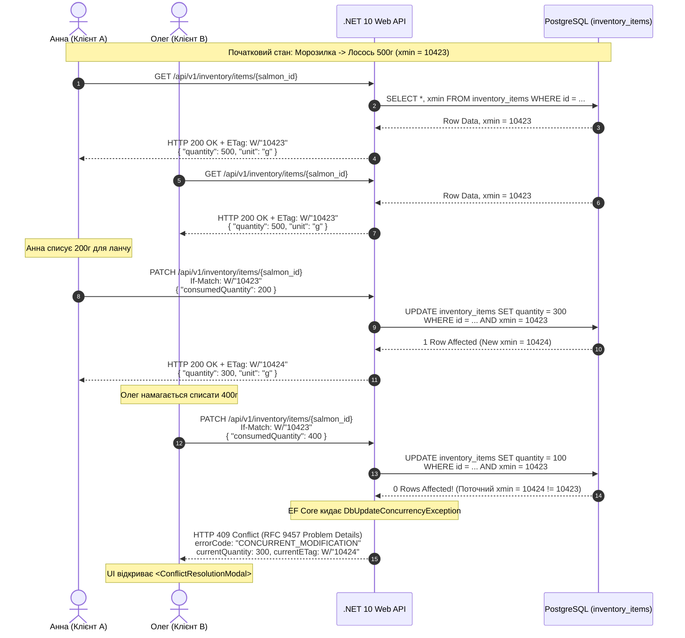

# 07. Модель даних (Data Model)

> **Статус:** Офіційний реліз базової специфікації (Baseline)  
> **Модуль SRS:** Розділ 07  
> **Зв'язок із завданнями:** TASK-01  
> **Стандарти:** PostgreSQL 17 Enterprise Guidelines, Entity Framework Core 10, RFC 9457

---

## 1. Архітектурні принципи моделі даних

Модель даних системи **ēdiens** спроектована з урахуванням високих вимог до строгої консистентності, масштабованості, захисту від колізій конкурентного доступу та низьких затримок читання за принципом **FEFO** (*First Expired, First Out*).

### Ключові принципи та конвенції:
1. **Стратегія первинних ключів (UUIDv7):** Для всіх сутностей використовується тип `uuid` з генерацією за стандартом **UUIDv7**. Завдяки вбудованій мітці часу в старших бітах (Unix Epoch timestamp) UUIDv7 забезпечує монотонне зростання ключів, що запобігає фрагментації B-Tree індексів у PostgreSQL і забезпечує швидкість вставки на рівні цілочисельних ключів `bigserial`, зберігаючи глобальну унікальність у розподіленому середовищі.
2. **Єдиний часовий простір (UTC Timestamps):** Усі поля дати та часу зберігаються виключно в типі `TIMESTAMP WITH TIME ZONE` (`TIMESTAMPTZ`) за шкалою UTC. Локальний час користувача враховується виключно на рівні клієнтського представлення.
3. **Строгий інваріант невід'ємних залишків:** Складські залишки не можуть набувати від'ємних значень за жодних обставин. Інваріант закріплено на рівні ядра СУБД декларативним перевірочним обмеженням: `CHECK (quantity >= 0)`.
4. **Багатоорендна ізоляція (Tenant Scoping):** Таблиці інвентарю, списків покупок та рецептів домогосподарств мають зовнішній ключ `household_id`. Персональні щоденники харчування та добові цілі макронутрієнтів ізольовані за `user_id`.
5. **Оптимістичне блокування (Optimistic Concurrency Control) через `xmin`:** Замість додаткових штучних стовпців версій для детекції колізій паралельної зміни партій використовується вбудований системний стовпець PostgreSQL `xmin`, що напряму транслюється у HTTP-заголовок `ETag`.
6. **Надійна асинхронна доставка (Transactional Outbox):** Усі події домену, що потребують подальшої асинхронної обробки (сповіщення, перерахунок скорингу, інвалідація кешів), зберігаються в таблиці `outbox_messages` у межах тієї ж транзакції, що й бізнес-мутації.
7. **Гарантія одноразового виконання (Idempotency Store):** Операції списання та логування їжі контролюються таблицею `idempotency_records`, що запобігає дублюванню при повторних мережевих викликах клієнта.

---

## 2. ER-діаграма системи (Entity-Relationship Diagram)

Нижче наведено повну схему взаємозв'язків між 13 реляційними сутностями системи у синтаксисі Mermaid `erDiagram`.

```mermaid
erDiagram
    users ||--o{ household_members : "is member of"
    users ||--o{ nutrition_targets : "has daily targets"
    users ||--o{ meal_logs : "logs consumption"
    users ||--o{ shopping_list_items : "adds items"

    households ||--|{ household_members : "contains"
    households ||--o{ inventory_items : "owns stock"
    households ||--o{ recipes : "creates custom"
    households ||--o{ shopping_list_items : "manages list"

    products ||--o{ inventory_items : "stocked as batches"
    products ||--o{ recipe_ingredients : "is component of"
    products ||--o{ meal_log_items : "logged in meal"
    products ||--o{ shopping_list_items : "optional product link"

    recipes ||--|{ recipe_ingredients : "consists of"

    meal_logs ||--|{ meal_log_items : "details"

    users ||--o{ idempotency_records : "issues requests"

    users {
        uuid id PK "UUIDv7"
        varchar email UK "RFC 5322"
        text password_hash "Argon2id"
        timestamptz created_at "UTC"
        timestamptz updated_at "UTC"
    }

    households {
        uuid id PK "UUIDv7"
        varchar name "Household Name"
        varchar invite_code UK "8-char code"
        timestamptz created_at "UTC"
        timestamptz updated_at "UTC"
    }

    household_members {
        uuid household_id PK, FK "Household Reference"
        uuid user_id PK, FK "User Reference"
        varchar role "Owner or Member"
        timestamptz joined_at "UTC"
    }

    products {
        uuid id PK "UUIDv7"
        varchar name "Product Title"
        varchar barcode UK "EAN-13 (Optional)"
        varchar brand "Brand or Manufacturer"
        numeric calories_per_100g "kcal / 100g"
        numeric protein_per_100g "g / 100g"
        numeric fat_per_100g "g / 100g"
        numeric carbs_per_100g "g / 100g"
        timestamptz created_at "UTC"
        timestamptz updated_at "UTC"
    }

    inventory_items {
        uuid id PK "UUIDv7"
        uuid household_id FK "Tenant ID"
        uuid product_id FK "Product ID"
        varchar location "Fridge, Freezer, Pantry"
        numeric quantity "Current Stock (>= 0)"
        varchar unit "g, ml, pcs"
        timestamptz expires_at "FEFO Expiry Date"
        timestamptz opened_at "Date Opened"
        timestamptz created_at "UTC"
        timestamptz updated_at "UTC"
        xid xmin "PostgreSQL RowVersion Concurrency Token"
    }

    nutrition_targets {
        uuid id PK "UUIDv7"
        uuid user_id FK "User Target Owner"
        numeric target_calories "kcal / day"
        numeric target_protein "g / day"
        numeric target_fat "g / day"
        numeric target_carbs "g / day"
        date effective_from "Active from Date"
        timestamptz created_at "UTC"
    }

    meal_logs {
        uuid id PK "UUIDv7"
        uuid user_id FK "User Reference"
        timestamptz logged_at "Consumption Timestamp"
        varchar meal_type "Breakfast, Lunch, Dinner, Snack"
        numeric calories "Total Meal kcal"
        numeric protein "Total Meal Protein"
        numeric fat "Total Meal Fat"
        numeric carbs "Total Meal Carbs"
        uuid idempotency_key UK "Client Request UUID"
        timestamptz created_at "UTC"
    }

    meal_log_items {
        uuid id PK "UUIDv7"
        uuid meal_log_id FK "Meal Log Parent"
        uuid product_id FK "Product Reference"
        numeric quantity "Consumed Amount"
        varchar unit "g, ml, pcs"
        numeric calories "Calculated kcal"
        numeric protein "Calculated Protein"
        numeric fat "Calculated Fat"
        numeric carbs "Calculated Carbs"
    }

    recipes {
        uuid id PK "UUIDv7"
        uuid household_id FK "Nullable: Custom or Global"
        varchar title "Recipe Name"
        text description "Summary"
        text instructions "Step-by-step Guide"
        numeric total_calories "Total kcal"
        numeric total_protein "Total Protein"
        numeric total_fat "Total Fat"
        numeric total_carbs "Total Carbs"
        integer prep_time_minutes "Preparation Time"
        timestamptz created_at "UTC"
        timestamptz updated_at "UTC"
    }

    recipe_ingredients {
        uuid id PK "UUIDv7"
        uuid recipe_id FK "Recipe Reference"
        uuid product_id FK "Required Product"
        numeric quantity "Required Amount"
        varchar unit "g, ml, pcs"
        boolean is_optional "Optional Ingredient Flag"
    }

    shopping_list_items {
        uuid id PK "UUIDv7"
        uuid household_id FK "Household Reference"
        varchar product_name "Item Description"
        numeric quantity "Required Amount"
        varchar unit "g, ml, pcs"
        boolean is_purchased "Purchased Checkbox"
        uuid added_by_user_id FK "Creator Reference"
        uuid product_id FK "Catalog Product Link (Optional)"
        bigint version "Vector Version for Offline Sync"
        timestamptz created_at "UTC"
        timestamptz updated_at "UTC"
    }

    outbox_messages {
        uuid id PK "UUIDv7"
        varchar event_type "Domain Event Name"
        jsonb payload "Event Body"
        varchar status "PENDING, PROCESSED, FAILED"
        integer retry_count "Attempts Count"
        text error_message "Failure Reason"
        timestamptz created_at "UTC"
        timestamptz processed_at "UTC (Nullable)"
    }

    idempotency_records {
        varchar idempotency_key PK "Client UUIDv7"
        uuid user_id FK "User Scope"
        varchar request_path "HTTP Endpoint"
        integer status_code "HTTP Status Code"
        jsonb response_body "Cached HTTP Response Payload"
        timestamptz created_at "UTC"
        timestamptz expires_at "TTL Timestamp"
    }
```



---

## 3. Детальні специфікації таблиць та повний DDL (Data Definition Language)

Нижче наведено повний SQL DDL для створення таблиць, зовнішніх зв'язків, індексів та перевірочних обмежень у PostgreSQL 17+.

```sql
-- Створення розширення для генерації UUID, якщо використовується системний виклик
CREATE EXTENSION IF NOT EXISTS "pgcrypto";

-- ============================================================================
-- 1. ТАБЛИЦЯ: users
-- ============================================================================
CREATE TABLE users (
    id UUID PRIMARY KEY,
    email VARCHAR(255) NOT NULL,
    password_hash TEXT NOT NULL,
    created_at TIMESTAMP WITH TIME ZONE NOT NULL DEFAULT CURRENT_TIMESTAMP,
    updated_at TIMESTAMP WITH TIME ZONE NOT NULL DEFAULT CURRENT_TIMESTAMP,
    CONSTRAINT uq_users_email UNIQUE (email)
);
COMMENT ON TABLE users IS 'Облікові записи користувачів платформи';

-- ============================================================================
-- 2. ТАБЛИЦЯ: households
-- ============================================================================
CREATE TABLE households (
    id UUID PRIMARY KEY,
    name VARCHAR(150) NOT NULL,
    invite_code VARCHAR(16) NOT NULL,
    created_at TIMESTAMP WITH TIME ZONE NOT NULL DEFAULT CURRENT_TIMESTAMP,
    updated_at TIMESTAMP WITH TIME ZONE NOT NULL DEFAULT CURRENT_TIMESTAMP,
    CONSTRAINT uq_households_invite_code UNIQUE (invite_code)
);
COMMENT ON TABLE households IS 'Домогосподарства (одиниця спільного володіння запасами)';

-- ============================================================================
-- 3. ТАБЛИЦЯ: household_members
-- ============================================================================
CREATE TABLE household_members (
    household_id UUID NOT NULL REFERENCES households(id) ON DELETE CASCADE,
    user_id UUID NOT NULL REFERENCES users(id) ON DELETE CASCADE,
    role VARCHAR(20) NOT NULL,
    joined_at TIMESTAMP WITH TIME ZONE NOT NULL DEFAULT CURRENT_TIMESTAMP,
    PRIMARY KEY (household_id, user_id),
    CONSTRAINT ck_household_members_role CHECK (role IN ('Owner', 'Member'))
);
CREATE INDEX idx_household_members_user ON household_members(user_id);
COMMENT ON TABLE household_members IS 'Зв''язок користувачів із домогосподарствами та їх ролі (RBAC)';

-- ============================================================================
-- 4. ТАБЛИЦЯ: products
-- ============================================================================
CREATE TABLE products (
    id UUID PRIMARY KEY,
    name VARCHAR(255) NOT NULL,
    barcode VARCHAR(13) NULL,
    brand VARCHAR(150) NULL,
    calories_per_100g NUMERIC(7, 2) NOT NULL,
    protein_per_100g NUMERIC(6, 2) NOT NULL,
    fat_per_100g NUMERIC(6, 2) NOT NULL,
    carbs_per_100g NUMERIC(6, 2) NOT NULL,
    created_at TIMESTAMP WITH TIME ZONE NOT NULL DEFAULT CURRENT_TIMESTAMP,
    updated_at TIMESTAMP WITH TIME ZONE NOT NULL DEFAULT CURRENT_TIMESTAMP,
    CONSTRAINT ck_products_macros_positive CHECK (
        calories_per_100g >= 0 AND
        protein_per_100g >= 0 AND
        fat_per_100g >= 0 AND
        carbs_per_100g >= 0
    )
);
CREATE UNIQUE INDEX idx_products_barcode ON products(barcode) WHERE barcode IS NOT NULL;
CREATE INDEX idx_products_name_trgm ON products USING gin (to_tsvector('simple', name));
COMMENT ON TABLE products IS 'Глобальний каталог продуктів харчування та їх КБЖВ на 100 г';

-- ============================================================================
-- 5. ТАБЛИЦЯ: inventory_items (Складські партії з токеном xmin)
-- ============================================================================
CREATE TABLE inventory_items (
    id UUID PRIMARY KEY,
    household_id UUID NOT NULL REFERENCES households(id) ON DELETE CASCADE,
    product_id UUID NOT NULL REFERENCES products(id) ON DELETE RESTRICT,
    location VARCHAR(20) NOT NULL,
    quantity NUMERIC(10, 2) NOT NULL,
    unit VARCHAR(10) NOT NULL,
    expires_at TIMESTAMP WITH TIME ZONE NOT NULL,
    opened_at TIMESTAMP WITH TIME ZONE NULL,
    created_at TIMESTAMP WITH TIME ZONE NOT NULL DEFAULT CURRENT_TIMESTAMP,
    updated_at TIMESTAMP WITH TIME ZONE NOT NULL DEFAULT CURRENT_TIMESTAMP,
    CONSTRAINT ck_inventory_location CHECK (location IN ('Fridge', 'Freezer', 'Pantry')),
    CONSTRAINT ck_inventory_unit CHECK (unit IN ('g', 'ml', 'pcs')),
    CONSTRAINT ck_inventory_quantity_non_negative CHECK (quantity >= 0)
);
-- Частковий композитний індекс для блискавичного FEFO-сортування активних залишків
CREATE INDEX idx_inventory_fefo ON inventory_items(household_id, expires_at ASC) WHERE quantity > 0;
CREATE INDEX idx_inventory_product ON inventory_items(product_id);
COMMENT ON TABLE inventory_items IS 'Складські партії продуктів у домогосподарствах з підтримкою FEFO';

-- ============================================================================
-- 6. ТАБЛИЦЯ: nutrition_targets
-- ============================================================================
CREATE TABLE nutrition_targets (
    id UUID PRIMARY KEY,
    user_id UUID NOT NULL REFERENCES users(id) ON DELETE CASCADE,
    target_calories NUMERIC(7, 2) NOT NULL,
    target_protein NUMERIC(6, 2) NOT NULL,
    target_fat NUMERIC(6, 2) NOT NULL,
    target_carbs NUMERIC(6, 2) NOT NULL,
    effective_from DATE NOT NULL,
    created_at TIMESTAMP WITH TIME ZONE NOT NULL DEFAULT CURRENT_TIMESTAMP,
    CONSTRAINT ck_nutrition_targets_positive CHECK (
        target_calories > 0 AND target_protein >= 0 AND target_fat >= 0 AND target_carbs >= 0
    )
);
CREATE INDEX idx_nutrition_targets_user ON nutrition_targets(user_id, effective_from DESC);
COMMENT ON TABLE nutrition_targets IS 'Історія та поточні цільові добові норми КБЖВ користувачів';

-- ============================================================================
-- 7. ТАБЛИЦЯ: meal_logs
-- ============================================================================
CREATE TABLE meal_logs (
    id UUID PRIMARY KEY,
    user_id UUID NOT NULL REFERENCES users(id) ON DELETE CASCADE,
    logged_at TIMESTAMP WITH TIME ZONE NOT NULL DEFAULT CURRENT_TIMESTAMP,
    meal_type VARCHAR(20) NOT NULL,
    calories NUMERIC(7, 2) NOT NULL DEFAULT 0,
    protein NUMERIC(6, 2) NOT NULL DEFAULT 0,
    fat NUMERIC(6, 2) NOT NULL DEFAULT 0,
    carbs NUMERIC(6, 2) NOT NULL DEFAULT 0,
    idempotency_key UUID NULL,
    created_at TIMESTAMP WITH TIME ZONE NOT NULL DEFAULT CURRENT_TIMESTAMP,
    CONSTRAINT ck_meal_logs_type CHECK (meal_type IN ('Breakfast', 'Lunch', 'Dinner', 'Snack')),
    CONSTRAINT uq_meal_logs_idempotency UNIQUE (idempotency_key)
);
CREATE INDEX idx_meal_logs_user_date ON meal_logs(user_id, logged_at DESC);
COMMENT ON TABLE meal_logs IS 'Щоденник фактичних прийомів їжі користувача';

-- ============================================================================
-- 8. ТАБЛИЦЯ: meal_log_items
-- ============================================================================
CREATE TABLE meal_log_items (
    id UUID PRIMARY KEY,
    meal_log_id UUID NOT NULL REFERENCES meal_logs(id) ON DELETE CASCADE,
    product_id UUID NOT NULL REFERENCES products(id) ON DELETE RESTRICT,
    quantity NUMERIC(10, 2) NOT NULL,
    unit VARCHAR(10) NOT NULL,
    calories NUMERIC(7, 2) NOT NULL,
    protein NUMERIC(6, 2) NOT NULL,
    fat NUMERIC(6, 2) NOT NULL,
    carbs NUMERIC(6, 2) NOT NULL,
    CONSTRAINT ck_meal_log_items_unit CHECK (unit IN ('g', 'ml', 'pcs')),
    CONSTRAINT ck_meal_log_items_quantity CHECK (quantity > 0)
);
CREATE INDEX idx_meal_log_items_parent ON meal_log_items(meal_log_id);
COMMENT ON TABLE meal_log_items IS 'Деталізація інгредієнтів/продуктів у конкретному прийомі їжі';

-- ============================================================================
-- 9. ТАБЛИЦЯ: recipes
-- ============================================================================
CREATE TABLE recipes (
    id UUID PRIMARY KEY,
    household_id UUID NULL REFERENCES households(id) ON DELETE CASCADE,
    title VARCHAR(255) NOT NULL,
    description TEXT NOT NULL,
    instructions TEXT NOT NULL,
    total_calories NUMERIC(7, 2) NOT NULL,
    total_protein NUMERIC(6, 2) NOT NULL,
    total_fat NUMERIC(6, 2) NOT NULL,
    total_carbs NUMERIC(6, 2) NOT NULL,
    prep_time_minutes INTEGER NOT NULL DEFAULT 15,
    created_at TIMESTAMP WITH TIME ZONE NOT NULL DEFAULT CURRENT_TIMESTAMP,
    updated_at TIMESTAMP WITH TIME ZONE NOT NULL DEFAULT CURRENT_TIMESTAMP,
    CONSTRAINT ck_recipes_prep_time CHECK (prep_time_minutes >= 0)
);
CREATE INDEX idx_recipes_household ON recipes(household_id);
COMMENT ON TABLE recipes IS 'Каталог кулінарних рецептів (глобальних або створених домогосподарством)';

-- ============================================================================
-- 10. ТАБЛИЦЯ: recipe_ingredients
-- ============================================================================
CREATE TABLE recipe_ingredients (
    id UUID PRIMARY KEY,
    recipe_id UUID NOT NULL REFERENCES recipes(id) ON DELETE CASCADE,
    product_id UUID NOT NULL REFERENCES products(id) ON DELETE RESTRICT,
    quantity NUMERIC(10, 2) NOT NULL,
    unit VARCHAR(10) NOT NULL,
    is_optional BOOLEAN NOT NULL DEFAULT FALSE,
    CONSTRAINT ck_recipe_ingredients_quantity CHECK (quantity > 0),
    CONSTRAINT ck_recipe_ingredients_unit CHECK (unit IN ('g', 'ml', 'pcs'))
);
CREATE INDEX idx_recipe_ingredients_recipe ON recipe_ingredients(recipe_id);
CREATE INDEX idx_recipe_ingredients_product ON recipe_ingredients(product_id);
COMMENT ON TABLE recipe_ingredients IS 'Компонентний склад рецептів із зазначенням необхідної ваги';

-- ============================================================================
-- 11. ТАБЛИЦЯ: shopping_list_items
-- ============================================================================
CREATE TABLE shopping_list_items (
    id UUID PRIMARY KEY,
    household_id UUID NOT NULL REFERENCES households(id) ON DELETE CASCADE,
    product_name VARCHAR(255) NOT NULL,
    quantity NUMERIC(10, 2) NOT NULL,
    unit VARCHAR(10) NOT NULL,
    is_purchased BOOLEAN NOT NULL DEFAULT FALSE,
    added_by_user_id UUID NULL REFERENCES users(id) ON DELETE SET NULL,
    product_id UUID NULL REFERENCES products(id) ON DELETE SET NULL,
    version BIGINT NOT NULL DEFAULT 1,
    created_at TIMESTAMP WITH TIME ZONE NOT NULL DEFAULT CURRENT_TIMESTAMP,
    updated_at TIMESTAMP WITH TIME ZONE NOT NULL DEFAULT CURRENT_TIMESTAMP,
    CONSTRAINT ck_shopping_list_quantity CHECK (quantity > 0)
);
CREATE INDEX idx_shopping_list_household ON shopping_list_items(household_id, is_purchased);
COMMENT ON TABLE shopping_list_items IS 'Спільний список покупок домогосподарства з підтримкою векторних версій для офлайн-злиття';

-- ============================================================================
-- 12. ТАБЛИЦЯ: outbox_messages (Transactional Outbox Pattern)
-- ============================================================================
CREATE TABLE outbox_messages (
    id UUID PRIMARY KEY,
    event_type VARCHAR(100) NOT NULL,
    payload JSONB NOT NULL,
    status VARCHAR(20) NOT NULL DEFAULT 'PENDING',
    retry_count INTEGER NOT NULL DEFAULT 0,
    error_message TEXT NULL,
    created_at TIMESTAMP WITH TIME ZONE NOT NULL DEFAULT CURRENT_TIMESTAMP,
    processed_at TIMESTAMP WITH TIME ZONE NULL,
    CONSTRAINT ck_outbox_status CHECK (status IN ('PENDING', 'PROCESSED', 'FAILED'))
);
-- Частковий індекс для надшвидкого вичитування черги нерозібраних подій
CREATE INDEX idx_outbox_pending ON outbox_messages(created_at ASC) WHERE status = 'PENDING';
COMMENT ON TABLE outbox_messages IS 'Таблиця патерну Transactional Outbox для асинхронної обробки подій';

-- ============================================================================
-- 13. ТАБЛИЦЯ: idempotency_records (Idempotency Key Store)
-- ============================================================================
CREATE TABLE idempotency_records (
    idempotency_key VARCHAR(64) PRIMARY KEY,
    user_id UUID NOT NULL REFERENCES users(id) ON DELETE CASCADE,
    request_path VARCHAR(255) NOT NULL,
    status_code INTEGER NOT NULL,
    response_body JSONB NOT NULL,
    created_at TIMESTAMP WITH TIME ZONE NOT NULL DEFAULT CURRENT_TIMESTAMP,
    expires_at TIMESTAMP WITH TIME ZONE NOT NULL
);
CREATE INDEX idx_idempotency_expiry ON idempotency_records(expires_at);
COMMENT ON TABLE idempotency_records IS 'Реєстр виконаних ідемпотентних мутацій для захисту від мережевих повторів';
```

---

## 4. Глибокий аналіз механізму конкурентності PostgreSQL `xmin`

### 4.1 Внутрішній устрій `xmin` у PostgreSQL
У системі управління базами даних PostgreSQL кожен рядок таблиці (кортеж або *tuple*) зберігає на диску приховані системні заголовки. Одним із найважливіших серед них є стовпець **`xmin`** (`xid` — 32-бітний цілочисельний ідентифікатор транзакції).

Коли транзакція створює новий рядок або оновлює існуючий рядок (`UPDATE`), PostgreSQL у рамках механізму MVCC (*Multi-Version Concurrency Control*):
1. Не змінює старі байти на місці, а створює нову фізичну версію рядка.
2. Записує у поле `xmin` нової версії ідентифікатор поточної транзакції (`TransactionXmin`).
3. Позначає поле `xmax` старого рядка ідентифікатором цієї транзакції як завершене.

Таким чином, **значення `xmin` гарантовано змінюється щоразу, коли рядок піддається будь-якій модифікації**. Це робить `xmin` ідеальним, нульово-затратним (*zero-overhead*) токеном версії рядка, оскільки:
- Не потрібно додавати окремий стовпець `version INT` або `concurrency_token UUID`.
- Не потрібно створювати ручні тригери чи піклуватися про збільшення лічильника в коді програми.

### 4.2 Маппінг `xmin` в Entity Framework Core 10
В ORM Entity Framework Core 10 для PostgreSQL (`Npgsql.EntityFrameworkCore.PostgreSQL`) системний стовпець `xmin` підтримується нативно на рівні конфігурації моделі за допомогою методу `.UseXminAsConcurrencyToken()` або `.IsRowVersion()`:

```csharp
public class InventoryItemConfiguration : IEntityTypeConfiguration<InventoryItem>
{
    public void Configure(EntityTypeBuilder<InventoryItem> builder)
    {
        builder.ToTable("inventory_items");

        builder.HasKey(e => e.Id);

        builder.Property(e => e.Quantity)
            .HasPrecision(10, 2)
            .IsRequired();

        // Маппінг системного поля xmin як токена паралелізму
        builder.UseXminAsConcurrencyToken();
    }
}
```

При такому налаштуванні EF Core під час виконання команди `SaveChangesAsync()` автоматично додає значення `xmin` у клаузулу `WHERE` згенерованого SQL-запиту:

```sql
UPDATE inventory_items 
SET quantity = @p0, updated_at = @p1
WHERE id = @p2 AND xmin = @p3;
```

### 4.3 Наскрізний потік ETag $\rightarrow$ If-Match $\rightarrow$ HTTP 409 Conflict



1. **Генерація ETag:** При запиті `GET /api/v1/inventory/items/{id}` бекенд формує заголовок відповіді:
   ```http
   ETag: W/"10423"
   ```
2. **Умовний запит:** Коли клієнт оновлює кількість партії або списує товар, він обов'язково повертає збережений токен:
   ```http
   PATCH /api/v1/inventory/items/0192e2b3-5730-7432-8411-cf0b91d23456
   If-Match: W/"10423"
   ```
3. **Обробка колізії:** Якщо інший член сім'ї встиг оновити цей рядок раніше, `xmin` змінився (наприклад, став `10424`). Запит `UPDATE` зачіпає $0$ рядків. EF Core генерує виняток `DbUpdateConcurrencyException`, який глобальний перехоплювач `ProblemDetailsExceptionHandler` транслює у відповідь:
   ```json
   {
     "type": "https://ediens.app/errors/concurrent-modification",
     "title": "Conflict during state modification",
     "status": 409,
     "detail": "Партія продукту була модифікована іншим членом домогосподарства.",
     "instance": "/api/v1/inventory/items/0192e2b3-5730-7432-8411-cf0b91d23456",
     "errorCode": "CONCURRENT_MODIFICATION",
     "extensions": {
       "currentETag": "W/\"10424\"",
       "currentQuantity": 300,
       "unit": "g"
     }
   }
   ```
4. **Клієнтська реакція:** Фронтенд не ламається і не втрачає дані, а відкриває модальне вікно вирішення колізії `<ConflictResolutionModal>`, де показує фактичний залишок ($300\text{ г}$) і пропонує користувачеві підтвердити списання з нового залишку або скасувати операцію.

---

## 5. Специфікація Transactional Outbox (`outbox_messages`)

Для підтримки принципу кінцевої узгодженості (*Eventual Consistency*) та уникнення патерну розподілених двохфазних транзакцій (2PC) у системі реалізовано патерн **Transactional Outbox**.

### 5.1 Алгоритм транзакційного збереження
Коли відбувається бізнес-подія (наприклад, додано партію товару, виконано 1-Click Cook або видалено прострочений продукт):
1. Відкривається транзакція PostgreSQL: `BEGIN TRANSACTION;`.
2. Виконуються мутації в таблицях `inventory_items` або `meal_logs`.
3. У **тій же транзакції** виконується `INSERT INTO outbox_messages` з типом події та JSONB-корисним навантаженням:
   ```sql
   INSERT INTO outbox_messages (id, event_type, payload, status, created_at)
   VALUES (
       '0192e2b3-9999-7000-8000-abcdef012345',
       'InventoryBatchCreated',
       '{"householdId": "...", "productId": "...", "quantity": 500, "expiresAt": "2026-11-03T00:00:00Z"}'::jsonb,
       'PENDING',
       CURRENT_TIMESTAMP
   );
   ```
4. Фіксація транзакції: `COMMIT;`. Подія гарантовано зберігається в базі тоді й лише тоді, коли збереглися самі дані.

### 5.2 Фоновий споживач: `FOR UPDATE SKIP LOCKED`
Фоновий системний процес (Background Outbox Worker) запускається за розкладом кожні 500 мс або реагує на внутрішній тригер і вичитує чергу повідомлень:

```sql
SELECT id, event_type, payload, retry_count
FROM outbox_messages
WHERE status = 'PENDING'
ORDER BY created_at ASC
LIMIT 20
FOR UPDATE SKIP LOCKED;
```

#### Чому `SKIP LOCKED`?
- **Горизонтальне масштабування:** Якщо розгорнуто 5 інстансів контейнера воркера, кожен із них одночасно блокує свій незалежний пакет із 20 рядків. Жоден інстанс не блокує інший і не очікує звільнення блокування.
- **Гарантія At-Least-Once Delivery:** Якщо воркер упаде посеред обробки пачки, транзакція відкочується автоматично, блокування звільняється, і сусідній воркер негайно підхоплює повідомлення.
- Після успішної відправки статус оновлюється на `PROCESSED`, а поле `processed_at` отримує поточну позначку часу. При виникненні помилки лічильник `retry_count` збільшується. Якщо `retry_count >= 5`, статус переходить у `FAILED` (Dead Letter).

---

## 6. Специфікація сховища ідемпотентності (`idempotency_records`)

Для операцій, де мережеві збої можуть призвести до подвійного списання запасів або дублювання запису в щоденнику харчування (`POST /api/v1/meals/log`, `POST /api/v1/recipes/{id}/cook`), система використовує комбінований дворівневий механізм ідемпотентності.

### 6.1 Життєвий цикл запиту з Idempotency-Key
1. **Перевірка наявності:** Клієнт генерує заголовок `Idempotency-Key: <UUIDv7>`. При отриманні запиту middleware перевіряє таблицю `idempotency_records` за первинним ключем.
2. **Запит вже оброблено:** Якщо знайдено запис зі збереженим `status_code` та `response_body`, сервер негайно повертає закешовану відповідь клієнту без виконання бізнес-логіки.
3. **Запит у процесі виконання (In-Flight):** У Redis накладається короткоживучий лок (`SET lock:idempotency:{key} {token} NX PX 10000`). Якщо інший запит із тим самим ключем надходить у той самий момент, він отримує HTTP `409 Conflict` або чекає на звільнення локу.
4. **Збереження результату:** Після успішної транзакції відповідь зберігається в `idempotency_records` із терміном придатності запису (TTL) 24 години (`expires_at = CURRENT_TIMESTAMP + INTERVAL '24 hours'`).
5. **Фонове очищення:** Застарілі записи видаляються щоночі фоновою задачею:
   ```sql
   DELETE FROM idempotency_records WHERE expires_at < CURRENT_TIMESTAMP;
   ```

---

## 7. Стратегія індексації та оптимізації запитів

Для гарантування часу відгуку API $p95 < 150\text{ ms}$ (NFR-01) спроектовано такі спеціалізовані індекси:

| Назва індексу | Таблиця | Стовпці / Умова | Призначення та бізнес-ефект |
| :--- | :--- | :--- | :--- |
| `idx_inventory_fefo` | `inventory_items` | `(household_id, expires_at ASC) WHERE quantity > 0` | **Головний FEFO-індекс:** Забезпечує миттєву вибірку та сортування партій без сканування всієї таблиці та без урахування списаних залишків (`quantity = 0`). |
| `idx_outbox_pending` | `outbox_messages` | `(created_at ASC) WHERE status = 'PENDING'` | **Outbox Queue Індекс:** Забезпечує надшвидке виконання вибірки `SKIP LOCKED` для фонового демона. |
| `idx_products_barcode`| `products` | `(barcode) WHERE barcode IS NOT NULL` | **EAN-13 Індекс:** Унікальний пошук за штрих-кодом з ігноруванням вагових товарів без штрих-коду. |
| `idx_meal_logs_user_date`| `meal_logs` | `(user_id, logged_at DESC)` | **Індекс дашборду макросів:** Дозволяє вибирати прийоми їжі за поточну добу для розрахунку залишку бюджету за $O(\log N)$. |
| `idx_shopping_list_household`| `shopping_list_items` | `(household_id, is_purchased)` | **Індекс списку покупок:** Прискорює фільтрацію некуплених позицій для мобільного клієнта. |
