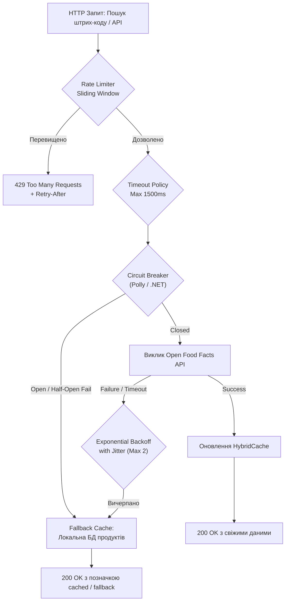

# 08. Модель стійкості (Resiliency Model)

> **Статус:** Затверджено  
> **Версія:** 1.0.0  
> **Авторство:** ēdiens Reliability Engineering Group (TASK-02)

---

## 8.1 Огляд та цілі моделі надійності

Модель стійкості системи **ēdiens** регламентує забезпечення безперервного функціонування сервісів харчування в умовах локальних збоїв інфраструктури, нестабільності мережі та деградації зовнішніх залежностей. Ключова мета — гарантувати виконання **NFR-03 (Resiliency & Circuit Breaker)** та забезпечення високої доступності ($99.9\%$ SLA).



---

## 8.2 Нефункціональна вимога NFR-03: Resiliency & Fault Tolerance

- **NFR-03.1 (Стійкість до збоїв зовнішніх API):** Жоден збій або зависання зовнішнього провайдера (Open Food Facts API, провайдери Push-повідомлень) не повинен призводити до каскадної відмови бекенду або блокування потоків виконання.
- **NFR-03.2 (Час спрацювання аварійного перемикання):** При повній недоступності або затримці зовнішнього API час повернення запасної (fallback) відповіді клієнту не повинен перевищувати **$500\text{ ms}$**.
- **NFR-03.3 (Автономність ядра):** Основні функції — облік запасів у холодильнику (Inventory CRUD), списання продуктів за FEFO та ручне логування КБЖВ — мають залишатися працездатними навіть за умови повної відсутності доступу до зовнішнього інтернету.

---

## 8.3 Патерн Circuit Breaker та конвеєри стійкості (Polly / Microsoft.Extensions.Resilience)

Інтеграція з зовнішнім Open Food Facts API налаштовується в .NET 10 за допомогою стандартизованих конвеєрів стійкості `ResiliencePipeline`:

```csharp
services.AddHttpClient<IOpenFoodFactsClient, OpenFoodFactsClient>(client =>
{
    client.BaseAddress = new Uri("https://world.openfoodfacts.org/api/v2/");
    client.Timeout = TimeSpan.FromSeconds(2);
})
.AddResilienceHandler("external-barcode-pipeline", builder =>
{
    // 1. Bulkhead: Обмеження одночасних викликів
    builder.AddConcurrencyLimiter(new ConcurrencyLimiterOptions
    {
        PermitLimit = 20,
        QueueLimit = 10
    });

    // 2. Таймаут окремої спроби
    builder.AddTimeout(TimeSpan.FromMilliseconds(1500));

    // 3. Retry з експоненційним бекофом та джитером
    builder.AddRetry(new HttpRetryStrategyOptions
    {
        MaxRetryAttempts = 2,
        Delay = TimeSpan.FromMilliseconds(200),
        BackoffType = DelayBackoffType.Exponential,
        UseJitter = true
    });

    // 4. Circuit Breaker
    builder.AddCircuitBreaker(new HttpCircuitBreakerStrategyOptions
    {
        FailureRatio = 0.5, // 50% помилок
        SamplingDuration = TimeSpan.FromSeconds(30),
        MinimumThroughput = 10,
        BreakDuration = TimeSpan.FromSeconds(30)
    });

    // 5. Загальний таймаут конвеєра
    builder.AddTimeout(TimeSpan.FromMilliseconds(2500));
});
```

### Стани автомата Circuit Breaker:
1. **Closed (Звичайний режим):** Всі запити вільно проходять до зовнішнього сервісу. Збирається статистика успішних та помилкових викликів.
2. **Open (Розірваний контур):** Якщо за 30-секундний інтервал частка помилок досягла $\ge 50\%$, автоматичний вимикач розмикає коло. Всі подальші запити протягом 30 секунд негайно перенаправляються на локальний кеш (Fallback) без реальних спроб виходу в мережу.
3. **Half-Open (Пробний режим):** Після 30 секунд вимикач пропускає 1 тестовий запит. У разі успіху контур переходить у `Closed`; у разі помилки — повертається в `Open` ще на 30 секунд.

---

## 8.4 Стратегія Graceful Degradation (Плавна деградація функцій)

Якщо один із допоміжних компонентів системи стає недоступним, ēdiens переходить у режим контрольованої плавної деградації:

| Компонент, що дав збій | Наслідок для системи | Аварійна стратегія деградації (Graceful Fallback) |
| :--- | :--- | :--- |
| **Open Food Facts API** | Неможливо отримати метадані невідомого штрих-коду | Пошук у локальній таблиці `products`. Якщо не знайдено — клієнту повертається форма для ручного введення назви та КБЖВ, яка зберігається в локальну базу домогосподарства. |
| **Redis Server** | Недоступний L2 кеш та розподілені блокування | Автоматичний fallback на L1 пам'ять процесу (In-Memory MemoryCache) та перехід операції `1-Click Cook` на песимістичне блокування рядків у PostgreSQL (`SELECT ... FOR UPDATE`). |
| **ML/Scoring Recipe Worker** | Не оновлюються динамічні скоринг-індекси рекомендацій | API переходить на швидкий детермінований алгоритм: вибірка рецептів за базовим SQL-запитом перетину наявних інгредієнтів із сортуванням за найближчим `expires_at`. |
| **Push Notification Gateway** | Повідомлення про закінчення терміну не надходять на смартфон | Повідомлення дублюються у внутрішню таблицю `in_app_notifications`, і користувач бачить бейджі свіжості в інтерфейсі веб-додатку. |

---

## 8.5 Перевірка життєздатності та готовності (Health Checks)

Система реалізує стандартні кінцеві точки зондування інфраструктури згідно з RFC Health Check Response Format:

### 1. Liveness Probe (`GET /healthz/live`)
- **Призначення:** Зондування факту того, що процес .NET живий і веб-сервер Kestrel приймає TCP-з'єднання.
- **Дія при збої:** Docker/Kubernetes перезавантажує контейнер.

### 2. Readiness Probe (`GET /healthz/ready`)
- **Призначення:** Перевірка здатності обробляти бізнес-трафік. Виконує активні перевірки:
  - З'єднання з PostgreSQL (`SELECT 1;`) та перевірка відсутності незастосованих міграцій EF Core.
  - Пінг до Redis (`PING -> PONG`).
  - Доступність дискового простору для тимчасових файлів ($> 500\text{ MB}$).
- **Формат відповіді при успіху (`200 OK`):**
  ```json
  {
    "status": "Healthy",
    "totalDuration": "00:00:00.0125431",
    "entries": {
      "postgresql": { "status": "Healthy", "duration": "00:00:00.005" },
      "redis": { "status": "Healthy", "duration": "00:00:00.002" }
    }
  }
  ```
- **Формат відповіді при деградації (`503 Service Unavailable`):**
  Якщо PostgreSQL недоступний, балансувальник трафіку виключає цей інстанс з маршрутизації до повного відновлення.
