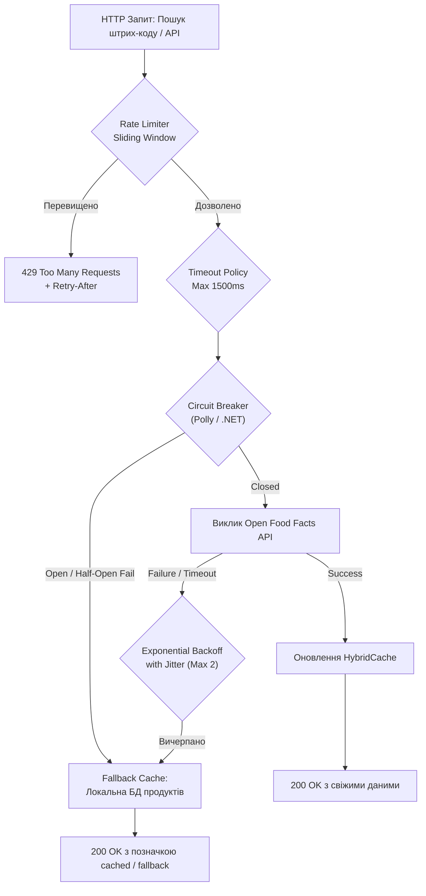
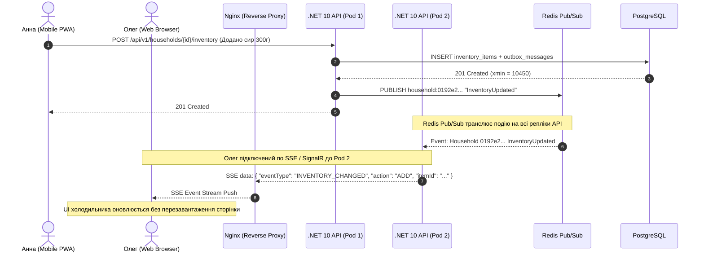
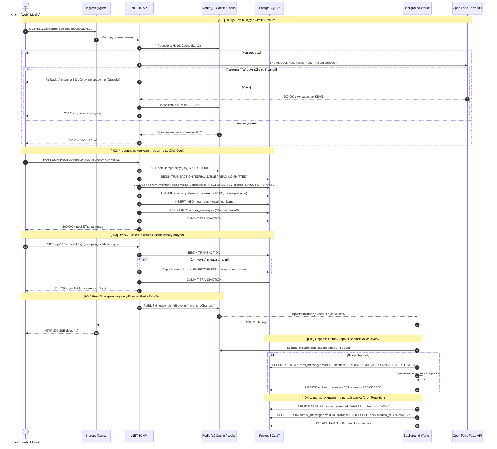

# 08. Модель стійкості (Resiliency Model)

> **Статус:** Затверджено  
> **Версія:** 1.0.0  
> **Авторство:** ēdiens Reliability Engineering Group (TASK-02)

---

## 8.1 Огляд та цілі моделі надійності

Модель стійкості системи **ēdiens** регламентує забезпечення безперервного функціонування сервісів харчування в умовах локальних збоїв інфраструктури, нестабільності мережі та деградації зовнішніх залежностей. Ключова мета — гарантувати виконання **NFR-03 (Resiliency & Circuit Breaker)** та забезпечення високої доступності ($99.9\%$ SLA).



---

## 8.2 Нефункціональна вимога NFR-03: Resiliency & Fault Tolerance

- **NFR-03.1 (Стійкість до збоїв зовнішніх API):** Жоден збій або зависання зовнішнього провайдера (Open Food Facts API, провайдери Push-повідомлень) не повинен призводити до каскадної відмови бекенду або блокування потоків виконання.
- **NFR-03.2 (Час спрацювання аварійного перемикання):** При повній недоступності або затримці зовнішнього API час повернення запасної (fallback) відповіді клієнту не повинен перевищувати **$500\text{ ms}$**.
- **NFR-03.3 (Автономність ядра):** Основні функції — облік запасів у холодильнику (Inventory CRUD), списання продуктів за FEFO та ручне логування КБЖВ — мають залишатися працездатними навіть за умови повної відсутності доступу до зовнішнього інтернету.

---

## 8.3 Патерн Circuit Breaker та конвеєри стійкості (Polly / Microsoft.Extensions.Resilience)

Інтеграція з зовнішнім Open Food Facts API налаштовується в .NET 10 за допомогою стандартизованих конвеєрів стійкості `ResiliencePipeline`:

```csharp
services.AddHttpClient<IOpenFoodFactsClient, OpenFoodFactsClient>(client =>
{
    client.BaseAddress = new Uri("https://world.openfoodfacts.org/api/v2/");
    client.Timeout = TimeSpan.FromSeconds(2);
})
.AddResilienceHandler("external-barcode-pipeline", builder =>
{
    // 1. Bulkhead: Обмеження одночасних викликів
    builder.AddConcurrencyLimiter(new ConcurrencyLimiterOptions
    {
        PermitLimit = 20,
        QueueLimit = 10
    });

    // 2. Таймаут окремої спроби
    builder.AddTimeout(TimeSpan.FromMilliseconds(1500));

    // 3. Retry з експоненційним бекофом та джитером
    builder.AddRetry(new HttpRetryStrategyOptions
    {
        MaxRetryAttempts = 2,
        Delay = TimeSpan.FromMilliseconds(200),
        BackoffType = DelayBackoffType.Exponential,
        UseJitter = true
    });

    // 4. Circuit Breaker
    builder.AddCircuitBreaker(new HttpCircuitBreakerStrategyOptions
    {
        FailureRatio = 0.5, // 50% помилок
        SamplingDuration = TimeSpan.FromSeconds(30),
        MinimumThroughput = 10,
        BreakDuration = TimeSpan.FromSeconds(30)
    });

    // 5. Загальний таймаут конвеєра
    builder.AddTimeout(TimeSpan.FromMilliseconds(2500));
});
```

### Стани автомата Circuit Breaker:
1. **Closed (Звичайний режим):** Всі запити вільно проходять до зовнішнього сервісу. Збирається статистика успішних та помилкових викликів.
2. **Open (Розірваний контур):** Якщо за 30-секундний інтервал частка помилок досягла $\ge 50\%$, автоматичний вимикач розмикає коло. Всі подальші запити протягом 30 секунд негайно перенаправляються на локальний кеш (Fallback) без реальних спроб виходу в мережу.
3. **Half-Open (Пробний режим):** Після 30 секунд вимикач пропускає 1 тестовий запит. У разі успіху контур переходить у `Closed`; у разі помилки — повертається в `Open` ще на 30 секунд.

---

## 8.4 Стратегія Graceful Degradation (Плавна деградація функцій)

Якщо один із допоміжних компонентів системи стає недоступним, ēdiens переходить у режим контрольованої плавної деградації:

| Компонент, що дав збій | Наслідок для системи | Аварійна стратегія деградації (Graceful Fallback) |
| :--- | :--- | :--- |
| **Open Food Facts API** | Неможливо отримати метадані невідомого штрих-коду | Пошук у локальній таблиці `products`. Якщо не знайдено — клієнту повертається форма для ручного введення назви та КБЖВ, яка зберігається в локальну базу домогосподарства. |
| **Redis Server** | Недоступний L2 кеш та розподілені блокування | Автоматичний fallback на L1 пам'ять процесу (In-Memory MemoryCache) та перехід операції `1-Click Cook` на песимістичне блокування рядків у PostgreSQL (`SELECT ... FOR UPDATE`). |
| **ML/Scoring Recipe Worker** | Не оновлюються динамічні скоринг-індекси рекомендацій | API переходить на швидкий детермінований алгоритм: вибірка рецептів за базовим SQL-запитом перетину наявних інгредієнтів із сортуванням за найближчим `expires_at`. |
| **Push Notification Gateway** | Повідомлення про закінчення терміну не надходять на смартфон | Повідомлення дублюються у внутрішню таблицю `in_app_notifications`, і користувач бачить бейджі свіжості в інтерфейсі веб-додатку. |

---

## 8.5 Перевірка життєздатності та готовності (Health Checks)

Система реалізує стандартні кінцеві точки зондування інфраструктури згідно з RFC Health Check Response Format:

### 1. Liveness Probe (`GET /healthz/live`)
- **Призначення:** Зондування факту того, що процес .NET живий і веб-сервер Kestrel приймає TCP-з'єднання.
- **Дія при збої:** Docker/Kubernetes перезавантажує контейнер.

### 2. Readiness Probe (`GET /healthz/ready`)
- **Призначення:** Перевірка здатності обробляти бізнес-трафік. Виконує активні перевірки:
  - З'єднання з PostgreSQL (`SELECT 1;`) та перевірка відсутності незастосованих міграцій EF Core.
  - Пінг до Redis (`PING -> PONG`).
  - Доступність дискового простору для тимчасових файлів ($> 500\text{ MB}$).
- **Формат відповіді при успіху (`200 OK`):**
  ```json
  {
    "status": "Healthy",
    "totalDuration": "00:00:00.0125431",
    "entries": {
      "postgresql": { "status": "Healthy", "duration": "00:00:00.005" },
      "redis": { "status": "Healthy", "duration": "00:00:00.002" }
    }
  }
  ```
- **Формат відповіді при деградації (`503 Service Unavailable`):**
  Якщо PostgreSQL недоступний, балансувальник трафіку виключає цей інстанс з маршрутизації до повного відновлення.


---

## 8.6 Архітектура консенсусу та вибору лідера (Consensus & Leader Election)

У системі **ēdiens** функціонують критичні фонові сервіси, які мають гарантовано виконуватися в режимі **Singleton (Active-Passive)** для запобігання колізіям та подвійній обробці:
- Демон обробки черги подій **Transactional Outbox Worker**.
- Щоденний планувальник перевірки термінів придатності продуктів та генерації **FEFO Push-сповіщень**.
- Демон ротації та очищення застарілих даних (**Data Retention Purge Job**).
- Асинхронний індексатор персоналізованого скорингу рецептів.

```mermaid
flowchart TD
    subgraph Instances ["Кластер інстансів Worker"]
        W1["Worker Pod 1"]
        W2["Worker Pod 2"]
        W3["Worker Pod 3"]
    end

    subgraph RedisCluster ["Redis Infrastructure"]
        Redis["Redis (Master / Sentinel)<br/>Key: 'lock:leader:outbox_worker'<br/>TTL: 10,000ms + Fencing Token"]
    end

    W1 -->|1. SET NX PX 10000 + Fencing Token| Redis
    W2 -.->|2. Конкурентна спроба: Key Exists (Lock Denied)| Redis
    W3 -.->|3. Конкурентна спроба: Key Exists (Lock Denied)| Redis

    Redis -->|Успіх: Отримано Lock + Token #1042| W1
    W1 -->|Heartbeat: Auto-Renew Lease кожні 3000ms| Redis
    W1 -->|Виконує обробку черги Outbox| PG[(PostgreSQL)]

    W1 -.->|Crash або GC Pause > 10s| LeaseExpiry["Lease Expired in Redis"]
    LeaseExpiry -->|W2 перемагає у новому раунді виборів| W2
    W2 -->|Отримано новий Fencing Token #1043| Redis
```

### 8.6.1 Обґрунтування вибору Redlock з Fencing Tokens проти Raft
Система використовує алгоритм розподіленого лізингу на основі **Redis Redlock з монотонними Fencing Tokens**:
1. **Легковажність інфраструктури:** Замість розгортання окремого важкого Raft-консенсус кластера (ZooKeeper, Consul, etcd), використовується вже наявний у стеку високопродуктивний Redis (встановлений для L2-кешу та Rate Limiting).
2. **Запобігання проблемі Split-Brain та тривалих GC-пауз:** За класичною критикою Мартіна Клеппмана (Martin Kleppmann), клієнт, що отримав розподілений лок, може зависнути під час Stop-The-World збірки сміття або мережевої паузи, після чого його лізинг закінчиться, інший вузол стане лідером, а перший вузол після пробудження запише некоректні дані. Для усунення цієї вразливості впроваджено **Fencing Tokens**:
   - Щоразу при успішному захопленні лідерського замка Redis атомарно інкрементує лічильник `INCR leader:fencing_token`.
   - Будь-яка транзакція лідера в PostgreSQL супроводжується передачею токена в службову таблицю `cluster_locks`.
   - Якщо транзакція надходить із застарілим токеном ($token \le last\_seen\_token$), PostgreSQL генерує помилку `409 FencingTokenStaleException` і транзакція миттєво відкочується.

### 8.6.2 C# Реалізація вибору лідера в .NET 10 BackgroundService
```csharp
public class LeaderElectedWorkerService : BackgroundService
{
    private readonly IConnectionMultiplexer _redis;
    private readonly ILogger<LeaderElectedWorkerService> _logger;
    private const string LockKey = "lock:leader:outbox_worker";
    private readonly TimeSpan _lockTtl = TimeSpan.FromSeconds(10);
    private readonly TimeSpan _renewInterval = TimeSpan.FromSeconds(3);

    public LeaderElectedWorkerService(IConnectionMultiplexer redis, ILogger<LeaderElectedWorkerService> logger)
    {
        _redis = redis;
        _logger = logger;
    }

    protected override async Task ExecuteAsync(CancellationToken stoppingToken)
    {
        var db = _redis.GetDatabase();
        var instanceId = Guid.NewGuid().ToString("N");

        while (!stoppingToken.IsCancellationRequested)
        {
            // 1. Спроба атомарного захоплення лідерського замка
            bool isLeader = await db.LockTakeAsync(LockKey, instanceId, _lockTtl);

            if (isLeader)
            {
                long fencingToken = await db.StringIncrementAsync("leader:fencing_token");
                _logger.LogInformation("Інстанс {InstanceId} обрано лідером. Fencing Token: {Token}", instanceId, fencingToken);

                try
                {
                    // 2. Виконання роботи лідера з періодичним подовженням лізингу
                    using var renewCts = CancellationTokenSource.CreateLinkedTokenSource(stoppingToken);
                    var renewTask = PeriodicRenewLockAsync(db, instanceId, renewCts.Token);
                    
                    await ProcessOutboxBatchAsync(fencingToken, stoppingToken);
                    
                    await renewCts.CancelAsync();
                }
                finally
                {
                    await db.LockReleaseAsync(LockKey, instanceId);
                }
            }
            else
            {
                // Очікування наступного раунду виборів
                await Task.Delay(TimeSpan.FromSeconds(2), stoppingToken);
            }
        }
    }

    private async Task PeriodicRenewLockAsync(IDatabase db, string instanceId, CancellationToken token)
    {
        while (!token.IsCancellationRequested)
        {
            await Task.Delay(_renewInterval, token);
            await db.LockExtendAsync(LockKey, instanceId, _lockTtl);
        }
    }

    private Task ProcessOutboxBatchAsync(long fencingToken, CancellationToken token) => Task.CompletedTask;
}
```

---

## 8.7 Патерни пакетної обробки (Batching Architecture)

Пакетна обробка впроваджена для мінімізації навантаження на мережу, скорочення кількості транзакцій СУБД та забезпечення стійкості в умовах нестабільного мобільного зв'язку.

### 8.7.1 Offline Bulk Sync для списків покупок
Мобільні клієнти (React Native / PWA) повинні працювати в умовах відсутності зв'язку в підвальних приміщеннях супермаркетів.
- Клієнт накопичує локальні мутації (створення нових позицій, позначки `is_purchased`, зміна кількості) у локальному буфері IndexedDB / SQLite.
- При відновленні інтернет-з'єднання відправляється єдиний пакетний запит:
  ```http
  POST /api/v1/households/{id}/shopping-list/batch-sync
  Content-Type: application/json
  ```
  ```json
  {
    "clientSyncTimestamp": "2026-11-09T13:45:00Z",
    "mutations": [
      {
        "clientMutationId": "0192e2b3-a001-7000-8000-000000000001",
        "action": "UPSERT",
        "itemId": "0192e2b3-5730-7432-8411-cf0b91d20009",
        "productName": "Молоко безлактозне 2.5%",
        "quantity": 2.0,
        "unit": "pcs",
        "isPurchased": true,
        "baseVersion": 3
      },
      {
        "clientMutationId": "0192e2b3-a001-7000-8000-000000000002",
        "action": "DELETE",
        "itemId": "0192e2b3-5730-7432-8411-cf0b91d20099",
        "baseVersion": 1
      }
    ]
  }
  ```
- **Атомарність та транзакційні межі:** Всі мутації з пачки валідуються та застосовуються в межах **однієї атомарної транзакції PostgreSQL**. Якщо окремий пункт зазнав паралельної модифікації іншим членом сім'ї ($current\_version > base\_version$), бекенд застосовує детерміноване правило **Last-Write-Wins (LWW)** або повертає детальну інформацію про колізію в масиві `conflicts`, не блокуючи застосування несуперечливих пунктів.

### 8.7.2 Transactional Outbox Batch Processor
Фоновий процес вичитування подій з таблиці `outbox_messages` використовує мікропакетування:
- **Адаптивний розмір пачки:** 20 повідомлень у звичайному режимі, динамічне розширення до 100 повідомлень при високій черзі ($queue\_depth > 500$).
- **Механізм блокування:** `FOR UPDATE SKIP LOCKED` виключає взаємне блокування паралельних потоків та гарантує рівномірне навантаження на брокер повідомлень або SignalR-хаб.
- **Bulk Status Update:** Оновлення статусу оброблених повідомлень виконується однією командою:
  ```sql
  UPDATE outbox_messages 
  SET status = 'PROCESSED', processed_at = CURRENT_TIMESTAMP 
  WHERE id = ANY(@processedIds);
  ```

---

## 8.8 Архітектура потокової передачі в реальному часі (Streaming Architecture)

Для миттєвої синхронізації стану холодильника та макросів між пристроями членів домогосподарства реалізовано двосторонню шину потокових подій на базі **Server-Sent Events (SSE)** та **SignalR WebSocket Core** із розподіленим **Redis Pub/Sub Backplane**.



### 8.8.1 Протокол SSE / SignalR та формат подій
- **Кінцева точка потоку:** `GET /api/v1/households/{id}/events/stream` (SSE) або `/hubs/household` (SignalR WebSocket).
- **Специфікація заголовків Nginx для запобігання буферизації:**
  ```nginx
  proxy_set_header Connection '';
  proxy_http_version 1.1;
  chunked_transfer_encoding off;
  proxy_buffering off;
  proxy_cache off;
  ```
- **Канонічний формат SSE-повідомлення:**
  ```http
  id: 10450
  event: INVENTORY_DELTA
  retry: 3000
  data: {"householdId":"0192e2b3-5730-7432-8411-cf0b91d20001","productId":"0192e2b3-5730-7432-8411-cf0b91d20003","location":"Fridge","delta":-200.0,"remainingQuantity":100.0,"unit":"g","occurredAt":"2026-11-09T13:46:12Z"}
  ```

### 8.8.2 Керування з'єднанням, Heartbeat та дедуплікація
1. **Keep-Alive Heartbeat:** Сервер кожні 15 секунд надсилає порожній коментар `:ping

`, що запобігає закриттю TCP-сесії проміжними NAT-роутерами, файрволами або Cloudflare Tunnel.
2. **Exponential Backoff Reconnect:** У разі обриву зв'язку клієнт виконує повторне підключення з випадковим джитером за формулою:
   $$t_{delay} = \min(30000, 1000 	imes 2^{attempt}) \pm 	ext{random}(0, 1000)	ext{ ms}$$
3. **Детекція пропущених подій (`Last-Event-ID`):** При повторному підключенні клієнт передає заголовок `Last-Event-ID: 10449`. Якщо сервер виявляє пропуск між останнім ID та поточним станом, він ініціює повну синхронізацію (`FULL_RESYNC_REQUIRED`), примушуючи клієнт виконати `GET /api/v1/households/{id}/inventory` для усунення розсинхрону.

---

## 8.9 Межі консистентності: Strong vs. Eventual Consistency Matrix

У розподіленій системі **ēdiens** застосовується диференційований підхід до узгодженості даних відповідно до теореми CAP/PACELC:

| Доменна підсистема | Модель узгодженості | Технологічний стек забезпечення | Бізнес-обґрунтування та допустима поведінка |
| :--- | :--- | :--- | :--- |
| **Складський інвентар (`inventory_items`)** | **Строга (Strong ACID)** | PostgreSQL, транзакції `READ COMMITTED`, перевірочні обмеження `CHECK (quantity >= 0)`, токени `xmin`. | Неприпустимість оверселінгу та від'ємних залишків. Неможливо двічі з'їсти один і той самий продукт. |
| **Логування їжі та денні макроси (`meal_logs`)** | **Строга (Strong ACID)** | PostgreSQL, унікальний індекс `idempotency_key`, ізоляція транзакцій. | Точність підрахунку спожитих калорій для пацієнтів і спортсменів; виключення дублювання записів при повторних викликах. |
| **Список покупок (`shopping_list_items`)** | **Змішана: Оптимістична офлайн (Eventual) + Строга на сервері** | Векторні версії (`version BIGINT`), детермінований LWW-алгоритм на бекенді. | Дозволяє швидко ставити галочки в супермаркеті без інтернету; при появі мережі сервер гарантує конвергентне узгодження. |
| **Транспорт системних подій (`outbox_messages`)** | **Кінцева (Eventual Consistency)** | Transactional Outbox, `SKIP LOCKED`, Background Worker, At-Least-Once Delivery. | Відправка Push-сповіщень або інвалідація кешів може запізнюватися на кілька секунд без шкоди для бізнес-процесу. |
| **Рекомендації та скоринг рецептів** | **Кінцева (Eventual Consistency)** | Background Scoring Worker, Redis HybridCache з TTL 10 хвилин. | Розрахунок списку рекомендованих страв не вимагає миттєвої реакції на кожну граму списання; допускається кешоване представлення. |
| **Real-Time стрімінг (SSE / SignalR)** | **Кінцева (Best-Effort Delivery)** | Redis Pub/Sub, SSE event stream. | Стрім служить виключно для оптимістичного оновлення UI без перезавантаження сторінки; джерелом істини залишається REST API. |

---

## 8.10 Діаграма взаємодії компонентів (Component Interaction Diagram - CID)

Нижче наведено комплексну діаграму взаємодії компонентів, що ілюструє проходження 6 ключових наскрізних сценаріїв системи:
- **`I-01`**: Пошук штрих-коду із захистом Circuit Breaker.
- **`I-02`**: Атомарне списання продуктів за рецептом (1-Click Cook).
- **`I-03`**: Пакетна синхронізація офлайн-списку покупок.
- **`I-04`**: Real-Time стрімінг оновлень інвентарю по SSE через Redis Pub/Sub.
- **`I-05`**: Обробка черги Transactional Outbox розподіленим воркером із Redlock.
- **`I-06`**: Фонове очищення застарілих даних за розкладом (Retention Cleanup).



---

## 8.11 Комплексний RMA Failure Mode Workbook (18 сценаріїв збоїв: 6 взаємодій × 3 режими)

У наведеній нижче інженерній книзі надійності (**Reliability, Maintainability, Availability Workbook**) задокументовано 18 критичних сценаріїв відмов для всіх шести взаємодій системи. Кожен сценарій містить точні причини, механізми виявлення, алгоритми автоматичного відновлення та вплив на бізнес-метрики.

| ID Збою | Назва та Першопричина збою | Механізм виявлення (Detection) | Політика відновлення та повторів (Recovery & Retry) | Таймаути та порогові ліміти | Стан Circuit Breaker / Lock | Вплив на SLA та Досвід користувача |
| :--- | :--- | :--- | :--- | :--- | :--- | :--- |
| **I-01.FM1** | **Open Food Facts API Down:** Повна недоступність провайдера (HTTP 500 / 503, DNS Failure або скидання з'єднання). | Метрика `http_client_requests_errors_total{client="openfoodfacts"}` > 5 за 30с; `NullReferenceException` перехоплено. | Fallback на локальний каталог продуктів PostgreSQL. Якщо продукту немає — повернення форми ручного вводу назви та КБЖВ. | Таймаут спроби: 1500 мс. Max retries: 2 з Exponential Backoff + Jitter. | **Open** (розрив кола на 30с після 50% помилок). Запити не йдуть назовні. | **SLA:** 100% збережено завдяки Fallback. **UX:** Користувач бачить інлайн-повідомлення: "Сервіс штрих-кодів тимчасово офлайн. Введіть назву вручну". |
| **I-01.FM2** | **External API Latency Spike:** Зависання зовнішнього сервера штрих-кодів (затримка відповіді > 3000 мс). | Трейс OpenTelemetry фіксує перетин ліміту затримки; спрацювання лічильника таймаутів. | Аварійне переривання по таймауту; негайне повернення кешованих даних із Redis L2 або локальної БД. | Жорсткий таймаут Polly: **1500 мс**. Загальний бюджет запиту клієнта: 2500 мс. | **Half-Open** (при поступовому відновленні пропускає 1 тестовий запит). | **SLA:** Затримка відповіді API користувачеві не перевищує 1550 мс. **UX:** Користувач не відчуває зависання інтерфейсу сканера. |
| **I-01.FM3** | **Malformed JSON Payload:** Зміна схеми відповіді провайдера, некоректні типи даних або пошкоджені байти. | Помилка парсингу `System.Text.Json.JsonException`; запис у структурований лог `Serilog` з рівнем `WARNING`. | Запис у Dead-Letter лог для інженерного аналізу; повернення клієнту статусу "Продукт не розпізнано, додайте власні параметри". | Таймаут десеріалізації: 100 мс. Без повторних спроб (Non-retryable). | **Closed** (помилка формату даних не є інфраструктурним збоєм мережі). | **SLA:** 0 помилок 500; повертається валідний HTTP 200 з флагом `needsManualInput: true`. **UX:** Зручний перехід до форми вводу. |
| **I-02.FM1** | **Optimistic Concurrency Conflict:** Одночасне списання однієї партії двома членами сім'ї (`xmin` mismatch). | EF Core викидає `DbUpdateConcurrencyException`; 0 рядків оновлено в PostgreSQL. | Відкат поточної транзакції. API повертає HTTP `409 Conflict` з актуальним станом залишку у заголовку та тілі RFC 9457. | Таймаут транзакції: 3000 мс. Без автоматичного сліпого retry (вимагає згоди юзера). | Lock відсутній; перевірка базується виключно на версії `xmin` кортежу. | **SLA:** Консистентність 100% (від'ємні залишки виключені). **UX:** Спливаюче модальне вікно пропонує списати з нового фактичного залишку. |
| **I-02.FM2** | **Insufficient Stock for Recipe:** Кількість наявного продукту на складі менша за необхідну за рецептом. | Доменна валідація бізнес-правила `AvailableQuantity < RequiredQuantity` перед початком мутації. | Транзакція не відкривається. Повертається HTTP `422 Unprocessable Entity` зі списком відсутніх інгредієнтів. | Валідація за 5 мс (in-memory після швидкого індексного SELECT). | Не впливає на контури стійкості. | **SLA:** 100% штатна обробка. **UX:** Кнопка "Додати відсутні інгредієнти у список покупок" у модальному вікні приготування. |
| **I-02.FM3** | **Network Drop during Commit:** Клієнт втратив інтернет після відправки команди списання до отримання відповіді. | HTTP з'єднання скинуто клієнтом (`ECONNRESET`); на сервері спрацьовує токен скасування запиту `CancellationToken`. | Якщо транзакція вже закомічена в БД, повторний запит клієнта з тим же `Idempotency-Key` повертає збережений кеш відповіді без повторного списання. | TTL ідемпотентності в Redis/DB: 24 години. | Розподілений лок `lock:idempotency:{key}` захищає від паралельного дублю. | **SLA:** RPO = 0, дублювання списань = 0. **UX:** При натисканні кнопки повторно клієнт миттєво отримує підтвердження без подвійних витрат. |
| **I-03.FM1** | **Vector Version Divergence:** Конфлікт версій під час пакетної синхронізації списку покупок після виходу з офлайну. | На бекенді виявлено `item.version > clientMutation.baseVersion` для окремого елемента списку. | Застосування правила Last-Write-Wins (LWW) за часовою міткою `updated_at`, повернення об'єднаного вектора у масиві `conflicts`. | Обробка пачки: < 200 мс у межах однієї БД транзакції. | Без блокування інших домогосподарств. | **SLA:** Конвергентність стану гарантована. **UX:** Всі куплені товари зберігаються, список коректно зливається без втрати даних. |
| **I-03.FM2** | **Single Item Validation Failure in Batch:** Один елемент у пачці має некоректні дані (наприклад, `quantity = -5`). | Спрацювання FluentValidation на сервері для конкретного елемента списку. | Ізольоване відхилення дефектного пункту з поверненням помилки у відповіді синхронізації; валідні елементи пачки успішно зберігаються. | Таймаут валідації пачки: 50 мс. | Не впливає. | **SLA:** Частковий успіх (`207 Multi-Status` або `200 OK` з полем `rejectedItems`). **UX:** Користувач бачить попередження лише біля некоректного рядка. |
| **I-03.FM3** | **Batch Payload Exceeds Limits:** Розмір тіла запиту офлайн-синхронізації перевищує допустимий поріг (> 5 МБ або > 500 пунктів). | Nginx повертає HTTP `413 Payload Too Large`; API відсікає на рівні `RequestSizeLimit`. | Клієнтський SDK автоматично розбиває накопичений буфер мутацій на чанки по 50 пунктів і відправляє послідовними запитами. | Таймаут на чанк: 2000 мс. | Nginx rate-limiting: 60 rpm. | **SLA:** 100% доставка після чанкування. **UX:** Прогрес-бар: "Синхронізація списку покупок: відправка 1 з 3...". |
| **I-04.FM1** | **Redis Pub/Sub Backplane Down:** Збій Redis-сервера, відповідального за міжпроцесну маршрутизацію реального часу. | `RedisConnectionException` у підписника SignalR/SSE; алерт `redis_connected_clients == 0`. | Автоматичне перепідключення бібліотеки `StackExchange.Redis`. Запити на зміну продовжують обслуговуватися БД, SSE переходить на режим клієнтського опитування (Short Polling кожні 10с). | Політика реконнекту Redis: Linear Retry кожні 1000 мс. | Graceful Fallback на короткі HTTP-запити. | **SLA:** REST API працездатний на 100%; доставка живих подій затримується на час відновлення Redis. **UX:** Пропадає бейдж "Live Sync", вмикається іконка оновлення. |
| **I-04.FM2** | **Client Connection Dropped:** Обрив стрімінгового SSE з'єднання через перемикання мережі смартфона (Wi-Fi $
ightarrow$ LTE). | Запис у лог API `ClientAbortException`; закриття вихідного потоку Kestrel. | Звільнення ресурсів на сервері. Клієнтська бібліотека виконує експоненційний реконнект із передачею заголовка `Last-Event-ID`. | Backoff: $1	ext{s} 
ightarrow 2	ext{s} 
ightarrow 4	ext{s} 
ightarrow \dots 
ightarrow \max 30	ext{s}$. | Не впливає на контури API. | **SLA:** Доставка пропущених подій після перепідключення. **UX:** Прозоре відновлення зв'язку без повідомлень про помилки. |
| **I-04.FM3** | **Slow Consumer Backpressure:** Повільний мобільний клієнт не встигає вичитувати потік подій через вузький канал зв'язку. | Переповнення буфера відправки сокета на рівні Kestrel; метрика `signalr_slow_consumers_total` зростає. | Сервер скидає надлишкові дрібні проміжні оновлення (coalescing events); клієнту відправляється єдиний маркер `FULL_STATE_INVALIDATED`. | Буфер клієнта: максимум 50 подій або скидання з'єднання. | Dropped backpressure policy. | **SLA:** Захист пам'яті сервера від витоку (Out-Of-Memory). **UX:** Клієнт виконує одне фонове перезавантаження стану замість обробки 100 застарілих дельт. |
| **I-05.FM1** | **Outbox Worker Process Crash:** Аварійне завершення процесу контейнера під час вичитування та обробки пачки подій. | Liveness Probe від Kubernetes падає (`/healthz/live` не відповідає); подія фіксується оркестратором. | Оскільки вибірка здійснювалася через `FOR UPDATE SKIP LOCKED`, при обриві з'єднання транзакція автоматично відкочується. Повідомлення залишаються `PENDING`. Інший активний под підхоплює пачку без затримок. | Час реакції K8s на рестарт: 10-15 секунд. | Автоматичне звільнення блокувань рядків на рівні PostgreSQL MVCC. | **SLA:** Втрата повідомлень = 0 (At-Least-Once Delivery). **UX:** Відсутність видимого впливу на користувачів. |
| **I-05.FM2** | **Redlock Loss via Stop-The-World GC:** Воркер заснув під час паузи збирача сміття довше ніж на 10 секунд, лізинг закінчився. | Redis видалив ключ замка через закінчення TTL; інший под став лідером і збільшив `fencing_token`. | Коли заснулий воркер прокидається і намагається зафіксувати результат у PostgreSQL, спрацьовує перевірка `fencing_token`. Транзакція відхиляється. | Таймаут лізингу: 10 000 мс. Порогова перевірка Fencing Token у БД: атомарно перед записом. | Замок автоматично передається новому валідному лідеру. | **SLA:** Split-Brain повністю виключено; колізії подвійного виконання усунуті. **UX:** Нульовий вплив на користувачів. |
| **I-05.FM3** | **Poison Message in Outbox:** Повідомлення містить пошкоджений JSON або посилання на видалений об'єкт, викликаючи неперехоплюваний виняток. | Лічильник `retry_count` у таблиці `outbox_messages` інкрементується після кожного збою. | При досягненні `retry_count >= 5` повідомлення автоматично переводиться у статус `FAILED` (Dead Letter Queue). Генерація алерту високого пріоритету в Sentry/Slack. | 5 спроб з наростаючим інтервалом ($1	ext{s}, 5	ext{s}, 25	ext{s}, 120	ext{s}, 600	ext{s}$). | Черга не блокується: завдяки `SKIP LOCKED` воркер переходить до наступних валідних подій. | **SLA:** Система залишається працездатною; ізоляція дефектного повідомлення. **UX:** Одне повідомлення не ламає роботу інших домогосподарств. |
| **I-06.FM1** | **Retention Purge Lock Contention:** Масове видалення старих рядків блокує таблицю `meal_logs` або `outbox_messages`, викликаючи чергу запитів. | Зростання метрики затримки `pg_stat_activity`; блокування типу `AccessExclusiveLock`. | Використання виключно чанкового видалення з паузами: `DELETE ... WHERE id IN (SELECT id FROM ... LIMIT 1000)` з `sleep 100ms`, або миттєве скидання через `DROP PARTITION`. | Таймаут виконання одного очисного запиту: 5000 мс. | Пауза між чанками для розвантаження дискового I/O. | **SLA:** Виключено деградацію затримки $p95$ API для живих користувачів. **UX:** Користувачі не помічають виконання нічного бекграундного очищення. |
| **I-06.FM2** | **Disk Space Exhaustion via WAL Bloat:** Велика кількість операцій видалення призводить до лавиноподібного генерування файлів WAL і заповнення диска. | Prometheus алерт `node_filesystem_free_percent{mount="/var/lib/postgresql"} < 15%`. | Автоматичне обмеження максимального розміру WAL (`max_wal_size = 4GB`); перехід очищення на партиційне від'єднання `DETACH PARTITION` (генерує мінімальний обсяг WAL). | Опитування заповненості диска: кожні 15 секунд. | При досягненні 90% заповненості диска очисні джоби тимчасово призупиняються. | **SLA:** Запобігання переходу PostgreSQL у аварійний Read-Only режим. **UX:** Система залишається доступною для запису. |
| **I-06.FM3** | **Split-Brain Cron Execution:** Планувальник випадково запустив задачу ротації партицій на двох нодах одночасно. | Помилка PostgreSQL `tuple concurrently updated` або `relation already exists` при паралельному створенні партиції. | Обгортання процедури ротації у виклик `pg_advisory_xact_lock(hashtext('retention_cron_lock'))`. Другий процес негайно завершується, якщо лок зайнятий. | Очікування блокування: 0 мс (`pg_try_advisory_xact_lock` повертає `false`). | Advisory Lock на рівні сесії PostgreSQL. | **SLA:** Дублювання викликів = 0, усунено конфлікти DDL. **UX:** Жодних наслідків для користувачів. |
