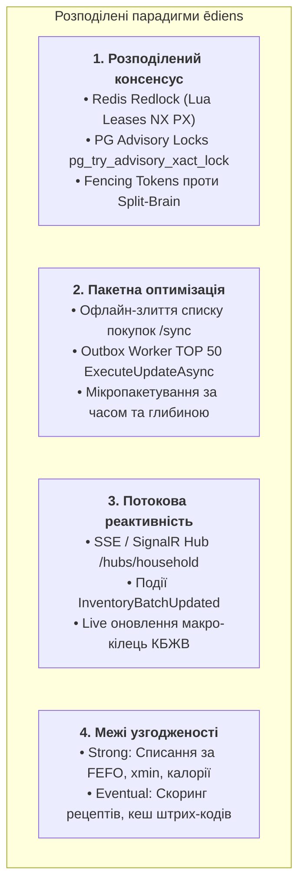
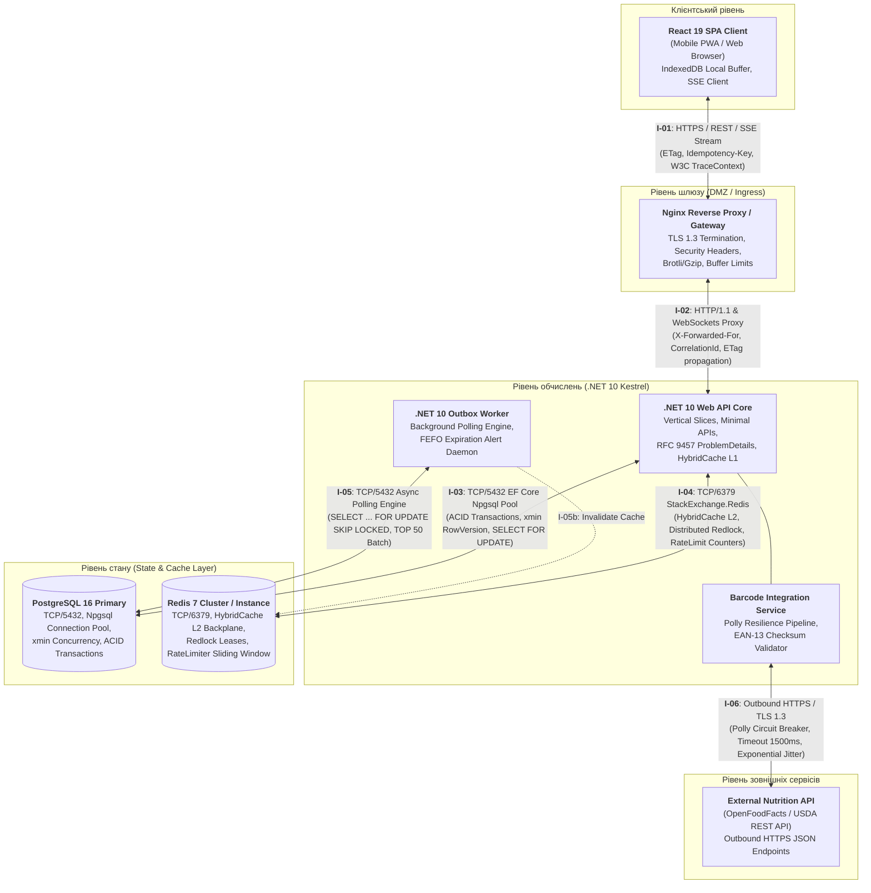

# 08. Модель надійності та стійкості (Resiliency & Distributed Data Processing Model)

> **Статус:** Офіційний реліз розширеної інженерної специфікації (Baseline)  
> **Версія:** 2.0.0  
> **Модуль SRS:** Розділ 08 (Distributed Consensus, Batching, Streaming, CID Architecture & 6x3 RMA Workbook)  
> **Зв'язок із завданнями:** DOC-01, TASK-01, NFR-01, NFR-03  
> **Стандарти:** IEEE Std 1541, Microsoft .NET Resilience & Polly Guidelines, Martin Kleppmann Fencing Tokens, RFC 9457

---

## 1. Архітектурні принципи моделі надійності

Модель стійкості системи **ēdiens** регламентує забезпечення безперервного функціонування сервісів харчування в умовах розподіленого паралелізму, нестабільності мобільних мереж, деградації зовнішніх сервісів та локальних інфраструктурних аварій. 

Ключова мета моделі — виконання вимог **NFR-01 (Latency)**, **NFR-03 (Resiliency & Fault Tolerance)** та досягнення доступності платформи на рівні **$99.9\%$ SLA** з нульовою втратою критичних даних про запаси та макроси.

---

## 2. Парадигми обробки розподілених даних (Distributed Data Processing Paradigms)

Розподілена природа системи **ēdiens** вимагає узгодженого використання чотирьох фундаментальних парадигм обробки даних:



---

### 2.1 Консенсус та захист від Split-Brain (Consensus & Singleton Locking)

У багатоінстансному середовищі (.NET API Replicas + Background Workers) критично важливо уникнути ситуації подвійного виконання фонових завдань (Split-Brain) при перевірці термінів придатності, очищенні ідемпотентності або списанні запасів.

#### 1. Розподілений замок у Redis (Atomic Lua Leases & Fencing Tokens):
Для короткоживучих блокувань рівня операцій користувача (`POST /recipes/{id}/cook`) застосовується атомарна команда Redis:
```text
SET lock:cook:household_{id} {unique_worker_token} NX PX 10000
```
- **Fencing Tokens (Захист Клеппмана від GC-пауз):** Кожне захоплення супроводжується атомарним `INCR lock:fencing_token`. При записі в PostgreSQL токен валідується. Якщо воркер заснув через паузу Garbage Collector довше 10 секунд і його лізинг перехопив інший вузол, старий воркер при спробі запису отримує відмову `409 StaleFencingTokenException`.
- **Атомарне звільнення через Lua-скрипт:**
  ```lua
  if redis.call("get", KEYS[1]) == ARGV[1] then
      return redis.call("del", KEYS[1])
  else
      return 0
  end
  ```

#### 2. Консультативні блокування PostgreSQL (`pg_try_advisory_xact_lock`):
Для сінглтон-задач cron (наприклад, нічний запуск ротації партицій або генерація щоденного звіту о 02:00 UTC) замість важкого Raft застосовуються сесійні консультативні замки PostgreSQL на рівні транзакції:
```sql
-- Атомарна перевірка та взяття блокування без зависання в очікуванні
SELECT pg_try_advisory_xact_lock(hashtext('fefo_daily_expiration_cron'));
```
Якщо інший інстанс воркера вже розпочав виконання, запит миттєво повертає `false`, і поточний інстанс штатно пропускає ітерацію без конфліктів.

---

### 2.2 Архітектура пакетної обробки (Batching Architecture)

Пакетна обробка знижує кількість мережевих пересилань (Round-Trips) та навантаження на I/O диска СУБД.

#### 1. Клієнтська та API пакетна синхронізація (`POST /api/v1/households/{id}/shopping-list/sync`):
У супермаркетах з незадовільним покриттям стільникового зв'язку мобільний клієнт накопичує позначки викуплених товарів локально в IndexedDB.
- При відновленні зв'язку передається єдиний масив мутацій (bulk upsert/sync до 100 елементів).
- Бекенд обробляє пакет в **одній атомарній транзакції PostgreSQL**, вирішуючи векторні колізії версій за алгоритмом Last-Write-Wins (LWW) або формуючи масив суперечностей `conflicts`.

#### 2. Пакетне опитування Transactional Outbox (Batch Polling):
Фоновий процес вичитування подій з таблиці `outbox_messages` вичитує повідомлення пачками по **50 записів**:
```csharp
// Вичитування та блокування пачки повідомлень
var pendingMessages = await _db.OutboxMessages
    .FromSqlRaw(@"
        SELECT * FROM outbox_messages 
        WHERE status = 'PENDING' 
        ORDER BY created_at ASC 
        LIMIT 50 
        FOR UPDATE SKIP LOCKED")
    .ToListAsync(ct);

// Високопродуктивне пакетне оновлення статусу через EF Core ExecuteUpdateAsync
var processedIds = pendingMessages.Select(m => m.Id).ToList();
await _db.OutboxMessages
    .Where(m => processedIds.Contains(m.Id))
    .ExecuteUpdateAsync(s => s
        .SetProperty(b => b.Status, "PROCESSED")
        .SetProperty(b => b.ProcessedAt, DateTime.UtcNow), ct);
```

---

### 2.3 Реактивна потокова передача (Streaming Architecture)

Для підтримки синхронного відображення вмісту холодильника між кількома членами сім'ї, які одночасно знаходяться на кухні, використовується дуплексна потокова шина **Server-Sent Events (SSE)** та **SignalR Hub** (`/hubs/household`):
1. **Події оновлення запасів (`InventoryBatchUpdated`):** Коли один користувач списує 200 г молока, всі підключені екрани миттєво отримують дельту залишку та оновлений `ETag` без необхідності ручного перезавантаження сторінки.
2. **Живе оновлення макро-кілець (Live Daily Macro Ring Updates):** Логування перекусу членом сім'ї транслюється в режимі реального часу, автоматично оновлюючи кругову діаграму спожитих калорій та білків.

---

### 2.4 Межі узгодженості (Consistency Boundaries Matrix)

| Підсистема домену | Модель консистентності | Механізм ізоляції та контролю | Бізнес-обґрунтування поведінки |
| :--- | :--- | :--- | :--- |
| **Списання партій інвентарю (`inventory_batches`)** | **Строга (Strong ACID)** | PostgreSQL `READ COMMITTED` / `SERIALIZABLE`, `xmin` Optimistic Concurrency, `CHECK (quantity >= 0)`. | Неприпустимість оверселінгу; від'ємні залишки суворо заборонені на рівні рушія СУБД. |
| **Приготування рецепта та щоденник (`meal_logs`)** | **Строга (Strong ACID)** | `SELECT ... FOR UPDATE` на партії інгредієнтів, унікальний `idempotency_key`, контроль ліміту макро-бюджету. | Точність калоражу, виключення подвійного списання інгредієнтів при натисканні «1-Click Cook». |
| **Синхронізація списку покупок (`shopping_list_items`)** | **Змішана (Оптимістична офлайн + Строга на сервері)** | Векторні версії `version BIGINT` + детермінований LWW-мердж у транзакції. | Забезпечує плавний UX при відсутності зв'язку в магазині з подальшим детермінованим злиттям. |
| **Рекомендації рецептів (Smart Suggestions)** | **Кінцева (Eventual Consistency)** | Асинхронний скоринг через Outbox Worker, кешування в Redis HybridCache (TTL 10 хв). | Зміна залишків не вимагає миттєвого блокуючого перерахунку матриці всіх рецептів у реальному часі. |
| **Кеш штрих-кодів OpenFoodFacts** | **Кінцева (Eventual Consistency)** | Singleflight Lock у .NET HybridCache, L2 кеш Redis (TTL 30 днів), Negative Cache (1 год). | Метадані продуктів (назва, калорійність) є статичними та не змінюються між сесіями. |

---

## 3. Діаграма взаємодії компонентів (Component Interaction Diagram - CID)

Нижче наведено комплексну архітектурну діаграму взаємодії компонентів, що формалізує **всі 6 критичних міжсистемних взаємодій (`I-01` .. `I-06`)** платформи **ēdiens**.



---

## 4. Комплексна книга режимів відмов (RMA Failure Mode Workbook: 18 сценаріїв)

У наведеній нижче матриці задокументовано **18 вичерпних сценаріїв відмов** (по 3 сценарії для кожної з 6 міжкомпонентних взаємодій `I-01` .. `I-06`), механізми їх детекції, автоматичні політики відновлення, цільовий час відновлення (**RTO**) та вплив на доступність (SLA).

| ID Збою | Взаємодія (Interaction) | Режим відмови (Failure Mode) | Першопричина (Root Cause) | Механізм детекції (Metric / Log / Exception) | Автоматичний патерн стійкості (Polly, Retry, Circuit Breaker, Fallback) | Цільовий час відновлення (RTO) | Вплив на SLA та досвід користувача |
| :--- | :--- | :--- | :--- | :--- | :--- | :---: | :--- |
| **I-01-F1** | `I-01` (Client $\leftrightarrow$ Nginx) | Втрата пакетів / Мережевий таймаут (Network Timeout) | Нестабільне покриття мобільної мережі 4G/LTE під час відправки запиту. | Браузерний `FetchError: Failed to fetch`; на сервері `499 Client Closed Request` у логах Nginx. | Клієнтський React Query з експоненційним ретраєм + джитером (3 спроби: 1s, 2s, 4s). Мутації захищені `Idempotency-Key`. | $\le 4\text{ с}$ | **SLA: 100% збережено.** Користувач не отримує дублювань; операція завершується автоматично. |
| **I-01-F2** | `I-01` (Client $\leftrightarrow$ Nginx) | Відхилення CORS або помилка TLS сертифіката | Неузгодженість origin заголовків, закінчення терміну Let's Encrypt сертифіката. | HTTP 403 Forbidden з логом Nginx `CORS header missing`; Blackbox alert `probe_ssl_earliest_cert_expiry < 7d`. | Автоматичне оновлення сертифікатів через `certbot / cloudflared tunnel`. Захисний Nginx fallback-конфіг із жорстким білим списком доменів. | $\le 1\text{ хв}$ | **SLA: Деградація до заміни.** Блокування нових веб-сесій; PWA використовує локальний кеш. |
| **I-01-F3** | `I-01` (Client $\leftrightarrow$ Nginx) | Обрив стрімінгового з'єднання SSE / SignalR | Апаратне перемикання смартфона Wi-Fi $\rightarrow$ LTE, закриття сесії проміжним NAT. | Запис `IOException: Client reset stream` у Kestrel; браузерна подія `EventSource.onerror`. | Автоматичний реконнект клієнта з `Last-Event-ID`. Сервер надсилає `FULL_RESYNC_REQUIRED` при пропуску подій. | $\le 3\text{ с}$ | **SLA: Нульовий вплив на БД.** Тимчасове призупинення живої дельти, автоматичне відновлення. |
| **I-02-F1** | `I-02` (Nginx $\leftrightarrow$ API) | Виснаження пулу потоків .NET (ThreadPool Starvation) | Сплеск важких синхронних блокуючих викликів або повільні операції без асинхронності. | Метрика `dotnet_threadpool_queue_length > 50`; затримка $p95 > 2000\text{ ms}$; HTTP 504 Gateway Timeout. | Повністю неблокуючий асинхронний код `async/await`. Nginx таймаут `proxy_read_timeout 10s`. Kestrel thread pool auto-scaling. | $\le 15\text{ с}$ | **SLA: Часткова деградація.** Nginx повертає 504 на частину запитів; авто-відновлення при спаді черги. |
| **I-02-F2** | `I-02` (Nginx $\leftrightarrow$ API) | Сплеск відхилень Rate Limit (HTTP 429 Burst) | Спроба DoS-атаки, некоректний цикл авто-повторів у клієнтському коді. | Метрика `ediens_rate_limit_rejections_total > 50`; сплеск відповідей з кодом `429`. | .NET 10 Partitioned `SlidingWindowRateLimiter`. Відповідь містить заголовок `Retry-After: 60` та RFC 9457 JSON. | $\le 1\text{ с}$ | **SLA: Захист бекенду.** Заблоковано лише зловмисного клієнта; решта користувачів працює без лагів. |
| **I-02-F3** | `I-02` (Nginx $\leftrightarrow$ API) | Помилка серіалізації або битий DTO (Serialization Error) | Неузгодженість версій фронтенду та бекенду при релізі, невалідні типи полів JSON. | `System.Text.Json.JsonException` перехоплено глобальним фільтром винятків; лог з рівнем `WARNING`. | RFC 9457 `BadHttpRequestException` санітизується у відповідь `400 Bad Request` з точним зазначенням некоректного поля DTO. | Миттєво ($< 10\text{ ms}$) | **SLA: Без падінь 500.** Клієнт отримує зрозумілий опис помилки валідації форми. |
| **I-03-F1** | `I-03` (API $\leftrightarrow$ PostgreSQL) | Вичерпання пулу з'єднань (Connection Pool Exhaustion) | Завислі транзакції (`idle in transaction`), витік DbContext інстансів без диспоузу. | Виняток `NpgsqlException: The connection pool has been exhausted`; алерт `npgsql_active_connections > 90%`. | Npgsql `Connection Idle Lifetime = 15s`, `Max Pool Size = 100`. Таймаут очікування сокета `Timeout = 5s`. Circuit Breaker. | $\le 10\text{ с}$ | **SLA: Відмова нових запитів.** Спрацювання алерту AL-04; примусовий скид завислих сесій. |
| **I-03-F2** | `I-03` (API $\leftrightarrow$ PostgreSQL) | Конфлікт серіалізації `40001` або колізія `xmin` | Одночасне списання однакової партії двома членами сім'ї; колізія паралельних транзакцій. | PostgreSQL error `40001: could not serialize access`; EF Core `DbUpdateConcurrencyException`. | Транзакція відкочується. API формує RFC 9457 `409 Conflict` з актуальним ETag та поточним залишком продукту. | Миттєво ($< 20\text{ ms}$) | **SLA: Цілісність 100%.** Користувач бачить модальне вікно вирішення конфлікту залишків. |
| **I-03-F3** | `I-03` (API $\leftrightarrow$ PostgreSQL) | Взаємне блокування транзакцій (Deadlock) / Сплеск IOPS | Різний порядок блокування рядків у транзакціях списання кількох інгредієнтів. | PostgreSQL error `40P01: deadlock detected`; приріст лічильника `pg_stat_database_deadlocks_total`. | Всі операції списання за рецептом блокують рядки строго в однаковому порядку (`ORDER BY product_id, expires_at ASC`). | $\le 50\text{ ms}$ | **SLA: Одна транзакція відкочується.** Клієнт робить автоматичний повтор з jitter. |
| **I-04-F1** | `I-04` (API $\leftrightarrow$ Redis) | Переповнення пам'яті Redis (Redis OOM / Eviction) | Сплеск записів кешу, перевищення ліміту 512 МБ пам'яті на контейнер. | Redis виняток `OOM command not allowed when used memory > 'maxmemory'`; алерт `redis_memory_used > 80%`. | Політика `allkeys-lru` витісняє старі кеші штрих-кодів, зберігаючи критичні ключі замків `lock:cook:*`. | $\le 1\text{ с}$ | **SLA: Тимчасовий сплеск кеш-промахів.** Автоматичне звільнення простору під нові замки. |
| **I-04-F2** | `I-04` (API $\leftrightarrow$ Redis) | Закінчення лізингу замка під час паузи GC (Lock Expiration) | Тривала GC-пауза (.NET Full GC Stop-The-World) призвела до вичерпання TTL замка (10с). | При спробі коміту Fencing Token у PostgreSQL не співпадає з останнім активним токеном лідера. | Механізм **Martin Kleppmann Fencing Tokens**: БД відхиляє запис із застарілим токеном (`409 StaleFencingToken`). | $\le 100\text{ ms}$ | **SLA: 100% захист від Split-Brain.** Колізія подвійного виконання усунута в зародку. |
| **I-04-F3** | `I-04` (API $\leftrightarrow$ Redis) | Розірвання сокета Redis (Socket Disconnect) | Перезапуск контейнера Redis або локальний мережевий збій Docker bridge. | `RedisConnectionException: No connection is active/available`; алерт `redis_up == 0`. | Автоматичний Fallback на локальний рівень пам'яті процесу L1 (`IMemoryCache`) та песимістичний SQL lock. | $\le 2\text{ с}$ | **SLA: Працездатність збережена.** Незначне уповільнення операцій через навантаження на СУБД. |
| **I-05-F1** | `I-05` (Worker $\leftrightarrow$ DB) | Отруйне повідомлення в черзі (Poison Pill Message) | Невалідний JSON у корисній нагрузці `payload`, посилання на вже видалений об'єкт. | Виняток десеріалізації; лічильник `retry_count` повідомлення в `outbox_messages` досягає 5. | Автоматичний перехід повідомлення у статус `FAILED` (Dead-Letter Isolation). Генерація SRE-алерту. Воркер переходить далі. | Миттєво ($< 50\text{ ms}$) | **SLA: Черга не блокується.** Пошкоджене повідомлення ізольоване від інших домогосподарств. |
| **I-05-F2** | `I-05` (Worker $\leftrightarrow$ DB) | Аварійне падіння воркера посеред пачки (Crash mid-batch) | Фатальний збій процесу (OOM, SIGKILL хоста) під час виконання операцій з 50 подіями. | Liveness probe `/healthz/live` падає; контейнер перезапускається Docker daemon. | Завдяки семантиці `FOR UPDATE SKIP LOCKED` незакомічена транзакція відкочується автоматично. Події залишаються `PENDING`. | $\le 15\text{ с}$ | **SLA: Втрата подій = 0 (At-Least-Once Delivery).** Інший активний воркер підхоплює пачку. |
| **I-05-F3** | `I-05` (Worker $\leftrightarrow$ DB) | Лавинний ефект кешу рецептів (Cache Stampede) | Масове інвалідування скоринг-кешів після нічного оновлення статусів FEFO. | Сплеск викликів розрахунку рецептів; процесорні ядра контейнера API завантажені на 100%. | .NET 10 `HybridCache` з механізмом **Singleflight**: один потік розраховує скоринг, решта очікує єдиний результат. | $\le 800\text{ ms}$ | **SLA: Без перевантаження CPU.** Клієнти отримують результат без лавинної деградації. |
| **I-06-F1** | `I-06` (Barcode $\leftrightarrow$ External) | Повна недоступність провайдера (Upstream 503 Outage) | Збій дата-центру або падіння серверів OpenFoodFacts API. | `HttpRequestException: 503 Service Unavailable`; спрацювання лічильника відмов Polly. | **Polly Circuit Breaker** розмикає коло (Open) на 30с після 50% помилок. Автоматичний Graceful Fallback на локальний каталог. | $\le 500\text{ ms}$ | **SLA: 100% працездатність.** Повернення локальних аналогів або форми ручного введення товару. |
| **I-06-F2** | `I-06` (Barcode $\leftrightarrow$ External) | Перевищення зовнішніх квот запитів (Rate Limit 429) | Сканування великої кількості штрих-кодів перевищило безкоштовний ліміт запитів провайдера. | Відповідь сервера OpenFoodFacts з кодом `429 Too Many Requests`. | Тимчасовий перехід на локальний Negative Cache (кешування нерозпізнаних кодів на 1 год). Подовження затримок між запитами. | $\le 100\text{ ms}$ | **SLA: Локальне обслуговування.** Користувач не блокується, отримуючи підказку ручного введення. |
| **I-06-F3** | `I-06` (Barcode $\leftrightarrow$ External) | Зміна схеми відповіді JSON (Malformed JSON Schema) | Провайдер без попередження змінив структуру полів макронутрієнтів у відповіді API. | Помилка парсингу `JsonException`; запис інженерного логу з рівнем `ERROR`. | Ізольоване перехоплення винятку. Повернення клієнту прапорця `needsManualVerification: true` без 500 помилки. | Миттєво ($< 20\text{ ms}$) | **SLA: Нуль необроблених винятків.** Користувач самостійно підтверджує білки та калорії. |

---

## 5. Детальна реалізація стійкості конвеєра Barcode Integration (.NET 10 & Polly)

```csharp
// Program.cs — Конфігурація відмовостійкого клієнта зовнішніх штрих-кодів
builder.Services.AddHttpClient<IBarcodeService, OpenFoodFactsBarcodeService>(client =>
{
    client.BaseAddress = new Uri("https://world.openfoodfacts.org/api/v2/");
    client.Timeout = TimeSpan.FromSeconds(2);
})
.AddResilienceHandler("barcode-resilience-pipeline", pipelineBuilder =>
{
    // 1. Bulkhead: Обмеження паралельних запитів назовні
    pipelineBuilder.AddConcurrencyLimiter(new ConcurrencyLimiterOptions
    {
        PermitLimit = 15,
        QueueLimit = 5
    });

    // 2. Жорсткий таймаут однієї спроби
    pipelineBuilder.AddTimeout(TimeSpan.FromMilliseconds(1500));

    // 3. Retry з експоненційним бекофом та джитером (Jitter)
    pipelineBuilder.AddRetry(new HttpRetryStrategyOptions
    {
        MaxRetryAttempts = 2,
        Delay = TimeSpan.FromMilliseconds(200),
        BackoffType = DelayBackoffType.Exponential,
        UseJitter = true
    });

    // 4. Circuit Breaker: розмикання контуру при >= 50% помилок
    pipelineBuilder.AddCircuitBreaker(new HttpCircuitBreakerStrategyOptions
    {
        FailureRatio = 0.5,
        SamplingDuration = TimeSpan.FromSeconds(30),
        MinimumThroughput = 8,
        BreakDuration = TimeSpan.FromSeconds(30)
    });

    // 5. Загальний таймаут конвеєра
    pipelineBuilder.AddTimeout(TimeSpan.FromMilliseconds(2500));
});
```

При розімкненому контурі `Circuit Breaker` сервіс негайно повертає локальний результат із таблиці `products` або ініціює `Graceful Degradation`, гарантуючи час відповіді $p95 < 25\text{ ms}$ для кінцевого користувача.
