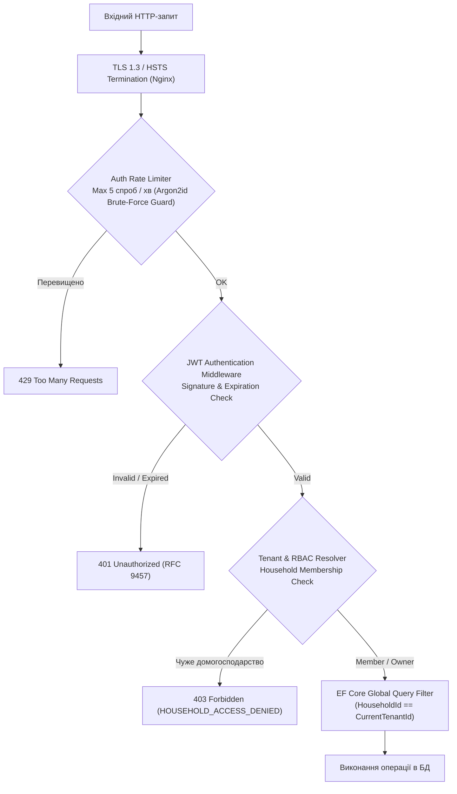

# 09. Модель безпеки (Security Model)

> **Статус:** Затверджено  
> **Версія:** 1.0.0  
> **Авторство:** ēdiens Application Security Working Group (TASK-02)

---

## 9.1 Огляд та цілі моделі безпеки

Модель безпеки системи **ēdiens** побудована на принципах **Zero Trust**, глибокого ешелонування захисту (Defense in Depth) та суворої багатокористувацької ізоляції даних (Multi-Tenant Scoping). Мета — виконання вимоги **NFR-04 (Security & Multi-Tenancy)** та захист персональних харчових звичок і запасів домогосподарств від несанкціонованого доступу.



---

## 9.2 Нефункціональна вимога NFR-04: Security & Multi-Tenancy

- **NFR-04.1 (Безпека автентифікації):** Автентифікація реалізується на базі Stateless JWT з коротким часом життя Access-токена (15 хвилин) та механізмом Refresh-токенів з одноразовою ротацією (Refresh Token Rotation).
- **NFR-04.2 (Сувора ізоляція даних домогосподарств):** Жоден авторизований користувач не має технічної можливості переглядати, змінювати або видаляти запаси іншого домогосподарства (Cross-Tenant Data Leakage Prevention). Будь-яка спроба негайно відхиляється статусом `403 Forbidden` (`HOUSEHOLD_ACCESS_DENIED`).
- **NFR-04.3 (Захист чутливих операцій):** Всі мутації (створення продуктів, логування прийомів їжі, списання) та авторизаційні точки захищаються лімітами швидкості (Rate Limiting). Паролі зберігаються виключно в хешованому вигляді (Argon2id).

---

## 9.3 Архітектура автентифікації (JWT & Refresh Token Rotation)

Система використовує пару токенів:
1. **Access Token (JWT):**
   - **Алгоритм:** HMAC-SHA256 (`HS256`) або Asymmetric RSA (`RS256`).
   - **Час життя (TTL):** 15 хвилин.
   - **Корисне навантаження (Claims):**
     ```json
     {
       "sub": "0192e2b0-1234-7000-8000-000000000001",
       "email": "oleh@example.com",
       "active_household_id": "0192e2b0-9999-7000-8000-000000000099",
       "role": "HouseholdOwner",
       "iat": 1730368800,
       "exp": 1730369700
     }
     ```
   - Передається в HTTP-заголовку: `Authorization: Bearer <token>`.
2. **Refresh Token (Рівень сесії):**
   - **TTL:** 30 діб.
   - Зберігається в таблиці `refresh_tokens` у вигляді криптографічного хешу SHA-256 (запобігає компрометації при витоку дампу БД).
   - Передається через браузерний `Set-Cookie` з прапорцями:
     `HttpOnly; Secure; SameSite=Strict; Path=/api/v1/auth`.
   - **Одноразова ротація (Rotation):** При кожному виклику `POST /api/v1/auth/refresh` старий Refresh-токен анулюється, і видається нова пара. Якщо виявляється спроба використати старий вже використаний токен $\rightarrow$ це розцінюється як крадіжка сесії, і **всі** активні сесії цього користувача миттєво відкликаються.

---

## 9.4 Багатокористувацька модель доступу (Household Multi-Tenancy & RBAC)

Система організована навколо сутності **Household (Домогосподарство)**. Користувач може бути членом кількох домогосподарств (наприклад, «Власна квартира» та «Батьківський дім»), перемикаючись між ними через вибір активного контексту.

### Рольова модель (RBAC):
| Дозволи та операції | HouseholdOwner | HouseholdMember | Гість / Неавтентифікований |
| :--- | :---: | :---: | :---: |
| Перегляд запасів та термінів FEFO | ✓ | ✓ | ✗ |
| Додавання та списання партій продуктів | ✓ | ✓ | ✗ |
| Виконання «1-Click Cook» та логування їжі | ✓ | ✓ | ✗ |
| Редагування спільного списку покупок | ✓ | ✓ | ✗ |
| Генерація інвайт-кодів для нових членів сім'ї | ✓ | ✗ | ✗ |
| Видалення учасника з домогосподарства | ✓ | ✗ | ✗ |
| Зміна назви або видалення домогосподарства | ✓ | ✗ | ✗ |

### Технічне забезпечення ізоляції (EF Core Global Query Filters):
Для запобігання помилкам розробників, коли забувається додати умову `WHERE household_id = @id`, в `DbContext` налаштовано глобальний фільтр:
```csharp
public class EdiensDbContext : DbContext
{
    private readonly ITenantContext _tenantContext;

    public EdiensDbContext(DbContextOptions options, ITenantContext tenantContext) 
        : base(options) => _tenantContext = tenantContext;

    protected override void OnModelCreating(ModelBuilder modelBuilder)
    {
        modelBuilder.Entity<InventoryItem>()
            .HasQueryFilter(item => item.HouseholdId == _tenantContext.CurrentHouseholdId);

        modelBuilder.Entity<ShoppingListItem>()
            .HasQueryFilter(item => item.HouseholdId == _tenantContext.CurrentHouseholdId);
    }
}
```
Будь-який запит автоматично обмежується `CurrentHouseholdId`. Спроба прямого доступу за ID до чужого ресурсу генерує `ITEM_NOT_FOUND` (404) або `HOUSEHOLD_ACCESS_DENIED` (403), унеможливлюючи витік даних.

---

## 9.5 Захист від атак та криптографічні стандарти

1. **Хешування паролів:** Використовується алгоритм **Argon2id** (пам'ять 64 МБ, 3 ітерації, 4 паралельні потоки) або BCrypt із коефіцієнтом складності $WorkFactor = 12$. Заборонено збереження паролів у відкритому вигляді.
2. **Захист від Brute-Force атак:** Точки автентифікації (`/api/v1/auth/login`, `/api/v1/auth/register`) захищені жорстким лімітом: не більше 5 спроб на хвилину з однієї IP-адреси.
3. **Заголовки безпеки (Security Headers):**
   - `Content-Security-Policy: default-src 'self'; img-src 'self' data: https:; script-src 'self'`
   - `Strict-Transport-Security: max-age=31536000; includeSubDomains; preload`
   - `X-Content-Type-Options: nosniff`
   - `X-Frame-Options: DENY`
   - `Referrer-Policy: strict-origin-when-cross-origin`
4. **Захист від XSS та CSRF:** Токени доступу не зберігаються в небезпечному `localStorage`. Оскільки API є повністю RESTful зі stateless заголовками `Authorization: Bearer`, ризик класичного CSRF усунено, а прапорець `SameSite=Strict` на куках сесії гарантує ізоляцію.
