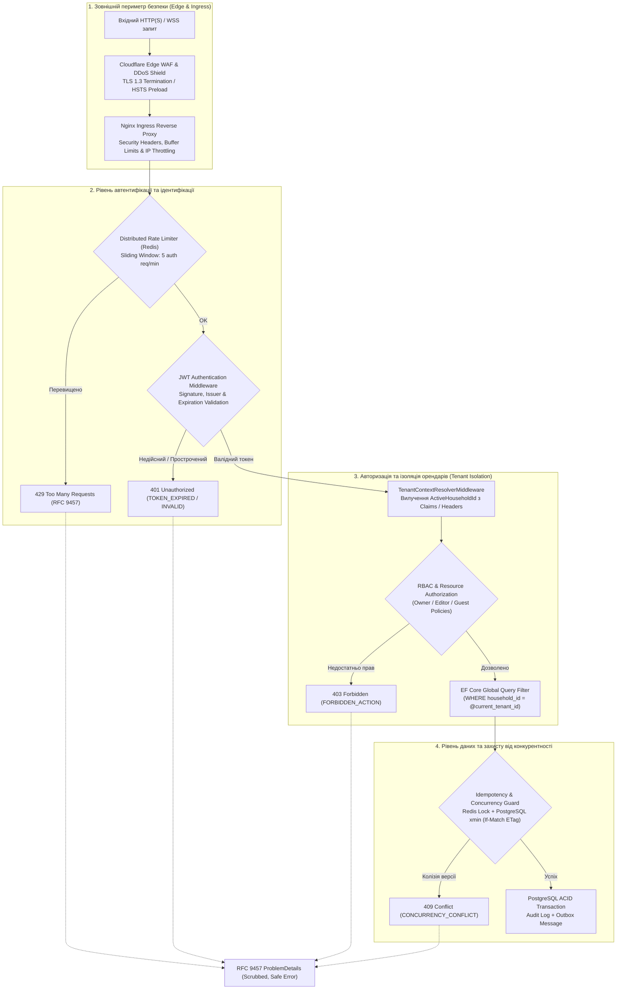

# 09. Модель безпеки (Security Model)

> **Статус:** Офіційний реліз розширеної інженерної специфікації (Baseline)  
> **Версія:** 2.0.0  
> **Модуль SRS:** Розділ 09 (Security, Threat Modeling & Multi-Tenancy Architecture)  
> **Зв'язок із завданнями:** DOC-02, TASK-02, NFR-04, SEC-01  
> **Стандарти:** OWASP Top 10 (2021/2025), OWASP ASVS 4.0.3 (Level 2), NIST SP 800-207 (Zero Trust Architecture), RFC 7519 (JWT), RFC 9457 (ProblemDetails), STRIDE Methodology

---

## 1. Архітектурні принципи моделі безпеки

Модель безпеки системи **ēdiens** спроектована за стандартами промислової кібербезпеки для хмарних та розподілених застосунків. Вона базується на парадигмі **Zero Trust** («ніколи не довіряй, завжди перевіряй»), глибокому ешелонуванні захисту (**Defense in Depth**) та суворій криптографічній і реляційній ізоляції орендарів (**Multi-Tenant Scoping**).

Головна мета моделі — повне виконання вимоги **NFR-04 (Security & Multi-Tenancy)**: забезпечення конфіденційності, цілісності, автентичності та доступності інформації про запаси продуктів, бюджет калорій, харчові розклади та транзакційні дії користувачів.



### Ключові принципи моделі:
1. **Принцип найменших привілеїв (Least Privilege):** Кожен користувач, мікросервіс, фоновий воркер або підключення до бази даних володіють мінімально необхідним набором прав. Фоновий воркер не має прав на зміну структури БД (DDL), а гостьовий користувач не має прав на списання продуктів.
2. **Багатошаровий захист (Defense in Depth):** Якщо один бар'єр скомпрометовано (наприклад, зловмисник отримав доступ до локальної мережі), наступний бар'єр (наприклад, взаємна ізоляція мереж Docker, TLS-з'єднання з Redis або Global Query Filters) блокує подальше просування загрози.
3. **Строга багатоорендна ізоляція (Multi-Tenancy Guard):** Усі бізнес-сутності, що належать домогосподарству, ізолюються на рівні ORM через механізм **Global Query Filters** у .NET 10 EF Core. Запит без явного `household_id` фізично не може отримати дані іншої родини.
4. **Неперервна верифікація та одноразовість (Zero Trust & Idempotency):** Жодній операції мутації (списання продуктів, логування прийомів їжі) не довіряють повторно. Обов'язкова валідація заголовків `Idempotency-Key` у поєднанні з криптографічним хешем тіла запиту SHA-256 захищає від атаки повторного списання («double spend»).
5. **Захист від витоку внутрішнього стану (RFC 9457 Data Sanitization):** Жодне системне повідомлення про помилку, трасування стеку (.NET StackTrace), внутрішні IP-адреси чи імена серверів не повертаються клієнту у виробничому середовищі. Усі відповіді про помилки нормалізуються у формат `application/problem+json` із генерацією унікального `traceId`.

---

## 2. Моделювання загроз за методологією STRIDE для 3 ключових потоків

Моделювання загроз у системі **ēdiens** здійснюється за індустріальною методологією **STRIDE**:
- **S**poofing (Підміна особи / автентифікації)
- **T**ampering (Фальсифікація / підробка даних)
- **R**epudiation (Відмова від авторства дій)
- **I**nformation Disclosure (Розкриття конфіденційної інформації)
- **D**enial of Service (Відмова в обслуговуванні)
- **E**levation of Privilege (Підвищення привілеїв)

---

### 2.1 Потік 1: Автентифікація домогосподарства, життєвий цикл JWT-сесії та рольові інвайти (Auth & RBAC Flow)

#### 2.1.1 Опис потоку та межі довіри (Trust Boundaries)
Потік охоплює процеси реєстрації користувача, входу в систему з отриманням пари `(Access Token, Refresh Token)`, ротацію токенів сесії, вибір активного домогосподарства та генерацію одноразових кодів запрошення нових членів родини з ролями `Owner`, `Editor`, `Guest`.

- **Trust Boundary 1 (TB-01: Public Internet $\leftrightarrow$ DMZ / Ingress):** Розділяє ненадійний інтернет (браузер клієнта) та зворотний проксі Nginx. Тут перевіряється валідність TLS, діють ліміти з'єднань і базовий WAF.
- **Trust Boundary 2 (TB-02: DMZ $\leftrightarrow$ Application Core):** Розділяє Nginx та внутрішню мережу .NET Web API (`ediens-app-net`). Передаються HTTP-запити з нормалізованими заголовками.
- **Trust Boundary 3 (TB-03: Application Core $\leftrightarrow$ Persistent Data Layer):** Розділяє шар бізнес-логіки та ізольовану мережу зберігання даних (`ediens-data-net`), де функціонують PostgreSQL 16 та Redis 7.

#### 2.1.2 Діаграма потоків даних (DFD) для Потоку 1

```mermaid
flowchart TB
    subgraph UntrustedZone ["Ненадійна зона (Untrusted Client Environment)"]
        ClientApp["React 19 SPA Client<br/>(Browser / Mobile Web)"]
        Attacker["Зловмисник / MITM / Botnet"]
    end

    subgraph TrustBoundary1 [" Межа довіри TB-01 (TLS 1.3 / Ingress Boundary) "]
        NginxProxy["Nginx Gateway<br/>(TLS Termination, WAF Rules,<br/>HSTS, Security Headers)"]
    end

    subgraph TrustBoundary2 [" Межа довіри TB-02 (Application Boundary) "]
        AuthEndpoint["POST /api/v1/auth/login<br/>POST /api/v1/auth/refresh<br/>POST /api/v1/households/invitations"]
        JwtHandler["JwtTokenService<br/>HMAC-SHA256 Sign/Verify"]
        RbacInterceptor["HouseholdAuthorizationHandler<br/>(Owner/Editor/Guest Roles)"]
    end

    subgraph TrustBoundary3 [" Межа довіри TB-03 (Data Layer Isolation) "]
        RedisSessionStore[("Redis 7 Store<br/>- Refresh Token Blacklist<br/>- Rate Limit Sliding Window<br/>- Invite Token TTL")]
        PostgresAuthDB[("PostgreSQL 16 DB<br/>- users (Argon2id hashes)<br/>- household_members (RBAC)<br/>- refresh_tokens (SHA-256)")]
    end

    ClientApp -->|1. POST /login (email, password)| NginxProxy
    Attacker -.->|Спроба Brute-Force / Replay| NginxProxy
    NginxProxy -->|2. Proxy Request (X-Forwarded-For)| AuthEndpoint
    AuthEndpoint -->|3. Перевірка ліміту спроб| RedisSessionStore
    AuthEndpoint -->|4. Верифікація пароля Argon2id| PostgresAuthDB
    AuthEndpoint -->|5. Генерація JWT + Refresh| JwtHandler
    JwtHandler -->|6. Збереження SHA-256 хешу сесії| PostgresAuthDB
    AuthEndpoint -->|7. HttpOnly Cookie + Bearer JWT| NginxProxy
    NginxProxy -->|8. Захищена відповідь 200 OK| ClientApp

    ClientApp -->|9. POST /invitations (Role: Editor)| AuthEndpoint
    AuthEndpoint -->|10. Авторизація Owner Policy| RbacInterceptor
    RbacInterceptor -->|11. Читання ролі з БД| PostgresAuthDB
    AuthEndpoint -->|12. Створення інвайт-коду (TTL 48h)| RedisSessionStore
```

#### 2.1.3 Детальний аналіз загроз STRIDE для Потоку 1:
1. **Spoofing (Підміна):**
   - *Загроза:* Перехоплення або крадіжка Refresh-токена з браузера клієнта через XSS або мережевий снифінг.
   - *Вразливість:* Збереження токенів у `localStorage` або передача відкритим текстом.
   - *Контрзаходи:* Збереження Refresh-токена виключно в куках із атрибутами `HttpOnly; Secure; SameSite=Strict; Path=/api/v1/auth`. Впровадження механізму **Refresh Token Rotation (RTR)**: при повторному пред'явленні вже використаного токена вся родина сесій користувача інвалідується в Redis та БД.
2. **Tampering (Підробка):**
   - *Загроза:* Модифікація клеймів у JWT-токені (наприклад, підміна `role: "Guest"` на `role: "Owner"` або зміна `household_id`).
   - *Контрзаходи:* Криптографічний підпис токенів алгоритмом HMAC-SHA256 (`HS256`) із секретним ключем довжиною $\ge 256$ біт, збереженим у змінних оточення хоста. Серверні валідатори `ValidateIssuerSigningKey = true`, `ValidateLifetime = true`.
3. **Repudiation (Відмова від авторства):**
   - *Загроза:* Власник домогосподарства стверджує, що не видавав запрошення сторонньому користувачу з роллю `Editor`.
   - *Контрзаходи:* Запис у незмінну таблицю `audit_logs` факту генерації запрошення із фіксацією `user_id`, `household_id`, `client_ip`, `user_agent` та мітки часу `TIMESTAMPTZ` за UTC.
4. **Information Disclosure (Витік інформації):**
   - *Загроза:* Перехоплення незашифрованого трафіку між клієнтом та сервером у публічній Wi-Fi мережі.
   - *Контрзаходи:* Примусовий TLS 1.3 із шифрами forward secrecy (ECDHE), заголовок `Strict-Transport-Security: max-age=31536000; includeSubDomains; preload`. Заборона протоколів нижче TLS 1.2.
5. **Denial of Service (Відмова в обслуговуванні):**
   - *Загроза:* Масований перебір паролів (Brute-Force) на `/api/v1/auth/login`, що призводить до перевантаження CPU алгоритмом Argon2id.
   - *Контрзаходи:* Розподілений Rate Limiter на базі Redis із плаваючим вікном: не більше 5 спроб за 60 секунд на пару `(IP, Email)`. При перевищенні повертається `429 Too Many Requests` із заголовком `Retry-After: 60`.
6. **Elevation of Privilege (Підвищення привілеїв):**
   - *Загроза:* Користувач із роллю `Guest` надсилає запит на створення інвайту або видалення іншого учасника домогосподарства.
   - *Контрзаходи:* Декларативна авторизація у Minimal APIs: `.RequireAuthorization("HouseholdOwnerPolicy")`, яка перевіряє роль користувача безпосередньо в базі даних та у валідованих клеймах токена.

---

### 2.2 Потік 2: Атомарне приготування рецепта (`POST /api/v1/recipes/{id}/cook`) — списання запасів та облік макросів в умовах паралелізму

#### 2.2.1 Опис потоку та межі довіри
Потік реалізує критичну бізнес-операцію: користувач готує страву на $N$ порцій. Система повинна:
1. Перевірити наявність інгредієнтів у запасах домогосподарства за правилом **FEFO** (*First Expired, First Out*).
2. Атомарно списати точну масу або кількість продуктів із партій.
3. Додати запис споживання до щоденника харчування користувача (`meal_logs`), автоматично збільшивши добові показники білків, жирів, вуглеводів та калорій.
4. Опублікувати подію `RecipeCookedDomainEvent` у Transactional Outbox для синхронізації стану.

- **Межа довіри TB-02:** Клієнт передає заголовок `Idempotency-Key` та опціональний `If-Match` (ETag версії інвентарю).
- **Межа довіри TB-03:** Одночасні запити від двох членів сім'ї на одній кухні конкурують за однаковий пакет молока чи яєць. Вимагається строга ізоляція транзакцій СУБД.

#### 2.2.2 Діаграма потоків даних (DFD) для Потоку 2

```mermaid
flowchart TB
    subgraph ClientZone ["Клієнтський рівень"]
        UserApp["React SPA / Mobile PWA<br/>POST /api/v1/recipes/{id}/cook<br/>Header: Idempotency-Key, If-Match"]
        ConcurrentMember["Інший член сім'ї<br/>Паралельне приготування"]
    end

    subgraph APICoreZone ["Ядро Web API (.NET 10)"]
        CookEndpoint["CookRecipeEndpointHandler"]
        IdempotencyService["IdempotencyManager<br/>(SHA-256 Request Hash Match)"]
        DistLockManager["RedisDistributedLock<br/>(Key: lock:cook:household_{id})"]
        InventoryDeductor["FEFO Inventory Deduction Service"]
        NutritionTracker["Macro Daily Budget Service"]
    end

    subgraph StateStorageZone ["Рівень збереження стану (ACID & Distributed Cache)"]
        RedisLockStore[("Redis 7 Store<br/>- SET NX PX Lease (10s)<br/>- Idempotency Cache (24h)")]
        PostgresTransactionalDB[("PostgreSQL 16 Engine<br/>- inventory_batches (CHECK qty >= 0, xmin)<br/>- meal_logs / meal_log_items<br/>- outbox_messages<br/>- idempotency_records")]
    end

    UserApp -->|1. POST /cook (RecipeId, Portions)| CookEndpoint
    ConcurrentMember -.->|1a. Паралельний запит на те ж молоко| CookEndpoint

    CookEndpoint -->|2. Перевірка Idempotency-Key + SHA256| IdempotencyService
    IdempotencyService -->|3. Читання запису| RedisLockStore

    CookEndpoint -->|4. Захоплення розподіленого замка| DistLockManager
    DistLockManager -->|5. SET lock:cook:{hh_id} NX PX 10000| RedisLockStore

    CookEndpoint -->|6. Початок ACID транзакції| InventoryDeductor
    InventoryDeductor -->|7. SELECT FOR UPDATE (FEFO Batches)| PostgresTransactionalDB
    InventoryDeductor -->|8. Перевірка залишків: qty - required >= 0| PostgresTransactionalDB
    InventoryDeductor -->|9. UPDATE inventory_batches (xmin оновлено)| PostgresTransactionalDB

    CookEndpoint -->|10. Логування споживання| NutritionTracker
    NutritionTracker -->|11. INSERT INTO meal_logs| PostgresTransactionalDB

    CookEndpoint -->|12. Запис до Transactional Outbox| PostgresTransactionalDB
    CookEndpoint -->|13. Збереження IdempotencyRecord| PostgresTransactionalDB

    CookEndpoint -->|14. Звільнення замка (Lua unlock)| DistLockManager
    CookEndpoint -->|15. Відповідь 200 OK (New Balance, Macros)| UserApp
```

#### 2.2.3 Детальний аналіз загроз STRIDE для Потоку 2:
1. **Spoofing (Підміна):**
   - *Загроза:* Списання продуктів від імені іншого користувача або стороннього домогосподарства шляхом підробки ID в тілі запиту.
   - *Контрзаходи:* Повна ігнорація будь-яких переданих клієнтом `user_id` чи `household_id` у тілі JSON. Ідентифікатори витягуються суто з криптографічно верифікованого токена `HttpContext.User`.
2. **Tampering (Фальсифікація / Double Spend):**
   - *Загроза:* Мережевий лаг спонукає користувача двічі натиснути кнопку «Приготувати». Повторний запит списує подвійну порцію продуктів і дублює калорії в щоденнику.
   - *Контрзаходи:* Клієнт зобов'язаний генерувати `Idempotency-Key: <UUIDv7>`. Бекенд зберігає хеш SHA-256 від `(UserId + RecipeId + Portions + RequestBody)` у таблиці `idempotency_records` та Redis. Якщо приходить ідентичний запит у стані `COMPLETED`, повертається збережена кешована відповідь без повторного списання. Якщо запит приходить під час виконання (`PENDING`), повертається `409 Conflict` (`CONCURRENT_REQUEST_IN_PROGRESS`).
3. **Repudiation (Відмова від авторства):**
   - *Загроза:* Один із партнерів звинувачує додаток у тому, що продукти «зникли самі по собі».
   - *Контрзаходи:* Кожна транзакція списання зв'язується з `meal_logs` та генерує рядок у `audit_logs` із точним зазначенням ID автора списання, переліку партій та списаної ваги.
4. **Information Disclosure (Розкриття інформації):**
   - *Загроза:* Помилка бази даних через блокування повертає клієнту SQL-запит, назви таблиць та версію PostgreSQL.
   - *Контрзаходи:* Глобальний обробник помилок перехоплює всі `DbUpdateConcurrencyException` та `PostgresException`, замінюючи їх на безпечний RFC 9457 `ProblemDetails` зі статусом `409 Conflict` або `422 Unprocessable Entity` (`INSUFFICIENT_STOCK`).
5. **Denial of Service (Відмова в обслуговуванні):**
   - *Загроза:* Передача параметра `portions: 999999999`, що викликає переповнення цілих чисел при підрахунку макросів або вичерпання пулу з'єднань БД через тривалий пошук партій.
   - *Контрзаходи:* FluentValidation валідація вхідного DTO: `RuleFor(x => x.Portions).InclusiveBetween(1, 50)`. Атомарне обмеження часу виконання транзакції (CancellationToken з таймаутом 3 секунди).
6. **Elevation of Privilege (Підвищення привілеїв):**
   - *Загроза:* Користувач із роллю `Guest` (гість вечірки) списує сімейний запас дорогих продуктів.
   - *Контрзаходи:* Політика `HouseholdEditorPolicy` вимагає роль `Owner` або `Editor` для виконання ендпоінту `/cook`.

---

### 2.3 Потік 3: Зовнішній пошук штрих-коду (`GET /api/v1/products/barcode/{code}`) та офлайн-синхронізація списку покупок (`POST /api/v1/households/{id}/shopping-list/sync`)

#### 2.3.1 Опис потоку та межі довіри
Потік об'єднує два сценарії:
1. Сканування штрих-коду EAN-13 камерою смартфона. Якщо продукту немає в локальній БД, здійснюється вихідний HTTPS-запит до зовнішнього публічного API (OpenFoodFacts / USDA).
2. Офлайн-робота в супермаркеті з нестабільним зв'язком: мобільний додаток накопичує локальні позначки куплених товарів і при появі зв'язку відправляє пачку змін (bulk upsert/sync).

- **Межа довіри TB-01:** Ненадійне введення від сканера штрих-кодів (можливість SQLi, Path Traversal, XSS або DoS через невалідні коди).
- **Межа довіри TB-04 (Application Core $\leftrightarrow$ External Third-Party APIs):** Вихідний HTTPS-трафік до OpenFoodFacts API. Сторонній сервіс не є довіреним (може повернути шкідливий JSON, мати високу затримку або бути недоступним).

#### 2.3.2 Діаграма потоків даних (DFD) для Потоку 3

```mermaid
flowchart TB
    subgraph ClientMobile ["Клієнтський мобільний інтерфейс"]
        BarcodeScanner["Камера / Сканер штрих-кодів<br/>(EAN-13 Raw Input)"]
        OfflineQueue["IndexedDB Local Sync Queue<br/>(Shopping List Item Checks)"]
    end

    subgraph EdgeAppZone ["Периметр безпеки API"]
        NginxGateway["Nginx Gateway<br/>(Body Size Limit: 64KB)"]
        BarcodeValidator["BarcodeFormatValidator<br/>(Regex Check: ^[0-9]{8,14}$)"]
        BarcodeEndpoint["GET /api/v1/products/barcode/{code}"]
        ShoppingSyncEndpoint["POST /api/v1/households/{id}/shopping-list/sync"]
        HybridCacheEngine[".NET HybridCache (L1 Memory + L2 Redis)<br/>Singleflight Lock + Negative 404 Cache"]
    end

    subgraph InternalDataStore ["Внутрішнє захищене сховище"]
        LocalProductCatalog[("PostgreSQL products<br/>(Parameterized LINQ)")]
        ShoppingTable[("PostgreSQL shopping_list_items<br/>(Bulk Upsert with Tenant Isolation)")]
    end

    subgraph ExternalThirdParty ["Межа довіри TB-04: Зовнішній інтернет"]
        PollyCircuitBreaker["Polly Resilient HTTP Client<br/>Circuit Breaker & Fallback"]
        OpenFoodFactsAPI["OpenFoodFacts REST API<br/>(External HTTPS Endpoint)"]
    end

    BarcodeScanner -->|1. GET /barcode/482000000001| NginxGateway
    NginxGateway -->|2. Перевірка формату regex| BarcodeValidator
    BarcodeValidator -->|3. Валідний штрих-код| BarcodeEndpoint
    BarcodeEndpoint -->|4. Перевірка кешу L1/L2| HybridCacheEngine
    HybridCacheEngine -->|5. Кеш-промах: пошук в локальній БД| LocalProductCatalog
    LocalProductCatalog -->|6. Продукт відсутній у власній базі| PollyCircuitBreaker
    PollyCircuitBreaker -->|7. Безпечний HTTPS GET (Таймаут 2с)| OpenFoodFactsAPI
    OpenFoodFactsAPI -->|8. Відповідь JSON (Харчова цінність)| PollyCircuitBreaker
    PollyCircuitBreaker -->|9. Парсинг та санітизація JSON| BarcodeEndpoint
    BarcodeEndpoint -->|10. Збереження в HybridCache (TTL 30d)| HybridCacheEngine

    OfflineQueue -->|11. POST /shopping-list/sync (Array max 100)| NginxGateway
    NginxGateway -->|12. Перевірка розміру тіла (<= 64KB)| ShoppingSyncEndpoint
    ShoppingSyncEndpoint -->|13. Валідація схеми елементів FluentValidation| ShoppingTable
    ShoppingSyncEndpoint -->|14. Пакетне оновлення в межах TenantId| ShoppingTable
```

#### 2.3.3 Детальний аналіз загроз STRIDE для Потоку 3:
1. **Spoofing (Підміна):**
   - *Загроза:* Зловмисник підробляє відповідь від OpenFoodFacts через DNS-спуфінг або атаку людини посередині (MITM).
   - *Контрзаходи:* Використання виключно HTTPS із валідацією системних CA-сертифікатів, заборона переходів за редиректами (`MaxAutomaticRedirections = 0`), фіксований базовий URL у конфігурації.
2. **Tampering (Фальсифікація / Ін'єкції):**
   - *Загроза:* Ін'єкція шкідливого SQL або JavaScript через поле назви товару у сторонньому API або через штрих-код виду `482000'; DROP TABLE products;--`.
   - *Контрзаходи:* Строга валідація маршрутного параметра штрих-коду регулярним виразом `^[0-9]{8,14}$`. Використання суто параметризованих запитів EF Core LINQ. HTML-санітизація текстових полів опису продукту перед збереженням у каталог.
3. **Repudiation (Відмова від авторства):**
   - *Загроза:* Користувач заявляє, що не видаляв позиції зі спільного списку покупок під час синхронізації.
   - *Контрзаходи:* Позначення кожного елемента `updated_by_user_id` та запис мітки часу `updated_at`.
4. **Information Disclosure (Розкриття інформації):**
   - *Загроза:* Перегляд списку покупок іншої родини через підміну `household_id` у маршруті `/sync`.
   - *Контрзаходи:* Авторизаційний фільтр перевіряє зв'язок між автентифікованим користувачем та `household_id` у таблиці `household_members`. Невідповідність викликає негайний `403 Forbidden`.
5. **Denial of Service (Відмова в обслуговуванні / Cache Stampede):**
   - *Загроза 1:* Одночасне сканування 1000 випадкових штрих-кодів, що виснажує зовнішній ліміт API OpenFoodFacts і блокує додаток.
   - *Контрзаходи 1:* Перевірка контрольної суми EAN-13 (Check Digit) ще до звернення до кешу чи бекенду. Застосування .NET 10 `HybridCache` із механізмом **Singleflight** (один запит летить назовні, решта чекає на його результат). Негативне кешування (відповідь `404 Not Found` кешується на 1 годину).
   - *Загроза 2:* Передача велетенського масиву даних (100 МБ JSON) у `/shopping-list/sync` для вичерпання оперативної пам'яті сервера (OOM).
   - *Контрзаходи 2:* Обмеження розміру запиту в Kestrel: `MaxRequestBodySize = 65536` (64 КБ). FluentValidation перевіряє `RuleFor(x => x.Items).NotNull().Must(items => items.Count <= 100)`.
6. **Elevation of Privilege (Підвищення привілеїв):**
   - *Загроза:* Модифікація глобального каталогу еталонних продуктів звичайним користувачем.
   - *Контрзаходи:* Продукти, отримані від зовнішніх API або створені користувачами для домашнього вжитку, позначаються `is_verified = false` або прив'язуються виключно до конкретного домогосподарства (`household_id IS NOT NULL`). Модифікація еталонних продуктів дозволена тільки під системною роллю `GlobalAdmin`.

---

## 3. Матриця пом'якшення 12 критичних загроз (Mitigation Plan Table)

Нижче наведено повну матрицю 12 критичних загроз безпеки архітектури **ēdiens**, їх класифікацію за STRIDE, оцінку вразливості за стандартом **CVSS v3.1** та конкретні технічні механізми захисту.

| ID | Категорія STRIDE | Назва загрози | Базовий вектор CVSS v3.1 | Оцінка CVSS | Вразливий компонент / Ендпоінт | Вектор атаки та наслідки | Технічний механізм пом'якшення (.NET 10 / Nginx / DB / Redis) | Посилання на автоматизований тест |
| :--- | :--- | :--- | :--- | :---: | :--- | :--- | :--- | :--- |
| **T-01** | Spoofing | Викрадення та повторне використання JWT / Refresh токена | `CVSS:3.1/AV:N/AC:L/PR:N/UI:R/S:U/C:H/I:H/A:N` | **8.1 (High)** | `/api/v1/auth/refresh`, JWT Cookies | Перехоплення токена через XSS або мережевий снифінг дає зловмиснику несанкціонований доступ до акаунта жертви. | Короткоживучі Access токени (15 хв). Refresh токени у `HttpOnly; SameSite=Strict; Secure` куках. Механізм Refresh Token Rotation (RTR): при повторній спробі використання старого токена вся сім'я сесій анулюється. | `AuthSecurityTests.RefreshToken_Reuse_InvalidatesAllUserSessions` |
| **T-02** | Tampering | Обхід або підробка заголовка `If-Match` (ETag) при зміні залишків | `CVSS:3.1/AV:N/AC:H/PR:L/UI:N/S:U/C:N/I:H/A:L` | **5.9 (Medium)** | `PATCH /api/v1/inventory/batches/{id}` | Пропуск перевірки ETag призводить до колізій "Lost Update", некоректних залишків та порушення принципу FEFO. | Обов'язкова вимога заголовка `If-Match` (`428 Precondition Required`). Серверне порівняння з системним стовпцем PostgreSQL `xmin::text`. При невідповідності повертається `409 Conflict`. | `InventoryConcurrencyTests.Missing_IfMatch_Returns_428_PreconditionRequired` |
| **T-03** | Tampering | Стан гонки («Double Spend») та маніпуляція `Idempotency-Key` при готуванні | `CVSS:3.1/AV:N/AC:L/PR:L/UI:N/S:U/C:N/I:H/A:L` | **7.1 (High)** | `POST /api/v1/recipes/{id}/cook` | Повторна відправка запиту з іншим або пустим ключем призводить до подвійного списання продуктів та дублювання калорій. | Розподілений замок у Redis `lock:cook:{household_id}`. Валідація SHA-256 хешу тіла запиту у зв'язці з `(UserId, IdempotencyKey)`. Збереження транзакційного статусу в БД. | `RecipeCookTests.Duplicate_IdempotencyKey_WithSamePayload_ReturnsCachedResult` |
| **T-04** | Repudiation | Непідтверджене деструктивне видалення партій продуктів домогосподарства | `CVSS:3.1/AV:N/AC:L/PR:L/UI:N/S:U/C:N/I:M/A:L` | **4.3 (Medium)** | `DELETE /api/v1/inventory/batches/{id}` | Користувач видаляє дорогі продукти іншого члена сім'ї та заперечує свою дію, руйнуючи довіру всередині домогосподарства. | Незмінна таблиця аудиту `audit_logs` із тригерами/EF Core interceptors: запис `user_id`, `household_id`, `trace_id`, `client_ip`, стану об'єкта до і після (JSON diff). | `AuditLogTests.InventoryDelete_Generates_ImmutableAuditRecord` |
| **T-05** | Info Disclosure | Міждомогосподарчий несанкціонований доступ до чужих об'єктів (IDOR) | `CVSS:3.1/AV:N/AC:L/PR:L/UI:N/S:U/C:H/I:H/A:N` | **8.8 (High)** | `GET/PATCH /api/v1/inventory/batches/{id}` | Зловмисник підставляє UUID іншого домогосподарства в URL і переглядає або модифікує чужі запаси та плани харчування. | EF Core Global Query Filter `item.HouseholdId == _tenantContext.CurrentHouseholdId` + авторизаційний інтерцептор перевірки членства в домогосподарстві. | `MultiTenancySecurityTests.AccessBatchOfOtherHousehold_Returns_NotFoundOrForbidden` |
| **T-06** | Info Disclosure | Витік трасувань стеку (.NET StackTrace) та конфігурації у 500 помилках | `CVSS:3.1/AV:N/AC:L/PR:N/UI:N/S:U/C:M/I:N/A:N` | **5.3 (Medium)** | Усі ендпоінти API (`Global Exception Handler`) | Необроблені винятки розкривають зловмиснику назви таблиць БД, версії бібліотек та рядки підключення. | RFC 9457 `ProblemDetails` санітизація у продакшн середовищі (`app.Environment.IsProduction()`). Експонування суто `traceId` та безпечного `errorCode`. | `ErrorHandlingSecurityTests.ProductionException_DoesNotLeak_StackTrace` |
| **T-07** | Denial of Service | Виснаження CPU алгоритмом підбору рецептів / AI-промпт флудинг | `CVSS:3.1/AV:N/AC:L/PR:L/UI:N/S:U/C:N/I:N/A:H` | **6.5 (Medium)** | `POST /api/v1/recipes/recommendations/smart` | Генерація десятків паралельних складних запитів на підбір рецептів виснажує пул потоків CPU та блокує API. | .NET 10 Partitioned `SlidingWindowRateLimiter` (10 запитів/хв на користувача). Повернення `429 Too Many Requests` із заголовком `Retry-After`. | `RateLimiterTests.RecipeRecommendation_RateLimit_Exceeded_Returns_429` |
| **T-08** | Denial of Service | Лавинний ефект (Cache Stampede) та вичерпання квоти зовнішнього API | `CVSS:3.1/AV:N/AC:L/PR:N/UI:N/S:U/C:N/I:N/A:M` | **5.3 (Medium)** | `GET /api/v1/products/barcode/{code}` | Масоване сканування випадкових штрих-кодів призводить до блокування системи сервісом OpenFoodFacts через ліміт запитів. | Попередня валідація контрольної суми EAN-13 (`400 Bad Request`). .NET `HybridCache` Singleflight блокування + Negative Caching (кешування 404 на 1 год). | `BarcodeLookupTests.InvalidEanChecksum_RejectedBeforeUpstreamCall` |
| **T-09** | Denial of Service | Атака переповнення пам'яті через велетенський масив у пакетній синхронізації | `CVSS:3.1/AV:N/AC:L/PR:L/UI:N/S:U/C:N/I:N/A:H` | **6.5 (Medium)** | `POST /api/v1/households/{id}/shopping-list/sync` | Передача JSON розміром 50-100 МБ із мільйонами фіктивних позицій викликає Out-Of-Memory (OOM) падіння Kestrel. | Kestrel `MaxRequestBodySize = 64KB`. FluentValidation валідація максимальної кількості елементів масиву (`Count <= 100`). | `ShoppingListSyncTests.PayloadExceeding64KB_Returns_413_PayloadTooLarge` |
| **T-10** | Elev of Privilege | Користувач із роллю `Guest` виконує видалення або списання продуктів | `CVSS:3.1/AV:N/AC:L/PR:L/UI:N/S:U/C:N/I:H/A:N` | **6.5 (Medium)** | `DELETE /api/v1/inventory/batches/{id}` | Неавторизована зміна або очищення холодильника гостьовим користувачем порушує цілісність обліку. | Ендпоінт захищено атрибутом `.RequireAuthorization("HouseholdEditorPolicy")`. Гості володіють виключно правами перегляду (`Read-Only`). | `RbacSecurityTests.GuestUser_CannotDeleteInventoryBatch` |
| **T-11** | Tampering | SQL-ін'єкція або SSRF через штрих-код чи кастомні назви товарів | `CVSS:3.1/AV:N/AC:L/PR:N/UI:N/S:U/C:H/I:H/A:H` | **9.8 (Critical)** | `GET /api/v1/products/barcode/{code}` | Впровадження SQL-команд або URL-адрес внутрішніх хостів (`http://169.254.169.254` або `http://postgres:5432`) у параметри запиту. | Строгий регулярний вираз маршрутизації: `^[0-9]{8,14}$`. Виключно параметризований LINQ у EF Core. Заборона формування HTTP-запитів на базі введених URL. | `InjectionSecurityTests.BarcodeSqlInjectionPayload_Returns_400_BadRequest` |
| **T-12** | Info Disclosure | Несанкціонований доступ до відкритих портів PostgreSQL та Redis | `CVSS:3.1/AV:N/AC:H/PR:N/UI:N/S:C/C:H/I:H/A:H` | **9.0 (Critical)** | Порти 5432, 6379 на Docker хості | Сканування хост-машини виявляє відкриті назовні порти бази даних, дозволяючи зловмиснику спробувати прямий злам. | Ізоляція через Docker bridge мережі: `ediens-data-net` без експонування `ports:` на `0.0.0.0`. Доступ адміністратора виключно через Tailscale VPN. | `InfrastructureSecurityTests.DatabasePorts_NotExposedToHostInterfaces` |

---

## 4. Детальний інженерний аналіз та реалізація пом'якшень для загроз T-01 .. T-12

### 4.1 T-01: Захист від викрадення токенів та Replay-атак (JWT & Refresh Token Rotation)

#### Архітектура рішення:
1. **Короткий життєвий цикл Access Token:** Термін дії обмежено 15 хвилинами (`TimeSpan.FromMinutes(15)`). Токен зберігається в пам'яті клієнтського застосунку (React state / React Query cache) і **ніколи** не записується в `localStorage` чи `sessionStorage`.
2. **Захищений контейнер сесії (HttpOnly Cookie):** Refresh-токен передається клієнту через заголовок `Set-Cookie` з обов'язковими атрибутами:
   - `HttpOnly` — блокує доступ з боку клієнтських JavaScript-скриптів (повний захист від XSS-крадіжки токена);
   - `Secure` — гарантує передачу куки виключно поверх захищеного протоколу TLS/HTTPS;
   - `SameSite=Strict` — кука передається виключно при переходах у межах того самого домену (захист від CSRF-атак);
   - `Path=/api/v1/auth` — обмежує зону відправки куки авторизаційними ендпоінтами.
3. **Механізм одноразової ротації (Refresh Token Rotation — RTR):**
   - Кожен Refresh-токен прив'язується до унікального сімейства сесій (`SessionFamilyId`).
   - При виклику `POST /api/v1/auth/refresh` поточний токен інвалідується (`is_revoked = true`), і клієнту видається новий токен.
   - **Детекція зламу (Compromise Detection):** Якщо надходить запит із Refresh-токеном, який уже був використаний або відкликаний раніше $\rightarrow$ система розцінює це як факт перехоплення токена третьою стороною. Негайно викликається процедура **Hard Revocation**: відкликаються **всі** активні сесії цього користувача у базі даних і чорному списку Redis (`jwt:blacklist:{user_id}`).

```csharp
// Приклад реалізації ротації та виявлення повторного використання токена
public async Task<TokenResponseDto> RefreshSessionAsync(string rawRefreshToken, CancellationToken ct)
{
    var tokenHash = HashHelper.Sha256(rawRefreshToken);
    var tokenRecord = await _db.RefreshTokens
        .Include(t => t.User)
        .FirstOrDefaultAsync(t => t.TokenHash == tokenHash, ct);

    if (tokenRecord is null)
        throw new SecurityException("INVALID_TOKEN");

    // Виявлення атаки повторного використання (Token Reuse Attack)
    if (tokenRecord.IsRevoked)
    {
        // Негайно анулюємо всі сесії сімейства користувача
        await _db.RefreshTokens
            .Where(t => t.UserId == tokenRecord.UserId && !t.IsRevoked)
            .ExecuteUpdateAsync(s => s.SetProperty(t => t.IsRevoked, true), ct);

        await _redis.SetAddAsync($"jwt:revoked_users", tokenRecord.UserId.ToString());
        _logger.LogCritical("CRITICAL SECURITY ALERT: Refresh token reuse detected for User {UserId}! All sessions revoked.", tokenRecord.UserId);
        throw new SecurityException("TOKEN_REUSE_DETECTED");
    }

    // Ротація: спалюємо використаний токен
    tokenRecord.IsRevoked = true;
    tokenRecord.ReplacedByTokenHash = HashHelper.Sha256(newRefreshToken);

    // Створення нового токена
    var newRefreshTokenRecord = new RefreshToken
    {
        UserId = tokenRecord.UserId,
        TokenHash = HashHelper.Sha256(newRefreshToken),
        ExpiresAt = DateTime.UtcNow.AddDays(30)
    };
    _db.RefreshTokens.Add(newRefreshTokenRecord);
    await _db.SaveChangesAsync(ct);

    return new TokenResponseDto(GenerateJwt(tokenRecord.User), newRefreshToken);
}
```

---

### 4.2 T-02: Запобігання колізіям та обходу ETag через системний `xmin` у PostgreSQL

#### Архітектура рішення:
При паралельній роботі з партіями продуктів (наприклад, зміна залишків або списання) відсутність контролю версій призводить до аномалії втраченого оновлення (**Lost Update**).
1. Усі мутуючі ендпоінти інвентарю вимагають заголовок `If-Match`. Якщо заголовок відсутній, middleware повертає `428 Precondition Required` (RFC 6585).
2. Замість ненадійних клієнтських лічильників версій система **ēdiens** використовує системний стовпець PostgreSQL **`xmin`**. Цей стовпець відображає ID транзакції, яка востаннє модифікувала відповідний фізичний рядок таблиці `inventory_batches`.
3. Заголовок `ETag` генерується сервером як `W/"<xmin>"`.
4. При оновленні Entity Framework Core генерує SQL-запит із предикатом:
   ```sql
   UPDATE inventory_batches 
   SET quantity = @new_quantity, updated_at = NOW()
   WHERE id = @id AND xmin = @expected_xmin;
   ```
5. Якщо інший процес змінив рядок першим, `xmin` змінюється, кількість оновлених рядків дорівнює `0`, і EF Core генерує `DbUpdateConcurrencyException`, яку API транслює у статус `409 Conflict`.

---

### 4.3 T-03: Захист від подвійного списання (Double Spend Guard) за допомогою Redis Lock & Idempotency Store

#### Архітектура рішення:
Для захисту ендпоінту `POST /api/v1/recipes/{id}/cook` застосовується комбінований трирівневий бар'єр:
1. **Заголовок `Idempotency-Key`:** Клієнт зобов'язаний передати унікальний UUIDv7.
2. **Перевірка хешу запиту (Payload Fingerprint):** Сервер генерує хеш `SHA-256` від комбінації `(UserId, RecipeId, Portions, JSON_Body)`.
   - Якщо в базі знайдено запис із тим самим `Idempotency-Key`, але хеш тіла не співпадає $\rightarrow$ це спроба фальсифікації, повертається `422 Unprocessable Entity` (`IDEMPOTENCY_PAYLOAD_MISMATCH`).
   - Якщо статус запису `COMPLETED` $\rightarrow$ повертається збережена попередня відповідь із заголовком `X-Cache-Lookup: HIT`.
3. **Розподілений замок у Redis:** Перед початком списання отримується замок із коротким терміном оренди (Lease: 10 секунд):
   ```text
   SET lock:cook:household_{household_id} {unique_worker_token} NX PX 10000
   ```
   Це гарантує, що два конкуруючі клієнти всередині одного домогосподарства не зможуть одночасно запустити калькуляцію списуваних партій.

---

### 4.4 T-04: Незмінний журнал аудиту деструктивних дій (Immutable Audit Log)

#### Архітектура рішення:
Будь-яка деструктивна операція (видалення або списання партії, вилучення користувача з домогосподарства, зміна цілей харчування) супроводжується створенням незмінного запису в таблиці `audit_logs`.

```sql
CREATE TABLE audit_logs (
    id UUID PRIMARY KEY DEFAULT gen_random_uuid(),
    entity_name VARCHAR(64) NOT NULL,
    entity_id UUID NOT NULL,
    action VARCHAR(32) NOT NULL, -- 'INSERT', 'UPDATE', 'DELETE'
    user_id UUID REFERENCES users(id) ON DELETE SET NULL,
    household_id UUID REFERENCES households(id) ON DELETE CASCADE,
    client_ip INET NOT NULL,
    user_agent TEXT,
    trace_id VARCHAR(64) NOT NULL,
    changes_diff JSONB NOT NULL,
    created_at TIMESTAMPTZ NOT NULL DEFAULT (NOW() AT TIME ZONE 'UTC')
);

-- Заборона будь-яких UPDATE та DELETE операцій над таблицею аудиту
CREATE RULE no_update_audit AS ON UPDATE TO audit_logs DO INSTEAD NOTHING;
CREATE RULE no_delete_audit AS ON DELETE TO audit_logs DO INSTEAD NOTHING;
```

---

### 4.5 T-05: Захист від міждомогосподарчого доступу (Multi-Tenancy IDOR Protection)

#### Архітектура рішення:
Проблема Insecure Direct Object Reference (IDOR) вирішується архітектурно на рівні ORM за допомогою **Global Query Filters** у .NET 10 EF Core:
1. `TenantContextResolverMiddleware` витягує ідентифікатор активного домогосподарства користувача з перевіреного токена.
2. Всі сутності, що мають зовнішній ключ `HouseholdId`, автоматично фільтруються при будь-якому зверненні:
   ```csharp
   modelBuilder.Entity<InventoryBatch>()
       .HasQueryFilter(b => b.HouseholdId == _tenantContext.CurrentHouseholdId);
       
   modelBuilder.Entity<ShoppingListItem>()
       .HasQueryFilter(s => s.HouseholdId == _tenantContext.CurrentHouseholdId);
   ```
3. Навіть якщо зловмисник виконає `GET /api/v1/inventory/batches/0192e2b0-9999-7000-8000-000000000099`, де ID належить іншому домогосподарству, SQL-запит EF Core згенерує:
   ```sql
   SELECT * FROM inventory_batches 
   WHERE id = @id AND household_id = @current_household_id;
   ```
   Запит поверне `0` рядків, і клієнт отримає стандартний `404 Not Found`, унеможливлюючи навіть факт розвідки про існування такого ID в системі.

---

### 4.6 T-06: Санітизація помилок та захист від витоку внутрішнього стану (RFC 9457)

#### Архітектура рішення:
1. У робочому середовищі (`Production`) реєстрація трасувань винятків здійснюється виключно у внутрішні захищені логі через `Serilog` / `OpenTelemetry`.
2. Клієнту повертається строго стандартизована структура `application/problem+json`:
   ```json
   {
     "type": "https://ediens.app/errors/concurrency-conflict",
     "title": "Concurrency Conflict",
     "status": 409,
     "detail": "The inventory batch was modified by another household member. Please refresh your inventory view.",
     "instance": "/api/v1/inventory/batches/0192e2b0-1234-7000-8000-000000000001",
     "errorCode": "CONCURRENCY_CONFLICT",
     "traceId": "00-4bf92f3577b34da6a3ce929d0e0e4736-00f067aa0ba902b7-01"
   }
   ```
3. Будь-які технічні подробиці (імена хостів БД, структури таблиць, текст SQL-помилок) вирізаються повністю.

---

### 4.7 T-07: Захист від виснаження CPU при розрахунку рекомендацій рецептів (Rate Limiting)

#### Архітектура рішення:
Ендпоінти складного розрахунку рецептів за інгредієнтами холодильника (`POST /api/v1/recipes/recommendations/smart`) вимагають інтенсивних операцій зіставлення множин інгредієнтів.
1. Застосовується вбудований у .NET 10 `PartitionedRateLimiter` із плаваючим вікном:
   - **Ліміт:** 10 запитів на хвилину на одного автентифікованого користувача.
   - **Черга очікування (QueueLimit):** 2 запити.
2. При вичерпанні ліміту негайно повертається `429 Too Many Requests` із заголовком `Retry-After: 60`, блокуючи спам і DoS-атаки на рівні конвеєра ASP.NET Core до завантаження процесорних ядер.

---

### 4.8 T-08: Захист від вичерпання квоти зовнішнього API та Cache Stampede

#### Архітектура рішення:
1. **Пре-валідація алгоритмом Луна / Check Digit EAN-13:** Перед формуванням будь-яких мережевих або кеш-запитів значення штрих-коду перевіряється на валідність контрольного розряду:
   $$\text{CheckSum} = \left(10 - \left(\sum_{i=1}^{12} d_i \times (1 \text{ if } i \text{ odd else } 3)\right) \bmod 10\right) \bmod 10$$
   Якщо розряд не збігається $\rightarrow$ повертається `400 Bad Request` без звернення до зовнішнього API.
2. **.NET 10 HybridCache Singleflight:** Якщо 50 клієнтів одночасно сканують новий штрих-код, система робить рівно **один** вихідний запит до OpenFoodFacts, а інші 49 клієнтів блокуються та очікують відповіді на внутрішньому асинхронному семафорі.
3. **Negative Caching:** Якщо зовнішнє API повертає `404 Not Found` (продукт невідомий), цей результат кешується в Redis на 1 годину. Це захищає від атак, коли зловмисник постійно опитує неіснуючі штрих-коди.

---

### 4.9 T-09: Захист від DoS через надвеликі пакети даних у синхронізації списку покупок

#### Архітектура рішення:
1. **Обмеження розміру тіла в Kestrel:**
   ```csharp
   builder.WebHost.ConfigureKestrel(options =>
   {
       options.Limits.MaxRequestBodySize = 64 * 1024; // 64 Kilobytes
   });
   ```
2. **Декларативна валідація FluentValidation:**
   ```csharp
   public class ShoppingListSyncDtoValidator : AbstractValidator<ShoppingListSyncDto>
   {
       public ShoppingListSyncDtoValidator()
       {
           RuleFor(x => x.Items)
               .NotNull()
               .Must(items => items.Count <= 100)
               .WithMessage("Shopping list sync batch cannot exceed 100 items.");

           RuleForEach(x => x.Items).ChildRules(item =>
           {
               item.RuleFor(i => i.CustomName).MaximumLength(128);
               item.RuleFor(i => i.Quantity).InclusiveBetween(0.01m, 10000m);
           });
       }
   }
   ```
3. Спроба відправити тіло запиту понад 64 КБ відхиляється на рівні Nginx або Kestrel зі статусом `413 Payload Too Large`.

---

### 4.10 T-10: Рольова модель доступу (RBAC) та захист від підвищення привілеїв

#### Матриця прав доступу (Permissions Matrix):

| Операція в системі | HTTP-метод та маршрут | HouseholdOwner | HouseholdEditor | HouseholdGuest |
| :--- | :--- | :---: | :---: | :---: |
| Перегляд запасів холодильника (FEFO) | `GET /api/v1/inventory/batches` | **Дозволено** | **Дозволено** | **Дозволено** |
| Перегляд деталей рецептів та калорій | `GET /api/v1/recipes/{id}` | **Дозволено** | **Дозволено** | **Дозволено** |
| Додавання нової партії продуктів | `POST /api/v1/inventory/batches` | **Дозволено** | **Дозволено** | *Заборонено (403)* |
| Списання та приготування страви | `POST /api/v1/recipes/{id}/cook` | **Дозволено** | **Дозволено** | *Заборонено (403)* |
| Синхронізація списку покупок | `POST /api/v1/households/{id}/shopping-list/sync` | **Дозволено** | **Дозволено** | *Заборонено (403)* |
| Генерація інвайт-кодів нових членів | `POST /api/v1/households/{id}/invitations` | **Дозволено** | *Заборонено (403)* | *Заборонено (403)* |
| Видалення учасника з родини | `DELETE /api/v1/households/{id}/members/{userId}` | **Дозволено** | *Заборонено (403)* | *Заборонено (403)* |
| Видалення або зміна назви родини | `DELETE /api/v1/households/{id}` | **Дозволено** | *Заборонено (403)* | *Заборонено (403)* |

Впровадження у .NET Minimal APIs:
```csharp
app.MapDelete("/api/v1/inventory/batches/{id}", DeleteBatchHandler)
   .RequireAuthorization("HouseholdEditorPolicy");
```

---

### 4.11 T-11: Захист від SQL Injection та Server-Side Request Forgery (SSRF)

#### Архітектура рішення:
1. **Регулярні вирази маршрутизації:** Параметр штрих-коду строго обмежено лише цифрами довжиною від 8 до 14 символів:
   ```csharp
   app.MapGet("/api/v1/products/barcode/{code:regex(^[0-9]{{8,14}}$)}", GetProductByBarcode);
   ```
2. **Параметризація через EF Core:** Заборонено використання методів сирого SQL виду `FromSqlRaw($"SELECT * FROM products WHERE barcode = '{code}'")`. Дозволено виключно строго типізований LINQ:
   ```csharp
   var product = await _db.Products
       .AsNoTracking()
       .FirstOrDefaultAsync(p => p.Barcode == code, ct);
   ```
3. **Захист від SSRF:** Адреси зовнішніх сервісів не приймаються від клієнта. Адреси API OpenFoodFacts (`https://world.openfoodfacts.org/api/v2/product/`) строго зашиті у конфігураційний файл `appsettings.json` або змінні оточення. Клієнт `HttpClient` сконфігурований із забороною внутрішніх адрес (блокування діапазонів `10.0.0.0/8`, `172.16.0.0/12`, `192.168.0.0/16`, `127.0.0.0/8`, `169.254.169.254`).

---

### 4.12 T-12: Мережева сегментація та захист від бічного переміщення (Docker Network Isolation & Tailscale)

#### Архітектура рішення:
1. **Розділені Docker Bridge мережі:**
   - `ediens-public-net` — об'єднує клієнтський Nginx та зовнішній трафік;
   - `ediens-app-net` — об'єднує Nginx та контейнери .NET Web API / Background Worker;
   - `ediens-data-net` — повністю ізольована внутрішня мережа для PostgreSQL 16 та Redis 7 (`internal: true`).
2. **Відсутність публікації портів СУБД на хості:** У файлі `compose.yaml` для сервісів `postgres` та `redis` відсутні директиви `ports: "5432:5432"` або `ports: "6379:6379"`. Вони доступні **виключно** всередині Docker-мережі `ediens-data-net` для контейнерів API та воркера.
3. **Захищений адміністративний доступ:** Доступ розробників та CI/CD пайплайнів до сервера та контейнерів здійснюється виключно через **Tailscale WireGuard Mesh VPN** із двофакторною автентифікацією (2FA) та списками контролю доступу (ACL).

---

## 5. Захист даних у стані спокою (At-Rest) та при передачі (In-Transit)

1. **Шифрування трафіку (In-Transit):**
   - Усі з'єднання шифруються за протоколом **TLS 1.3** із забороною застарілих алгоритмів RSA key exchange та переходом на ECDHE (Elliptic Curve Diffie-Hellman Ephemeral).
   - Примусове використання криптографічних сюїтів: `TLS_AES_256_GCM_SHA384` та `TLS_CHACHA20_POLY1305_SHA256`.
2. **Шифрування сховищ (At-Rest):**
   - Томи бази даних PostgreSQL (`pgdata`) та Redis (`redisdata`) розташовуються на блочних сховищах хоста із шифруванням **LUKS / dm-crypt** (AES-XTS-256).
   - Резервні копії БД (`pg_dump`) перед збереженням або передачею у хмарне сховище шифруються асиметричним ключем за допомогою `GnuPG` (AES-256).
3. **Хешування паролів:**
   - Алгоритм: **Argon2id** (пам'ять 64 МБ, 3 ітерації, ступінь паралелізму 4).
   - Кожен пароль отримує унікальну криптографічну сіль (Salt) довжиною 128 біт.
4. **Маскування персональних даних у логах (PII Scrubbing):**
   - Утиліти логування автоматично замінюють символи електронної пошти (`o***k@example.com`) та маскують останні октети IP-адрес користувачів перед відправкою у сховища телеметрії.
