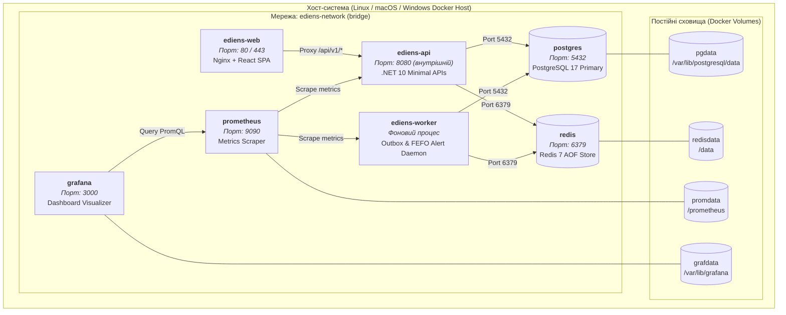

# 10. Модель розгортання (Deployment Model)

> **Статус:** Затверджено  
> **Версія:** 1.0.0  
> **Авторство:** ēdiens DevOps & Platform Engineering Group (TASK-02)

---

## 10.1 Огляд та цілі моделі розгортання

Модель розгортання системи **ēdiens** базується на повній контейнеризації всіх компонентів за допомогою **Docker** та оркестрації через **Docker Compose** для локальної розробки, CI/CD середовищ і продуктових стендів. Це повністю задовольняє вимогу **NFR-06 (Portability & Containerization)**: будь-який розробник або інженер може розгорнути повний функціональний стек однією командою.



---

## 10.2 Нефункціональна вимога NFR-06: Portability & Containerization

- **NFR-06.1 (Однокомандний запуск):** Вся екосистема ēdiens (веб-інтерфейс, бекенд API, фоновий воркер, база даних PostgreSQL 17, Redis 7, Prometheus та Grafana) має успішно підніматися командою:
  ```bash
  docker compose up --build -d
  ```
  без необхідності попереднього встановлення .NET SDK, Node.js чи СУБД на хост-машину.
- **NFR-06.2 (Ізоляція та персистентність):** Стан бази даних, кешів та метрик має зберігатися між перезапусками у виділених Docker Volumes (`pgdata`, `redisdata`, `promdata`).
- **NFR-06.3 (Мінімальний розмір образів):** Продакшн-образи будуються з використанням багатоетапної збірки (Multi-Stage Builds) на базі мінімальних базових образів Alpine Linux або Chiseled Ubuntu, мінімізуючи вектор атак і час завантаження.

---

## 10.3 Специфікація Docker Compose (`docker-compose.yml`)

Конфігурація визначає взаємодію сервісів, залежності здоров'я (`healthcheck`), ліміти ресурсів та змінні оточення:

```yaml
version: '3.8'

networks:
  ediens-network:
    driver: bridge

volumes:
  pgdata:
  redisdata:
  promdata:
  grafdata:

services:
  postgres:
    image: postgres:17-alpine
    container_name: ediens-postgres
    restart: unless-stopped
    environment:
      POSTGRES_DB: ediens_db
      POSTGRES_USER: ediens_user
      POSTGRES_PASSWORD: ediens_secure_password
    volumes:
      - pgdata:/var/lib/postgresql/data
    ports:
      - "5432:5432"
    networks:
      - ediens-network
    healthcheck:
      test: ["CMD-SHELL", "pg_isready -U ediens_user -d ediens_db"]
      interval: 5s
      timeout: 5s
      retries: 5
    deploy:
      resources:
        limits:
          cpus: '1.0'
          memory: 1024M

  redis:
    image: redis:7-alpine
    container_name: ediens-redis
    restart: unless-stopped
    command: ["redis-server", "--appendonly", "yes"]
    volumes:
      - redisdata:/data
    ports:
      - "6379:6379"
    networks:
      - ediens-network
    healthcheck:
      test: ["CMD", "redis-cli", "ping"]
      interval: 5s
      timeout: 3s
      retries: 5
    deploy:
      resources:
        limits:
          cpus: '0.5'
          memory: 512M

  ediens-api:
    build:
      context: .
      dockerfile: src/Ediens.Api/Dockerfile
    container_name: ediens-api
    restart: unless-stopped
    depends_on:
      postgres:
        condition: service_healthy
      redis:
        condition: service_healthy
    environment:
      ASPNETCORE_ENVIRONMENT: Production
      ConnectionStrings__DefaultConnection: "Host=postgres;Port=5432;Database=ediens_db;Username=ediens_user;Password=ediens_secure_password"
      ConnectionStrings__Redis: "redis:6379"
      JwtSettings__Secret: "EdiensSecretKeyLongEnoughForHMACSHA256Security2026!"
    networks:
      - ediens-network
    healthcheck:
      test: ["CMD-SHELL", "curl -f http://localhost:8080/healthz/ready || exit 1"]
      interval: 10s
      timeout: 5s
      retries: 3
      start_period: 15s
    deploy:
      resources:
        limits:
          cpus: '1.5'
          memory: 1024M

  ediens-worker:
    build:
      context: .
      dockerfile: src/Ediens.Worker/Dockerfile
    container_name: ediens-worker
    restart: unless-stopped
    depends_on:
      postgres:
        condition: service_healthy
      redis:
        condition: service_healthy
    environment:
      DOTNET_ENVIRONMENT: Production
      ConnectionStrings__DefaultConnection: "Host=postgres;Port=5432;Database=ediens_db;Username=ediens_user;Password=ediens_secure_password"
      ConnectionStrings__Redis: "redis:6379"
    networks:
      - ediens-network
    deploy:
      resources:
        limits:
          cpus: '0.5'
          memory: 512M

  ediens-web:
    build:
      context: src/ediens-web
      dockerfile: Dockerfile
    container_name: ediens-web
    restart: unless-stopped
    ports:
      - "80:80"
    depends_on:
      ediens-api:
        condition: service_healthy
    networks:
      - ediens-network

  prometheus:
    image: prom/prometheus:v2.54.1
    container_name: ediens-prometheus
    volumes:
      - ./infrastructure/prometheus/prometheus.yml:/etc/prometheus/prometheus.yml:ro
      - promdata:/prometheus
    ports:
      - "9090:9090"
    networks:
      - ediens-network

  grafana:
    image: grafana/grafana:11.2.0
    container_name: ediens-grafana
    volumes:
      - ./infrastructure/grafana/provisioning:/etc/grafana/provisioning:ro
      - grafdata:/var/lib/grafana
    ports:
      - "3000:3000"
    depends_on:
      - prometheus
    networks:
      - ediens-network
```

---

## 10.4 Управління конфігурацією та секретами

Конфігураційні параметри розподілені за ієрархічним принципом:
1. **Базові налаштування (Non-Sensitive):** Зберігаються у файлах `appsettings.json` (лог-левели, форматування дат, назви черг).
2. **Чутливі параметри (Secrets):** Передаються виключно через змінні середовища хоста або файл `.env` (що знаходиться в `.gitignore`):
   - `ConnectionStrings__DefaultConnection` (паролі БД);
   - `JwtSettings__Secret` (секретний ключ підпису токенів);
   - `VapidSettings__PrivateKey` (приватний ключ push-сповіщень).

---

## 10.5 Плавне завершення роботи (Graceful Shutdown)

Для уникнення втрати транзакцій під час перерозгортання або зупинки контейнерів у .NET 10 налаштовано подовжений таймаут зупинки:
```csharp
builder.Services.Configure<HostOptions>(opts =>
{
    opts.ShutdownTimeout = TimeSpan.FromSeconds(30);
});
```
При отриманні сигналу `SIGTERM`:
1. Nginx перестає приймати нові з'єднання та повертає код перенаправлення.
2. Web API завершує обробку активних HTTP-запитів протягом 30 секунд.
3. Фоновий воркер чекає завершення поточної пачки повідомлень з Transactional Outbox і безпечно фіксує транзакцію перед завершенням процесу.
