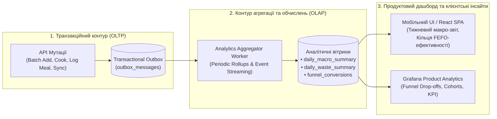
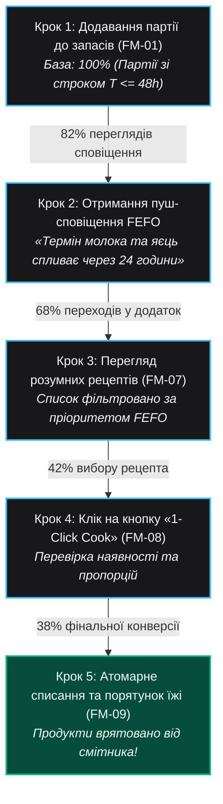
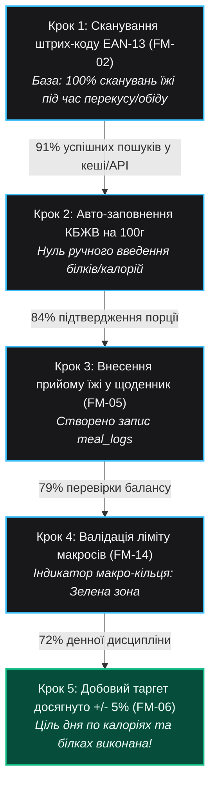
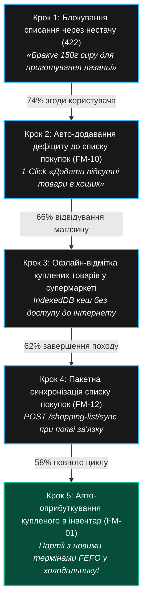

# 11. Модель функціональної аналітики продукту (Functional Product Analytics Model)

> **Статус:** Офіційний реліз розширеної інженерної специфікації (Baseline)  
> **Версія:** 2.0.0  
> **Модуль SRS:** Розділ 11 (Product Analytics, Zero-Waste KPIs, Funnel Mechanics & Data Aggregation)  
> **Зв'язок із завданнями:** DOC-03, TASK-02, FR-01..FR-12, NFR-05  
> **Стандарти:** ISO/IEC 15939 (Software measurement process), Pirate Metrics Framework (AARRR), Google HEART Framework

---

## 1. Архітектурні принципи та цілі аналітичної моделі

Аналітична модель платформи **ēdiens** спроектована для вимірювання реальної ефективності трьох взаємопов'язаних продуктових стовпів:
1. **Зниження харчових відходів (Zero-Food-Waste Efficiency):** Кількісна оцінка відсотка врятованої їжі за рахунок своєчасного використання за правилом **FEFO** (*First Expired, First Out*).
2. **Точність нутриціологічної дисципліни (Precision Nutrition Adherence):** Моніторинг відхилення фактичного щоденного споживання калорій, білків, жирів та вуглеводів від персоналізованих цілей.
3. **Замкнений цикл поповнення та споживання запасів (Closed-Loop Pantry-to-Table Orchestration):** Аналіз швидкості руху продуктів від списку покупок у супермаркеті до холодильника та автоматичного списання через 1-Click Cook.

### Ключові конвенції та правила збору даних:
- **Повна ізоляція аналітичних контурів (OLTP vs OLAP):** Аналітичні розрахунки не створюють блокувань у транзакційній базі. Первинні події генеруються у межах бізнес-транзакцій через **Transactional Outbox**, а фонові воркери формують денормалізовані агрегати у таблицях `daily_macro_summary`, `daily_household_waste_summary` та `analytics_funnel_events`.
- **Конфіденційність та анонімізація:** Усі аналітичні показники знеособлюються. Персональні ідентифікатори користувачів замінюються синтетичними хешами перед генерацією звітів.

---

## 2. Головна таблиця 15 функціональних продуктових метрик (FM-01 .. FM-15)

Нижче наведено повний перелік 15 ключових функціональних продуктових метрик платформи **ēdiens**. Кожна метрика містить математичну формулу, виміри розрізу (Dimensions), джерело подій, прив'язку до функціональних вимог (FR-01..FR-12) та цільовий орієнтир (Target KPI).

| ID | Назва продуктової метрики | Математична формула / Правило агрегації | Виміри (Dimensions / Labels) | Тригерна API / Доменна подія | Зв'язок із FR | Цільовий KPI | Бізнес-мета та призначення |
| :--- | :--- | :--- | :--- | :--- | :---: | :---: | :--- |
| **FM-01** | **Inventory Batch Addition Rate** (Інтенсивність поповнення запасів) | $$\text{Count}(\text{BatchAddedEvent})$$ | `category`, `storage_location` (fridge, freezer, pantry), `input_method` (barcode, manual, receipt_sync) | `POST /api/v1/inventory/batches` (`BatchAddedEvent`) | **FR-01**, **FR-02** | $\ge 12$ партій / сім'ю на тиждень | Вимірювання регулярності ведення обліку продуктів домогосподарством. |
| **FM-02** | **Barcode Scan Hit Ratio** (Точність розпізнавання штрих-кодів) | $$\frac{\text{Hits}}{\text{TotalScans}} \times 100\%$$ | `source` (`local_db`, `openfoodfacts`), `category`, `client_platform` (web, pwa) | `GET /api/v1/products/barcode/{code}` (`BarcodeScannedEvent`) | **FR-02** | $\ge 88\%$ успішних розпізнавань | Зниження тертя користувача при додаванні нових товарів до холодильника. |
| **FM-03** | **Pre-Expiry Consumption Rate** (FEFO Efficiency: Відсоток вчасного споживання) | $$\frac{\sum Qty_{\text{consumed\_before\_expiry}}}{\sum Qty_{\text{total\_batches}}} \times 100\%$$ | `category`, `household_id`, `shelf_life_days_bucket` (<3d, 3-7d, >7d) | `POST /api/v1/recipes/{id}/cook` / `BatchDepletedEvent` | **FR-01**, **FR-09** | $\ge 92\%$ спожито до кінця терміну | Головна місія: запобігання псуванню запасів через пріоритет FEFO. |
| **FM-04** | **Food Spoilage / Waste Ratio** (Коефіцієнт харчових втрат) | $$\frac{\sum \text{Grams}_{\text{expired\_discarded}}}{\sum \text{Grams}_{\text{total\_purchased}}} \times 100\%$$ | `category` (dairy, meat, produce, bakery), `household_id` | `POST /api/v1/inventory/batches/{id}/discard` (`BatchExpiredEvent`) | **FR-03**, **FR-09** | $\le 8\%$ втрат від загальної ваги | Мінімізація викинутої їжі та економія сімейного бюджету. |
| **FM-05** | **Daily Macro Logging Adherence** (Дисципліна щоденного трекінгу КБЖВ) | $$\frac{\text{DaysWithLoggedMeals}}{7} \times 100\%$$ | `user_id`, `goal_type` (cut, maintain, bulk), `user_tenure_weeks` | `POST /api/v1/meal-logs` (`MealLoggedEvent`) | **FR-04** | $\ge 5.5$ днів / тиждень ($\ge 78\%$) | Формування сталої звички ведення харчового щоденника. |
| **FM-06** | **Caloric & Protein Target Accuracy** (Точність попадання в макро-бюджет) | $$\Delta_M = \frac{|M_{\text{actual}} - M_{\text{target}}|}{M_{\text{target}}} \times 100\%$$ | `macro_type` (calories, protein, fat, carbs), `user_id`, `day_of_week` | `daily_macro_summary` rollup calculation | **FR-05** | $\Delta_{\text{cal}} \le 7\%$, $\Delta_{\text{protein}} \le 10\%$ | Запобігання недоїданню або переїданню відповідно до фітнес-цілей. |
| **FM-07** | **Recipe Recommendation Match Score** (Індекс відповідності рецептів наявним запасам) | $$\text{Avg}\left(\frac{\text{AvailableIngredients}}{\text{TotalRecipeIngredients}}\right)$$ | `cuisine_type`, `prep_time_bucket` (<15m, 15-30m, >30m), `household_id` | `POST /api/v1/recipes/recommendations/smart` | **FR-06** | $\ge 82\%$ наявних інгредієнтів | Мінімізація потреби в додаткових екстрених походах до магазину. |
| **FM-08** | **Recipe Recommendation-to-Cook Conversion Rate** (Конверсія рекомендації у приготування) | $$\frac{\text{Count}(\text{RecipesCooked})}{\text{Count}(\text{RecommendationsViewed})} \times 100\%$$ | `expiring_priority_flag` (true/false), `missing_ingredients_count` (0, 1, 2+) | `POST /api/v1/recipes/{id}/cook` (`RecipeCookedEvent`) | **FR-06**, **FR-07** | $\ge 35\%$ для рецептів з продуктами, що спливають | Оцінка ефективності алгоритму рекомендацій смарт-рецептів. |
| **FM-09** | **Expiring Ingredient Rescue Rate** (Маса врятованих критичних інгредієнтів) | $$\sum \text{Grams}_{\text{expiring\_used\_in\_cooking}}$$ | `days_to_expiry_bucket` (0-24h, 24-48h, 48-72h), `category` | `POST /api/v1/recipes/{id}/cook` | **FR-06**, **FR-07** | $\ge 1.8\text{ кг}$ врятованих продуктів на сім'ю/тиждень | Пряма кількісна оцінка внеску системи у скорочення відходів. |
| **FM-10** | **Missing Ingredient Auto-Cart Adoption** (Конверсія дефіциту продуктів у список покупок) | $$\frac{\text{Count}(\text{CartAdditionsFrom422})}{\text{Count}(\text{422\_InsufficientStockErrors})} \times 100\%$$ | `recipe_id`, `category`, `household_id` | `POST /api/v1/shopping-list/batch` (Source: CookModal422) | **FR-07**, **FR-08** | $\ge 65\%$ додавання відсутніх товарів | Усунення бар'єра при спробі приготувати рецепт без потрібних інгредієнтів. |
| **FM-11** | **Household Multi-User Collaboration Index** (Коефіцієнт сімейної колаборації) | $$\text{CountDistinct}(\text{ActiveMembersPerHouseholdPerWeek})$$ | `household_size` (1, 2, 3-4, 5+), `role` (Owner, Editor) | All authenticated mutating API requests | **FR-10** | $\ge 1.8$ активних користувачів на сім'ю $\ge 2$ осіб | Перевірка мультитенантного використання замість одноосібного обліку. |
| **FM-12** | **Shopping List Sync Completion Rate** (Відсоток викуплених та оприбуткованих товарів) | $$\frac{\text{CheckedItemsConvertedToInventory}}{\text{TotalShoppingListItems}} \times 100\%$$ | `sync_mode` (online, offline_batch), `store_trip_duration` | `POST /api/v1/households/{id}/shopping-list/sync` | **FR-08**, **FR-11** | $\ge 85\%$ запланованих покупок оприбутковано | Замкнений цикл: список покупок автоматично стає партіями в холодильнику. |
| **FM-13** | **Concurrency Conflict Resolution Rate** (Успішність авто-вирішення конфліктів версій) | $$\frac{\text{Resolved409Merges}}{\text{Total409Conflicts}} \times 100\%$$ | `resolution_choice` (keep_mine, accept_remote, manual_merge), `entity_type` | `PATCH /api/v1/inventory/batches/{id}` | **FR-03**, **FR-10** | $\ge 95\%$ вирішення конфлікту за $< 5$ секунд | Мінімізація негативного досвіду користувачів при одночасному редагуванні. |
| **FM-14** | **Macro Budget Overrun Override Rate** (Частота свідомого перевищення ліміту калорій) | $$\frac{\text{ForcedMealLogsAfter422}}{\text{Total422MacroBudgetWarnings}} \times 100\%$$ | `meal_slot` (breakfast, lunch, dinner, snack), `user_goal` | `POST /api/v1/meal-logs` (Header: `X-Override-Macro-Cap: true`) | **FR-04**, **FR-05** | $\le 20\%$ примусових перелімітів | Запобігання зривам у дієті при збереженні гнучкості користувача. |
| **FM-15** | **Time-to-First-Cooked-Meal** (Час до першого приготованого рецепта в онбордингу) | $$T_{\text{FirstCook}} - T_{\text{Registration}} \text{ (хвилини)}$$ | `acquisition_channel`, `household_type` (single, family) | `POST /api/v1/recipes/{id}/cook` | **FR-01**, **FR-07** | $\le 45$ хвилин для 60% нових користувачів | Швидкість досягнення «Ага!-моменту» (Aha! Moment) новим користувачем. |

---

## 3. Наскрізні конверсійні воронки продукту (End-to-End Product Funnels)

### 3.1 Воронка 1: Нульові відходи — «Від холодильника до приготованої страви» (Zero-Waste Funnel)

Головна мета воронки — своєчасне виявлення продуктів із критичним терміном придатності ($T \le 48\text{ годин}$) та їх трансформація у приготовану страву до настання псування.

#### Покроковий аналіз дроп-офів (Drop-off Analysis):
1. **Від Кроку 1 до Кроку 2 (Втрата 18%):** Причина — вимкнені системні повідомлення або відсутність дозволу на Web Push у браузері.
   *Оптимізація:* Впровадження in-app бейджів-нагадувань на головній панелі та щоденного зведення в Telegram.
2. **Від Кроку 2 до Кроку 3 (Втрата 14%):** Користувач побачив сповіщення, але не має часу відкрити додаток одразу.
   *Оптимізація:* Deep-linking безпосередньо на екран рекомендованих рецептів із одного кліка по пуш-повідомленню.
3. **Від Кроку 3 до Кроку 4 (Втрата 26%):** Рекомендовані страви вимагають занадто багато часу на приготування або бракує 2-3 додаткових інгредієнтів.
   *Оптимізація:* Пріоритизація рецептів категорії «Швидка вечеря до 15 хвилин» та підтримка смарт-замін (наприклад, сметана замість вершків).
4. **Від Кроку 4 до Кроку 5 (Втрата 4%):** Конфлікт блокування `409 Conflict` (партнер уже використав ці продукти) або раптова відсутність електрики/газу.

---

### 3.2 Воронка 2: Прецизійне харчування — «Від сканування штрих-коду до щоденного макро-таргету» (Precision Nutrition Funnel)

Мета воронки — забезпечення мінімальних часових витрат користувача на точне ведення щоденника КБЖВ без відмови від трекінгу через втому чи рутину.

#### Покроковий аналіз дроп-офів:
1. **Від Кроку 1 до Кроку 2 (Втрата 9%):** Невідомий локальний штрих-код (наприклад, крафтова випічка або локальна кулінарія супермаркету), відсутній у базі OpenFoodFacts.
   *Оптимізація:* Форма швидкого створення «Кастомний продукт за 3 кліки» з інтелектуальним підбором аналога за категорією.
2. **Від Кроку 2 до Кроку 3 (Втрата 7%):** Користувач не знає точної ваги страви в грамах через відсутність кухонних ваг.
   *Оптимізація:* Підтримка інтуїтивних одиниць виміру («1 склянка», «1 шматок», «столова ложка», «пачка»).
3. **Від Кроку 3 до Кроку 4 (Втрата 5%):** Отримання попередження про перевищення добового ліміту жирів чи вуглеводів.
   *Оптимізація:* Пропозиція зменшити рекомендований розмір порції безпосередньо у діалоговому вікні.

---

### 3.3 Воронка 3: Замкнений цикл поповнення — «Від дефіциту інгредієнтів до поповнення холодильника» (Closed-Loop Restocking Funnel)

Мета воронки — безшовне перетворення відмови у приготуванні рецепта через брак інгредієнтів на автоматично сформований список покупок та його подальше оприбуткування після повернення з магазину.

#### Покроковий аналіз дроп-офів:
1. **Від Кроку 1 до Кроку 2 (Втрата 26%):** Користувач вирішує готувати іншу страву з тих, на які інгредієнтів вистачає на 100%.
2. **Від Кроку 2 до Кроку 3 (Втрата 8%):** Похід до магазину відкладається або товар купується без використання додатку.
3. **Від Кроку 3 до Кроку 4 (Втрата 4%):** Збій під час синхронізації через повний розряд смартфона або закриття вкладки до виходу в онлайн.
   *Оптимізація:* Background Sync API через Service Worker, що гарантує відправку буфера одразу при підключенні до домашнього Wi-Fi.
4. **Крок 5 (Фінал):** Куплені продукти миттєво з'являються у холодильнику з автоматично розрахованими середніми термінами придатності, розблоковуючи бажаний рецепт.
