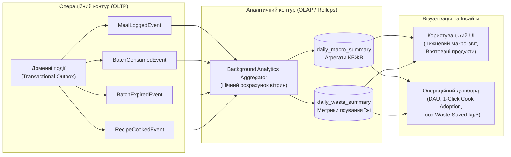

# 11. Модель аналітики (Analytics Model)

> **Статус:** Затверджено  
> **Версія:** 1.0.0  
> **Авторство:** ēdiens Product & Data Analytics Working Group (TASK-02)

---

## 11.1 Огляд та цілі моделі аналітики

Модель аналітики системи **ēdiens** забезпечує вимірювання продуктових показників успішності, оцінку харчової поведінки користувачів та кількісний розрахунок ключової місії проекту — **скорочення харчових відходів (Food Waste Reduction)** за принципом **FEFO**.



---

## 11.2 Ключові продуктові метрики (KPI)

### 1. Ефективність запобігання харчовим відходам (Food Waste Reduction)
- **Коефіцієнт утилізації запасів (Inventory Utilization Rate, $IUR$):**
  $$IUR = \frac{\sum Qty_{consumed}}{\sum Qty_{consumed} + \sum Qty_{expired}} \times 100\%$$
  *Цільове значення:* $\ge 92\%$ (не більше $8\%$ викинутої їжі).
- **Економічна вигода (Saved Food Value, $SFV$):** Оціночна грошова вартість продуктів, спожитих до закінчення терміну придатності завдяки рекомендаціям страв:
  $$SFV = \sum_{i \in ConsumedBatches} Qty_i \times PricePerUnit_i$$
- **Середній час перебування продукту в інвентарі (Inventory Turnover Days).**

### 2. Нутриціологічна дисципліна (Macro Adherence)
- **Відхилення від цільового макро-бюджету (Target Variance Score):**
  $$\Delta_{E} = \frac{|E_{actual} - E_{target}|}{E_{target}} \times 100\%$$
- **Розподіл білків, жирів та вуглеводів:** Відображення добового профілю в інтерактивному макро-кільці.
- **Логування за типами прийомів їжі:** Співвідношення між сніданком, обідом, вечерею та перекусами.

### 3. Залученість та використання функцій (Engagement & Adoption)
- **1-Click Cook Adoption Rate:** Відсоток прийомів їжі, внесених через автоматичне списання за рецептом, порівняно з ручним введенням.
- **DAU / MAU (Sticky Factor):** Регулярність повернення користувачів до перевірки холодильника.

---

## 11.3 Схема зберігання аналітичних агрегатів

Для швидкого формування звітності без перевантаження транзакційних таблиць використовуються агреговані вітрини даних:

```sql
-- Щоденний аналітичний зріз споживання макросів
CREATE TABLE daily_macro_summary (
    user_id UUID NOT NULL,
    summary_date DATE NOT NULL,
    target_calories INT NOT NULL,
    consumed_calories INT NOT NULL,
    consumed_protein NUMERIC(6, 2) NOT NULL,
    consumed_fat NUMERIC(6, 2) NOT NULL,
    consumed_carbs NUMERIC(6, 2) NOT NULL,
    meals_count INT NOT NULL,
    variance_percentage NUMERIC(5, 2) NOT NULL,
    PRIMARY KEY (user_id, summary_date)
);

-- Щоденний зріз втрат та збереження їжі домогосподарства
CREATE TABLE daily_household_waste_summary (
    household_id UUID NOT NULL,
    summary_date DATE NOT NULL,
    consumed_weight_grams NUMERIC(10, 2) NOT NULL,
    expired_weight_grams NUMERIC(10, 2) NOT NULL,
    fefo_saved_weight_grams NUMERIC(10, 2) NOT NULL,
    estimated_saved_currency NUMERIC(10, 2) NOT NULL,
    PRIMARY KEY (household_id, summary_date)
);
```

---

## 11.4 Конфіденційність даних та відповідність GDPR

1. **Анонімізація:** У глобальних аналітичних звітах ідентифікатори користувачів хешуються із застосуванням солі (`HMAC-SHA256(user_id, salt)`), що унеможливлює ідентифікацію конкретної особи.
2. **Право на забуття (Right to be Forgotten — GDPR Article 17):** При видаленні акаунта користувача всі деталізовані записи в журналі прийомів їжі (`meal_logs`) безповоротно видаляються через каскадне видалення (CASCADE DELETE). В аналітичній таблиці `daily_macro_summary` ідентифікатор користувача замінюється на фіксований `UUID: 00000000-0000-0000-0000-000000000000`, зберігаючи загальну статистику системи без персональної прив'язки.
