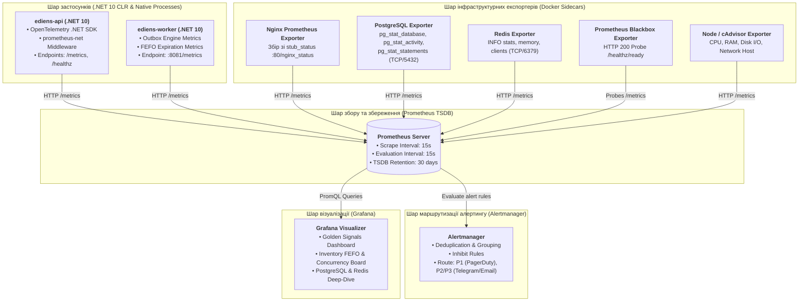

# 12. Модель моніторингу, спостережуваності та алертингу (Monitoring, Observability & Alerting Model)

> **Статус:** Офіційний реліз розширеної інженерної специфікації (Baseline)  
> **Версія:** 2.0.0  
> **Модуль SRS:** Розділ 12 (Observability, OpenTelemetry, Prometheus Metrics, 10 Production Alerts & SRE Runbooks)  
> **Зв'язок із завданнями:** DOC-03, TASK-02, NFR-01, NFR-05  
> **Стандарти:** Google SRE Book (Four Golden Signals), OpenTelemetry Semantic Conventions v1.24, Prometheus Alerting Standards, RFC 9457

---

## 1. Архітектура збору телеметрії та спостережуваності

Платформа **ēdiens** реалізує комплексну тривимірну парадигму спостережуваності (**Three Pillars of Observability**):
1. **Метрики (Metrics):** Числові часові ряди, експортовані у форматі Prometheus зі збором кожні 15 секунд.
2. **Трасування (Distributed Tracing):** Наскрізне трасування запитів за стандартом **W3C TraceContext** (`traceparent`, `tracestate`) через усі шари: React SPA $\rightarrow$ Nginx $\rightarrow$ .NET 10 Kestrel $\rightarrow$ EF Core / Npgsql $\rightarrow$ Redis $\rightarrow$ Outbox Worker.
3. **Логи (Structured Logs):** Структуровані JSON-логи через бібліотеку `Serilog` з обов'язковими контекстними полями `trace_id`, `span_id`, `user_id`, `household_id`, `client_ip` та санітизацією чутливих даних (PII).



### Деталі підключення OpenTelemetry у .NET 10:
У файлі конфігурації `Program.cs` сервіс реєструє інструментування лічильників ASP.NET Core, HttpClient, Runtime та власний простір імен `Ediens.*`:

```csharp
builder.Services.AddOpenTelemetry()
    .WithMetrics(metrics => metrics
        .SetResourceBuilder(ResourceBuilder.CreateDefault().AddService("Ediens.Api"))
        .AddAspNetCoreInstrumentation()
        .AddHttpClientInstrumentation()
        .AddRuntimeInstrumentation()
        .AddProcessInstrumentation()
        .AddMeter("Ediens.Core.Inventory")
        .AddMeter("Ediens.Core.Recipes")
        .AddMeter("Ediens.Core.Outbox")
        .AddPrometheusExporter());
```

---

## 2. Головна таблиця 15 операційних метрик інфраструктури (OM-01 .. OM-15)

Нижче наведено повний каталог 15 ключових операційних метрик інфраструктури та сервісів платформи **ēdiens**.

| ID | Назва метрики в Prometheus | Тип метрики | Виміри (Dimensions / Labels) | Прив'язаний ресурс інфраструктури | Метод збору та інтервал | Опис та інженерне призначення |
| :--- | :--- | :--- | :--- | :--- | :--- | :--- |
| **OM-01** | `http_server_request_duration_seconds` | Histogram | `http_route`, `http_request_method_name`, `http_response_status_code` | .NET 10 Kestrel Web API | OpenTelemetry ASP.NET Core Middleware (Scrape 15s) | Розподіл часу відповіді API ($p50, p95, p99$). Бакети: `0.005, 0.01, 0.025, 0.05, 0.1, 0.25, 0.5, 1, 2.5, 5s`. |
| **OM-02** | `http_server_requests_total` | Counter | `http_route`, `http_response_status_code`, `error_code` | .NET 10 Kestrel Web API | OpenTelemetry ASP.NET Core Metrics (Scrape 15s) | Загальна кількість запитів для підрахунку RPS, відсотка 4xx та 5xx помилок. |
| **OM-03** | `ediens_concurrency_conflicts_total` | Counter | `entity_type` (`inventory_batch`, `meal_log`, `recipe`), `household_id` | .NET 10 Concurrency Middleware | Власний лічильник `System.Diagnostics.Metrics.Counter` | Фіксація колізій `409 Conflict` (невідповідність системного `xmin` або ETag). |
| **OM-04** | `ediens_rate_limit_rejections_total` | Counter | `policy_name` (`auth_strict`, `recipes_smart`, `sync_bulk`), `endpoint` | .NET 10 PartitionedRateLimiter | Middleware відхилення запитів із HTTP `429 Too Many Requests` | Виявлення спроб перебору паролів або DoS-атак на ресурсомісткі ендпоінти. |
| **OM-05** | `dotnet_process_cpu_usage_ratio` & `dotnet_process_memory_working_set_bytes` | Gauge | `process_name`, `container_name` (`ediens-api`, `ediens-worker`) | .NET 10 CLR Runtime / Docker Cgroups | .NET Runtime Instrumentation / cAdvisor (Scrape 15s) | Споживання ядер процесора (0.0..1.0) та оперативної пам'яті контейнером бекенду. |
| **OM-06** | `dotnet_gc_pause_duration_seconds` & `dotnet_threadpool_queue_length` | Histogram / Gauge | `generation` (`gen0`, `gen1`, `gen2`), `process_name` | .NET 10 Garbage Collector & ThreadPool | .NET EventCounters / OpenTelemetry Runtime Metrics | Тривалість пауз зупинки світу (Stop-the-world GC) та розмір черги очікування пулу потоків. |
| **OM-07** | `npgsql_connection_pool_active_connections` & `npgsql_connection_pool_wait_count` | Gauge / Counter | `database`, `pool_name` | EF Core 10 / Npgsql Connection Pool | Драйвер Npgsql Performance Counters (Scrape 15s) | Кількість активних з'єднань із PostgreSQL та лічильник очікувань вільного сокета в пулі. |
| **OM-08** | `pg_stat_activity_count` & `pg_locks_count` | Gauge | `datname`, `state` (`active`, `idle_in_transaction`), `mode` (`ExclusiveLock`, `RowShareLock`) | PostgreSQL 16 Primary | PostgreSQL Exporter через системний погляд `pg_stat_activity` | Кількість відкритих сесій до СУБД та кількість блокувань на рівні рядків/таблиць. |
| **OM-09** | `pg_stat_statements_mean_exec_time_ms` & `pg_stat_database_deadlocks_total` | Gauge / Counter | `datname`, `queryid` | PostgreSQL 16 Engine | Модуль `pg_stat_statements` та `pg_stat_database` | Середній час виконання важких SQL-запитів та загальна кількість виявлених дедлоків. |
| **OM-10** | `pg_database_size_bytes` & `node_filesystem_avail_bytes` | Gauge | `datname`, `mountpoint` (`/var/lib/postgresql/data`, `/`) | Хост Ubuntu 24.04 / Docker NVMe Volume | Node Exporter & PostgreSQL Exporter | Фізичний розмір бази даних та залишок вільного дискового простору на розділі. |
| **OM-11** | `redis_connected_clients` & `redis_memory_used_bytes` / `redis_memory_max_bytes` | Gauge | `instance`, `role` (`master`) | Redis 7 Alpine In-Memory Store | Redis Prometheus Exporter (`INFO memory`, `INFO clients`) | Кількість клієнтських сокетів та відсоток заповнення виділеного ліміту пам'яті (512 МБ). |
| **OM-12** | `redis_keyspace_hits_total` vs `redis_keyspace_misses_total` | Counter | `instance`, `db` | Redis 7 HybridCache L2 Store | Redis Exporter (`INFO stats`) | Відсоток влучання в кеш (Cache Hit Ratio): $\text{Hits} / (\text{Hits} + \text{Misses}) \times 100\%$. |
| **OM-13** | `ediens_outbox_pending_messages_count` & `ediens_outbox_oldest_unprocessed_age_seconds` | Gauge | `event_type` (`RecipeCooked`, `BatchConsumed`, `InventoryUpdated`) | .NET 10 Transactional Outbox Worker | Фоновий воркер через SQL-запит `COUNT(*) WHERE processed_at IS NULL` | Розмір нерозібраної черги повідомлень Outbox та вік найстарішої події в секундах. |
| **OM-14** | `ediens_external_barcode_api_duration_seconds` & `circuit_breaker_state` | Histogram / Gauge | `target_service` (`open_food_facts`, `usda_nutrition`), `state` (`Closed`, `HalfOpen`, `Open`) | Outbound Polly HTTP Client | Інструментування вихідного `HttpClient` через Polly Resilience | Затримка запитів до зовнішнього каталогу продуктів та статус захисного автомата аварій. |
| **OM-15** | `probe_success` & `probe_http_duration_seconds` | Gauge / Histogram | `target` (`https://ediens.app/healthz/ready`), `instance` | Nginx Ingress / End-to-End System | Prometheus Blackbox Exporter (Зовнішній зонд кожні 15s) | Комплексна доступність системи (1 = Up, 0 = Down) та наскрізний мережевий пінг. |

---

## 3. Матриця правил алертингу (10 обов'язкових правил AL-01 .. AL-10)

Нижче наведено повну матрицю з 10 критичних та попереджувальних правил алертингу Prometheus Alertmanager.

| ID алерту | Назва правила в Prometheus | PromQL вираз перевірки | Допустимий діапазон норми | Поріг Warning | Поріг Critical | Вікно оцінки (`for`) | Рівень критичності | Канал сповіщення |
| :--- | :--- | :--- | :---: | :---: | :---: | :---: | :---: | :---: |
| **AL-01** | `HighHttp5xxErrorRate` | `(sum(rate(http_server_requests_total{http_response_status_code=~"5.."}[5m])) / sum(rate(http_server_requests_total[5m]))) * 100` | $0.0\% - 0.5\%$ | $> 1.0\%$ | $> 5.0\%$ | 2m | **P1 (Critical)** | PagerDuty, Telegram Emergency |
| **AL-02** | `HighApiLatencyP95` | `histogram_quantile(0.95, sum(rate(http_server_request_duration_seconds_bucket[5m])) by (le, http_route))` | $\le 150\text{ ms}$ (CRUD)<br/>$\le 800\text{ ms}$ (Smart) | $> 250\text{ ms}$ (CRUD)<br/>$> 800\text{ ms}$ (Smart) | $> 1500\text{ ms}$ | 5m | **P2 (Major)** | Telegram Alerts |
| **AL-03** | `EdiensApiDown` | `probe_success{instance="https://ediens.app/healthz/ready"} == 0 or up{job="ediens-api"} == 0` | $1$ (Сервіс живий) | — | $== 0$ | 1m | **P1 (Critical)** | PagerDuty On-Call, Phone Call |
| **AL-04** | `PostgresConnectionPoolExhaustion` | `(npgsql_connection_pool_active_connections / 100) * 100` | $10\% - 60\%$ | $> 80\%$ | $> 92\%$ | 2m | **P1 (Critical)** | Telegram Emergency, PagerDuty |
| **AL-05** | `PostgresDeadlocksDetected` | `increase(pg_stat_database_deadlocks_total[5m])` | $0$ дедлоків | $> 0$ (за 5 хв) | $> 3$ (за 5 хв) | 1m | **P2 (Major)** | Telegram Alerts |
| **AL-06** | `OutboxProcessingLagHigh` | `ediens_outbox_pending_messages_count > 100 or ediens_outbox_oldest_unprocessed_age_seconds > 120` | $\le 20$ повідомлень<br/>$\text{Вік} \le 15\text{ с}$ | $\text{Вік} > 60\text{ с}$ | $> 100\text{ повідомлень}$ або $\text{Вік} > 120\text{ с}$ | 5m | **P2 (Major)** | Telegram Alerts |
| **AL-07** | `RedisMemorySaturation` | `(redis_memory_used_bytes / redis_memory_max_bytes) * 100` | $20\% - 60\%$ | $> 80\%$ | $> 95\%$ | 3m | **P1 (Critical)** | Telegram Emergency, PagerDuty |
| **AL-08** | `HighInventoryConcurrencyConflicts` | `(rate(ediens_concurrency_conflicts_total[5m]) / (rate(http_server_requests_total{http_request_method_name=~"POST\|PATCH\|PUT"}[5m]) + 0.001)) * 100` | $\le 3.0\%$ | $> 8.0\%$ | $> 15.0\%$ | 5m | **P2 (Major)** | Telegram Alerts |
| **AL-09** | `RateLimiterAbuseSpike` | `sum(rate(ediens_rate_limit_rejections_total[1m]))` | $\le 5\text{ req/min}$ | $> 20\text{ req/min}$ | $> 50\text{ req/min}$ | 1m | **P2 (Major)** | Telegram Alerts |
| **AL-10** | `HostDiskSpaceExhaustion` | `(node_filesystem_avail_bytes{mountpoint="/"} / node_filesystem_size_bytes{mountpoint="/"}) * 100` | $> 30\%$ вільно | $< 15\%$ вільно | $< 8\%$ вільно | 5m | **P1 (Critical)** | PagerDuty, Telegram Emergency |

---

## 4. Покрокові інженерні регламенти усунення інцидентів (SRE Mitigation Runbooks)

Нижче наведено вичерпні покрокові інструкції дій чергового інженера під час спрацювання кожного з 10 алертингових правил.

---

### 4.1 Runbook AL-01: Критичний сплеск 5xx помилок API (`HighHttp5xxErrorRate`)
- **Симптоми:** Клієнти отримують сторінку 500/502/503. Відсоток помилок перевищує 5%.
- **Покроковий план локалізації та ліквідації:**
  1. Перевірити останні логи застосунку за допомогою Docker CLI:
     ```bash
     docker compose logs --tail=200 -f ediens-api | grep -i "fail\|crit\|exception"
     ```
  2. Знайти унікальний `traceId` з проблемних відповідей користувачів та відфільтрувати спани в Jaeger / Grafana Loki.
  3. Якщо помилка викликана збоєм міграції або падінням коннекту до СУБД: перевірити доступність контейнера PostgreSQL:
     ```bash
     docker compose exec ediens-postgres pg_isready -U ediens_user -d ediens_db
     ```
  4. Якщо помилка з'явилася одразу після релізу нової версії образу: виконати миттєвий відкат (Rollback):
     ```bash
     git checkout HEAD~1 && docker compose up -d ediens-api
     ```

---

### 4.2 Runbook AL-02: Висока затримка обробки запитів API (`HighApiLatencyP95`)
- **Симптоми:** Відповіді на запити виконуються понад 1500 мс. Користувачі помічають зависання інтерфейсу при переході між екранами.
- **Покроковий план:**
  1. Визначити проблемний маршрут (`http_route`) через PromQL:
     ```promql
     topk(5, sum(rate(http_server_request_duration_seconds_sum[5m])) by (http_route) / sum(rate(http_server_request_duration_seconds_count[5m])) by (http_route))
     ```
  2. Якщо затримка на `POST /recipes/recommendations/smart`:
     - Перевірити стан процесора (`top`, `docker stats ediens-api`).
     - Перевірити утилізацію HybridCache: якщо hit-ratio впав нижче 40%, перевірити зв'язок із Redis.
  3. Якщо затримка на CRUD-операціях інвентарю: перевірити тривалі запити в PostgreSQL через `pg_stat_activity`:
     ```sql
     SELECT pid, now() - pg_stat_activity.query_start AS duration, query, state 
     FROM pg_stat_activity 
     WHERE state != 'idle' AND (now() - pg_stat_activity.query_start) > interval '1 second';
     ```

---

### 4.3 Runbook AL-03: Повна недоступність сервісу (`EdiensApiDown`)
- **Симптоми:** Blackbox Exporter фіксує `probe_success == 0`. Контейнер або вхідний шлюз не відповідають.
- **Покроковий план:**
  1. Перевірити статус контейнерів хоста:
     ```bash
     docker compose ps
     ```
  2. Якщо контейнер `ediens-api` у статусі `Restarting` або `Exited`:
     ```bash
     docker compose logs --tail=100 ediens-api
     ```
     Часта причина — OOMKilled (Out-of-Memory). Перевірити системний лог ядра: `dmesg -T | grep -i oom`.
  3. Якщо контейнери працюють, але запити не проходять ззовні: перевірити стан Cloudflare Tunnel та Nginx:
     ```bash
     systemctl status cloudflared || docker compose logs ediens-web
     ```
  4. Виконати перезапуск сервісу з перевіркою стану готовності:
     ```bash
     docker compose restart ediens-web ediens-api && ./scripts/smoke-test.sh
     ```

---

### 4.4 Runbook AL-04: Вичерпання пулу підключень до бази даних (`PostgresConnectionPoolExhaustion`)
- **Симптоми:** У логах API з'являється виняток `Npgsql.NpgsqlException: The connection pool has been exhausted`.
- **Покроковий план:**
  1. Перевірити активні підключення до PostgreSQL:
     ```sql
     SELECT count(*), state FROM pg_stat_activity GROUP BY state;
     ```
  2. Знайти запити в стані `idle in transaction` (завислі відкриті транзакції):
     ```sql
     SELECT pid, client_addr, now() - state_change as idle_duration, query 
     FROM pg_stat_activity 
     WHERE state = 'idle in transaction' AND now() - state_change > interval '30 seconds';
     ```
  3. Примусово завершити завислі сесії:
     ```sql
     SELECT pg_terminate_backend(pid) 
     FROM pg_stat_activity 
     WHERE state = 'idle in transaction' AND now() - state_change > interval '60 seconds';
     ```
  4. Якщо навантаження легітимне (сплеск трафіку): тимчасово збільшити параметр пулу в рядку підключення API: `Maximum Pool Size=200;` та перезапустити API.

---

### 4.5 Runbook AL-05: Виявлення дедлоків у PostgreSQL (`PostgresDeadlocksDetected`)
- **Симптоми:** Користувачі отримують випадкові 500 помилки при паралельному списанні інгредієнтів.
- **Покроковий план:**
  1. Витягти деталі останнього дедлоку з системного логу PostgreSQL:
     ```bash
     docker compose logs ediens-postgres | grep -A 10 "deadlock detected"
     ```
  2. Проаналізувати порядок блокування рядків: чи відбувається захоплення партій продуктів у різному порядку транзакціями списання.
  3. **Тимчасове пом'якшення:** Переконатися, що у коді списання сортування списуваних партій здійснюється строго за первинним ключем або терміном придатності (`ORDER BY expires_at ASC, id ASC`) перед виконанням операцій `SELECT ... FOR UPDATE`.

---

### 4.6 Runbook AL-06: Зависання черги Transactional Outbox (`OutboxProcessingLagHigh`)
- **Симптоми:** Зміни в інвентарі не відображаються у сповіщеннях інших членів сім'ї. Кількість нерозібраних подій перевищує 100.
- **Покроковий план:**
  1. Перевірити працездатність контейнера `ediens-worker`:
     ```bash
     docker compose ps ediens-worker && docker compose logs --tail=100 ediens-worker
     ```
  2. Знайти у таблиці `outbox_messages` так звану «отруйну пігулку» (Poison Pill) — повідомлення, обробка якого викликає фатальний виняток:
     ```sql
     SELECT id, event_type, retry_count, error_message, created_at 
     FROM outbox_messages 
     WHERE processed_at IS NULL AND retry_count >= 5 
     ORDER BY created_at ASC LIMIT 5;
     ```
  3. Якщо виявлено бите повідомлення із невалідним JSON: перемістити його в чергу мертвих повідомлень (Dead Letter Queue):
     ```sql
     UPDATE outbox_messages 
     SET processed_at = NOW(), error_message = 'MANUALLY_QUARANTINED_POISON_PILL' 
     WHERE id = '<poison_message_id>';
     ```
  4. Перезапустити контейнер воркера: `docker compose restart ediens-worker`.

---

### 4.7 Runbook AL-07: Переповнення пам'яті Redis (`RedisMemorySaturation`)
- **Симптоми:** Пам'ять Redis досягає >95%. Ризик скидання блокувань `lock:cook:*` через витіснення за політикою LRU.
- **Покроковий план:**
  1. Перевірити статистику використання пам'яті через Redis CLI:
     ```bash
     docker compose exec ediens-redis redis-cli info memory
     ```
  2. Перевірити розподіл ключів за типами:
     ```bash
     docker compose exec ediens-redis redis-cli --bigkeys
     ```
  3. Якщо пам'ять забита старими кешами пошуку продуктів: скинути виключно простір імен зовнішнього кешу (не зачіпаючи замки блокувань):
     ```bash
     docker compose exec ediens-redis redis-cli --scan --pattern "cache:barcode:*" | xargs -L 100 docker compose exec -T ediens-redis redis-cli del
     ```
  4. За потреби збільшити параметр пам'яті в `compose.yaml`: `maxmemory 768mb`.

---

### 4.8 Runbook AL-08: Шторм конфліктів конкурентності (`HighInventoryConcurrencyConflicts`)
- **Симптоми:** Понад 15% запитів мутацій повертають `409 Conflict`. Користувачі отримують діалогові вікна узгодження версій.
- **Покроковий план:**
  1. Визначити, чи відбувається конфлікт у межах одного домогосподарства (наприклад, масовий шопінг 5 членів сім'ї одночасно), чи це програмна циклічна спроба повтору (Retry Storm).
  2. Перевірити метрику в розрізі домогосподарств:
     ```promql
     topk(3, sum(rate(ediens_concurrency_conflicts_total[5m])) by (household_id))
     ```
  3. Якщо один клієнт відправляє десятки запитів на секунду без очікування: перевірити поведінку клієнтського React Query та наявність випадкового експоненційного бекофу (Full Jitter Retry).

---

### 4.9 Runbook AL-09: Сплеск блокувань Rate Limiter (`RateLimiterAbuseSpike`)
- **Симптоми:** Понад 50 відхилень `429 Too Many Requests` за хвилину.
- **Покроковий план:**
  1. Визначити IP-адресу зловмисника або скомпрометований акаунт через логи Nginx:
     ```bash
     docker compose exec ediens-web awk '($9 ~ /429/)' /var/log/nginx/access.log | tail -n 50
     ```
  2. Якщо атака ведеться на точку `/api/v1/auth/login`: заблокувати IP на рівні хоста або Cloudflare WAF:
     ```bash
     docker compose exec ediens-web iptables -A INPUT -s <ATTACKER_IP> -j DROP
     ```
  3. Сповістити користувача про спробу зламу його пароля, якщо атака була направлена на конкретний email.

---

### 4.10 Runbook AL-10: Вичерпання дискового простору хоста (`HostDiskSpaceExhaustion`)
- **Симптоми:** Вільний дисковий простір становить менше 8%. СУБД переходить у режим захисту від запису (Read-Only).
- **Покроковий план:**
  1. Перевірити використання файлової системи хоста:
     ```bash
     df -h /var/lib/docker
     ```
  2. Очистити старі неактивні образи Docker, білд-кеші та зупинені контейнери:
     ```bash
     docker system prune -af --volumes=false
     ```
  3. Перевірити розмір логів Docker контейнерів:
     ```bash
     du -sh /var/lib/docker/containers/*/*-json.log
     ```
     За потреби урізати файли логів: `truncate -s 0 /var/lib/docker/containers/*/*-json.log`.
  4. Перевірити каталог резервних копій PostgreSQL `/backups` та видалити архіви старіші за 14 діб.
