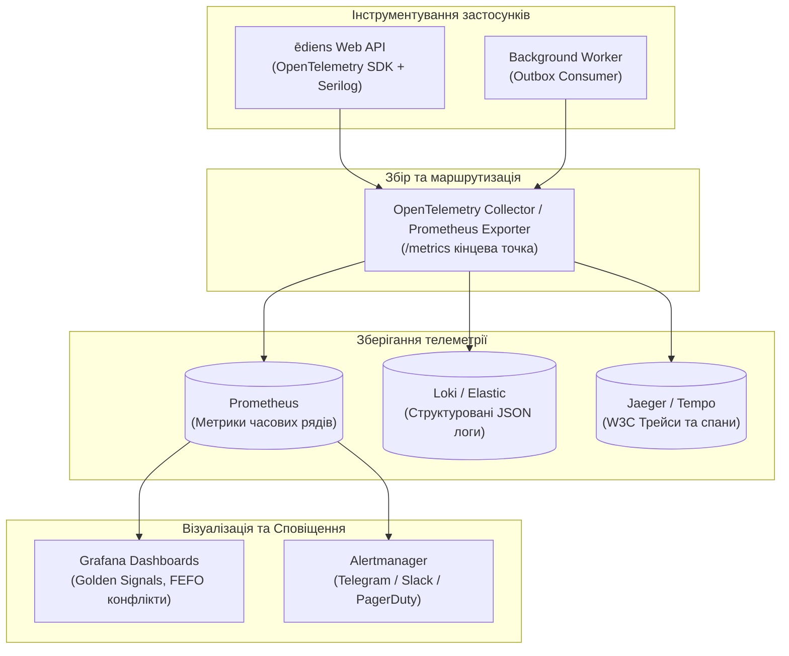

# 12. Моніторинг, спостережуваність та алертинг (Monitoring & Alerting Model)

> **Статус:** Затверджено  
> **Версія:** 1.0.0  
> **Авторство:** ēdiens Site Reliability Engineering (SRE) Working Group (TASK-02)

---

## 12.1 Огляд та цілі моделі спостережуваності

Модель моніторингу та спостережуваності (Observability) платформи **ēdiens** базується на концепції трьох стовпів (Three Pillars of Observability: **Метрики**, **Трасування**, **Логи**). Вона забезпечує суворий контроль за дотриманням **NFR-01 (Latency)** та **NFR-05 (Observability)**, дозволяючи виявляти та усувати деградації продуктивності до того, як вони вплинуть на користувачів.



---

## 12.2 Нефункціональні вимоги: NFR-01 та NFR-05

- **NFR-01 (Latency & Performance):**
  - Час відповіді API ($p95$) для базових операцій (додавання партії продукту, перегляд холодильника, списання, ручне логування їжі) не повинен перевищувати **$150\text{ ms}$**.
  - Час генерації списку рекомендацій страв ($p95$) на основі перетину термінів придатності та макросів не повинен перевищувати **$800\text{ ms}$**.
  - Час пошуку штрих-коду EAN-13 у кеші ($p95$) не перевищує **$25\text{ ms}$**.
- **NFR-05 (Observability & Distributed Tracing):**
  - Усі HTTP-запити маркуються наскрізним ідентифікатором трасування згідно зі стандартом **W3C TraceContext** (`traceparent`).
  - Логування ведеться виключно у структурованому форматі JSON із обов'язковим додаванням `trace_id`, `span_id`, `user_id` та `household_id`.
  - Усі помилки API повертають `traceId` у тілі RFC 9457 Problem Details для миттєвої кореляції звернення користувача з системними логами.

---

## 12.3 Чотири золоті сигнали (The Four Golden Signals)

Система моніторить чотири фундаментальні метрики надійності:
1. **Затримка (Latency):** Час обробки запитів, виміряний окремо для успішних ($2xx$) та помилкових ($4xx, 5xx$) відповідей у квантилях $p50, p95, p99$.
2. **Трафік (Traffic):** Кількість запитів за секунду (RPS) за типами ендпоінтів.
3. **Помилки (Errors):** Відсоток помилок HTTP 5xx (критичні відмови сервера) та сплески 409 Conflict (колізії паралельного редагування).
4. **Насиченість (Saturation):** Утилізація пулу підключень PostgreSQL (Npgsql Connection Pool), заповненість пам'яті Redis та розмір черги нерозібраних повідомлень Transactional Outbox.

---

## 12.4 Специфікація ключових метрик Prometheus

| Назва метрики | Тип | Лейбли (Мітки) | Опис та призначення |
| :--- | :--- | :--- | :--- |
| `http_requests_total` | Counter | `handler`, `method`, `status` | Загальна кількість вхідних HTTP-запитів до API. |
| `http_request_duration_seconds` | Histogram | `handler`, `method`, `status` | Розподіл тривалості виконання запитів (бакети від $5\text{ ms}$ до $5\text{ s}$). |
| `inventory_concurrency_conflicts_total` | Counter | `household_id`, `action` | Кількість оптимістичних конфліктів `xmin` (HTTP 409). |
| `inventory_fefo_expired_batches_total` | Counter | `location` | Кількість партій, термін придатності яких закінчився до споживання. |
| `outbox_messages_lag_seconds` | Gauge | `event_type` | Часова затримка між створенням події в БД та її обробкою воркером. |
| `hybridcache_requests_total` | Counter | `cache_name`, `result` (`hit`/`miss`) | Ефективність багаторівневого кешування (L1/L2 Cache Hit Ratio). |
| `circuit_breaker_state` | Gauge | `target_service` | Поточний стан вимикача: $0 = \text{Closed}$, $1 = \text{Half-Open}$, $2 = \text{Open}$. |

---

## 12.5 Наскрізне трасування (OpenTelemetry & W3C TraceContext)

Кожен запит від React-клієнта містить HTTP-заголовок трасування:
```text
traceparent: 00-4bf92f3577b34da6a3ce929d0e0e4736-00f067aa0ba902b7-01
```
У конвеєрі .NET 10 цей заголовок реєструється в `ActivitySource`:
1. **Root Span:** Вхідний HTTP-запит `POST /api/v1/recipes/101/cook`.
2. **Child Span 1:** Захоплення розподіленого блокування `SET lock:cook:*` у Redis.
3. **Child Span 2:** Виконання SQL-запитів `SELECT ... FOR UPDATE` та `UPDATE inventory_items` через Npgsql.
4. **Child Span 3:** Запис події в `outbox_messages`.
Якщо під час операції стається збій, `traceId` додається у RFC 9457 `ProblemDetails`:
```json
{
  "type": "https://ediens.app/errors/concurrent-modification",
  "title": "Conflict during state modification",
  "status": 409,
  "traceId": "00-4bf92f3577b34da6a3ce929d0e0e4736-00f067aa0ba902b7-01"
}
```
Інженер підтримки або розробник вводить цей `traceId` у Grafana/Tempo і миттєво бачить повне дерево спанів запиту з точним місцем виникнення проблеми.

---

## 12.6 Правила алертингу (Alerting Rules)

Специфікація критичних та попереджувальних правил для Prometheus Alertmanager:

```yaml
groups:
  - name: ediens_sla_alerts
    rules:
      # Alert 1: Перевищення ліміту затримки (NFR-01)
      - alert: HighApiLatencyP95
        expr: histogram_quantile(0.95, sum(rate(http_request_duration_seconds_bucket[5m])) by (le, handler)) > 0.250
        for: 3m
        labels:
          severity: warning
        annotations:
          summary: "API Latency p95 > 250ms on {{ $labels.handler }}"
          description: "Endpoint {{ $labels.handler }} p95 response time is {{ $value }}s, exceeding SLA."

      # Alert 2: Сплеск внутрішніх помилок 5xx
      - alert: HighHttp5xxErrorRate
        expr: (sum(rate(http_requests_total{status=~"5.."}[5m])) / sum(rate(http_requests_total[5m]))) * 100 > 1.0
        for: 2m
        labels:
          severity: critical
        annotations:
          summary: "HTTP 5xx error rate exceeded 1%"
          description: "Server error rate is currently at {{ $value }}%."

      # Alert 3: Зависання обробки Transactional Outbox
      - alert: OutboxProcessingLagHigh
        expr: outbox_messages_lag_seconds > 60
        for: 2m
        labels:
          severity: warning
        annotations:
          summary: "Transactional Outbox consumer is lagging"
          description: "Outbox processing delay is {{ $value }} seconds. Check background worker logs."

      # Alert 4: Розмикання Circuit Breaker зовнішнього API
      - alert: OpenFoodFactsCircuitBreakerOpen
        expr: circuit_breaker_state{target_service="open_food_facts"} == 2
        for: 1m
        labels:
          severity: warning
        annotations:
          summary: "Circuit Breaker for Open Food Facts is OPEN"
          description: "External API is failing or timing out. Traffic is being routed to fallback cache."
```
