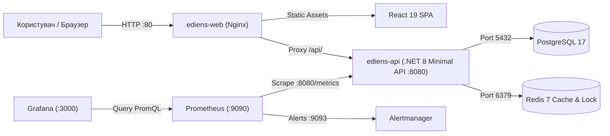

# Посібник з локальної розробки (Local Development Guide) — ēdiens

> **Версія:** 1.0.0  
> **Оновлено в рамках:** TASK-08  
> **Статус:** Офіційний регламент розгортання та локальної розробки

---

## 1. Огляд та архітектура локального середовища

Платформа **ēdiens** складається з модульних контейнеризованих сервісів, які взаємодіють через спільну мережу Docker Bridge (`ediens-network`). Архітектура оптимізована як для швидкого запуску всього стеку однією командою (відповідно до вимоги **NFR-06 Portability & Containerization**), так і для гібридної розробки з гарячим перезавантаженням (Hot Module Replacement) фронтенду та бекенду.



---

## 2. Системні вимоги (Prerequisites)

Перед початком переконайтеся, що на вашій робочій станції встановлено:
- **Docker & Docker Compose:** Docker Desktop 4.28+ (або OrbStack на macOS / Podman).
- **.NET SDK:** .NET 8.0 SDK (рекомендовано 8.0.11+) для збірки та запуску тестів бекенду.
- **Node.js & npm:** Node.js v20+ або v22+ (LTS), npm 10+.
- **Git:** Git 2.40+ для взаємодії з системою контролю версій.

---

## 3. Швидкий старт через Docker Compose

### 3.1 Запуск основного додатку (Application Stack)
Щоб скомпілювати та запустити повний стек (PostgreSQL 17, Redis 7, .NET API та Nginx з React SPA), виконайте:

```bash
docker compose up --build -d
```

Команда автоматично:
1. Завантажить базові образи PostgreSQL 17 Alpine та Redis 7 Alpine.
2. Виконає багатоетапну збірку .NET 8 API (Multi-Stage Dockerfile).
3. Збере оптимізований бандл React 19 та сконфігурує Nginx.
4. Дочекається успішного проходження healthchecks для БД та кешу перед запуском сервісів.
5. Проведе автоматичний демо-сідінг продуктів та інвентарю.

### 3.2 Запуск стеку спостережуваності (Monitoring Stack)
Для підключення Prometheus, Alertmanager та Grafana запустіть обидва стек-файли разом:

```bash
docker compose -f compose.yaml -f compose.monitoring.yaml up -d
```

Або запустити лише моніторинг окремо (при вже запущеному основному стеку):
```bash
docker compose -f compose.monitoring.yaml up -d
```

### 3.3 Зупинка та очищення контейнерів
- **Зупинка зі збереженням даних у volumes:**
  ```bash
  docker compose -f compose.yaml -f compose.monitoring.yaml down
  ```
- **Повне скидання включно з видаленням даних БД та кешів:**
  ```bash
  docker compose -f compose.yaml -f compose.monitoring.yaml down -v
  ```

---

## 4. Реєстр локальних портів та кінцевих точок

Після успішного старту доступні наступні інтерфейси та сервіси:

| Сервіс | Адреса в браузері | Призначення | Облікові дані за замовчуванням |
| :--- | :--- | :--- | :--- |
| **ediens-web** | `http://localhost:80` | Веб-інтерфейс ēdiens (React 19 SPA) | — |
| **ediens-api** | `http://localhost:8080/swagger` | OpenAPI / Swagger UI документація ендпоінтів | — |
| **Health Check** | `http://localhost:8080/health` | Діагностичний статус здоров'я бекенду | — |
| **Prometheus** | `http://localhost:9090` | Консоль перегляду метрик PromQL | — |
| **Alertmanager** | `http://localhost:9093` | Моніторинг активних сповіщень та правил SLA | — |
| **Grafana** | `http://localhost:3000` | Дашборди Golden Signals та FEFO аналітики | `admin` / `admin` |
| **PostgreSQL** | `localhost:5432` | Реляційне сховище (DB: `ediens`) | `postgres` / `ediens_secure_password` |
| **Redis** | `localhost:6379` | Розподілений кеш та блокування | — |

---

## 5. Гібридний режим локальної розробки (Hybrid / Bare-Metal Mode)

Для активної розробки інтерфейсу та коду API зручніше запускати інфраструктуру в Docker, а вихідний код — безпосередньо на хості з підтримкою відлагодження (Debug) та швидкого перезавантаження:

### Крок 1: Запуск залежностей у Docker
```bash
docker compose up -d postgres redis
```

### Крок 2: Запуск бекенду (.NET 8 Web API)
```bash
cd src/Ediens.Api
dotnet run
```
API запуститься на `http://localhost:8080`. При старті API автоматично перевірить підключення до PostgreSQL та застосує демо-сідінг бази даних.

### Крок 3: Запуск фронтенду (Vite Dev Server)
В окремому терміналі:
```bash
cd src/ediens-web
npm install
npm run dev
```
Vite dev server відкриється за адресою `http://localhost:5173` із підтримкою Hot Module Replacement (HMR).

---

## 6. Змінні середовища (Environment Configuration)

Параметри конфігурації можна перевизначати через файл `.env` у кореневому каталозі репозиторію:

```env
# База даних PostgreSQL
POSTGRES_DB=ediens
POSTGRES_USER=postgres
POSTGRES_PASSWORD=ediens_secure_password
POSTGRES_PORT=5432

# Redis
REDIS_PORT=6379

# Backend API
API_PORT=8080
ASPNETCORE_ENVIRONMENT=Production
JWT_SECRET=EdiensSecretKeyLongEnoughForHMACSHA256Security2026!

# Frontend Web
WEB_PORT=80

# Monitoring
PROMETHEUS_PORT=9090
ALERTMANAGER_PORT=9093
GRAFANA_PORT=3000
GRAFANA_ADMIN_USER=admin
GRAFANA_ADMIN_PASSWORD=admin
```

---

## 7. Робота з базою даних та міграціями EF Core

1. **Створення нової міграції:**
   ```bash
   dotnet ef migrations add AddNewFeatureField --project src/Ediens.Api
   ```
2. **Застосування міграцій до бази даних:**
   ```bash
   dotnet ef database update --project src/Ediens.Api
   ```
3. **Пряме підключення до БД через CLI:**
   ```bash
   docker compose exec postgres psql -U postgres -d ediens
   ```

---

## 8. Запуск автоматизованих тестів та верифікації

Перед створенням пул-реквестів обов'язково виконайте перевірку локального коду:

```bash
# 1. Запуск тестового набору бекенду (17+ тестів xUnit)
dotnet test src/Ediens.Tests/Ediens.Tests.csproj

# 2. Збірка веб-інтерфейсу
(cd src/ediens-web && npm run build)

# 3. Запуск повної верифікації проекту
./scripts/verify.sh
```

---

## 9. Діагностика та усунення несправностей (Troubleshooting)

### 9.1 Конфлікт зайнятих портів (Port Conflict: 5432, 6379, 80)
Якщо локальний порт вже зайнятий іншою службою (наприклад, локальною службою PostgreSQL):
- Змініть зовнішній порт у файлі `.env`, наприклад: `POSTGRES_PORT=5433` або `WEB_PORT=8081`.
- Перевірте зайняті порти: `lsof -i :5432` або `netstat -vanp tcp | grep 5432`.

### 9.2 Перевірка стану та логів контейнерів
- Статус усіх контейнерів: `docker compose ps`
- Логи бекенд-сервісу: `docker compose logs -f ediens-api`
- Логи Nginx веб-сервісу: `docker compose logs -f ediens-web`
- Логи бази даних: `docker compose logs -f postgres`

### 9.3 Очищення Docker образів та кешів
У разі виникнення застарілих кешів шарів збірки:
```bash
docker compose build --no-cache
docker compose up -d --force-recreate
```
